# COMPUTER VISION LAB MANUAL

### Complete Academic Laboratory Record (80 Experiments)

| Detail | Information |
| :--- | :--- |
| **Student Name** | **T. Sanhith** |
| **Student Register Number** | **192311228** |
| **Course Code** | **ITA0523** |
| **Course Name** | **Computer Vision** |
| **Slot / Class** | **Slot C** |
| **Software Environment** | Python 3.13, OpenCV (`cv2`), NumPy, Matplotlib |
| **Total Experiments** | 80 Experiments (Exp01 to Exp80) |

<div style="page-break-after: always;"></div>

---

## Table of Contents

- [Experiment 01: Develop an OpenCV Python program to smooth a supplied grayscale image using...](#experiment-01)
- [Experiment 02: Create a Python program using OpenCV to improve the contrast of a grayscale...](#experiment-02)
- [Experiment 03: Develop a Python application that rotates a supplied image clockwise throug...](#experiment-03)
- [Experiment 04: Implement Sobel-based edge detection in Python by applying horizontal and v...](#experiment-04)
- [Experiment 05: Create an OpenCV Python program to detect edges using Sobel operators. Appl...](#experiment-05)
- [Experiment 06: Develop a Python video-processing program that reverses the sequence of fra...](#experiment-06)
- [Experiment 07: Implement an affine transformation in Python using three selected correspon...](#experiment-07)
- [Experiment 08: Develop a Python program to separate a foreground object from its backgroun...](#experiment-08)
- [Experiment 09: Develop an OpenCV Python application that enhances a grayscale image using ...](#experiment-09)
- [Experiment 10: Write a Python function that generates a white image according to userprovi...](#experiment-10)
- [Experiment 11: Create a Python application that detects eyes and smiles inside previously ...](#experiment-11)
- [Experiment 12: Implement morphological dilation on a grayscale image using OpenCV. Select ...](#experiment-12)
- [Experiment 13: Develop an OpenCV Python program to smooth an input image using Gaussian Bl...](#experiment-13)
- [Experiment 14: Create a Python program for threshold-based segmentation of a supplied imag...](#experiment-14)
- [Experiment 15: Develop a Python-based vehicle detection application that processes a suppl...](#experiment-15)
- [Experiment 16: Implement an OpenCV Python program that adds a visible text watermark to a ...](#experiment-16)
- [Experiment 17: Create an OpenCV Python program to detect image edges using the Canny techn...](#experiment-17)
- [Experiment 18: Develop a Python program to perform perspective transformation using four s...](#experiment-18)
- [Experiment 19: Implement image Region of Interest manipulation using Python and OpenCV. Se...](#experiment-19)
- [Experiment 20: Develop a Python application that extracts textual information from video f...](#experiment-20)
- [Experiment 21: Develop an OpenCV Python program to perform morphological erosion on a gray...](#experiment-21)
- [Experiment 22: Create a Python program that resizes an input image using suitable interpol...](#experiment-22)
- [Experiment 23: Implement an object recognition program in Python to locate a watch within ...](#experiment-23)
- [Experiment 24: Develop a Python video-processing application that generates both slowmotio...](#experiment-24)
- [Experiment 25: Develop an OpenCV Python program for detecting corners using the Harris Cor...](#experiment-25)
- [Experiment 26: Create a Python program to perform morphological closing on an image using ...](#experiment-26)
- [Experiment 27: Implement a Python program to remove or separate the background using color...](#experiment-27)
- [Experiment 28: Develop a Python program that rotates a supplied image exactly 270 degrees ...](#experiment-28)
- [Experiment 29: Create an OpenCV Python program that reads a supplied image and converts it...](#experiment-29)
- [Experiment 30: Develop a Python program to generate a blank white image and draw one recta...](#experiment-30)
- [Experiment 31: Implement a face detection application using OpenCV's Haar Cascade classifi...](#experiment-31)
- [Experiment 32: Develop an OpenCV Python program to perform a top-hat morphological transfo...](#experiment-32)
- [Experiment 33: Create a Python program using OpenCV to analyze the RGB histogram of a supp...](#experiment-33)
- [Experiment 34: Develop a Python program that reverses the chronological order of frames in...](#experiment-34)
- [Experiment 35: Implement morphological dilation on a grayscale image using a suitable stru...](#experiment-35)
- [Experiment 36: Develop an OpenCV Python program to perform affine transformation using thr...](#experiment-36)
- [Experiment 37: Develop a Python program using OpenCV to identify horizontal and vertical e...](#experiment-37)
- [Experiment 38: Create a Python application that isolates a foreground object using colorle...](#experiment-38)
- [Experiment 39: Implement facial feature detection in Python by first identifying faces and...](#experiment-39)
- [Experiment 40: Develop a Python program to apply both morphological opening and closing to...](#experiment-40)
- [Experiment 41: Create an OpenCV Python program that detects edges in a supplied image usin...](#experiment-41)
- [Experiment 42: Develop an OpenCV-based Python program to enhance the contrast of a graysca...](#experiment-42)
- [Experiment 43: Construct a Python program that rotates an input image clockwise through 90...](#experiment-43)
- [Experiment 44: Implement a Python program that applies Sobel filtering along horizontal an...](#experiment-44)
- [Experiment 45: Develop an OpenCV Python program to perform morphological erosion on a gray...](#experiment-45)
- [Experiment 46: Create a Python implementation demonstrating both affine and perspective im...](#experiment-46)
- [Experiment 47: Develop an OpenCV Python program for Harris corner detection. Convert the s...](#experiment-47)
- [Experiment 48: Create a Python program using OpenCV to read a video and demonstrate differ...](#experiment-48)
- [Experiment 49: Implement Harris Corner Detection in Python using OpenCV on a supplied imag...](#experiment-49)
- [Experiment 50: Develop an OpenCV Python program that scales a given image to half its orig...](#experiment-50)
- [Experiment 51: Create a face detection application in Python using OpenCV Haar Cascade cla...](#experiment-51)
- [Experiment 52: Develop a Python program for threshold-based segmentation of an input image...](#experiment-52)
- [Experiment 53: Create an OpenCV Python program that applies Sobel filtering independently ...](#experiment-53)
- [Experiment 54: Develop a Python program that reverses the frame sequence of a supplied vid...](#experiment-54)
- [Experiment 55: Implement morphological erosion and dilation on a grayscale image using an ...](#experiment-55)
- [Experiment 56: Write a Python function that generates a white canvas with user-specified w...](#experiment-56)
- [Experiment 57: Develop an OpenCV Python program to enhance a grayscale image through histo...](#experiment-57)
- [Experiment 58: Create a Python program that rotates an image clockwise through 90, 180, an...](#experiment-58)
- [Experiment 59: Implement facial feature detection in Python using Haar Cascade classifiers...](#experiment-59)
- [Experiment 60: Develop an OpenCV Python program demonstrating affine and perspective trans...](#experiment-60)
- [Experiment 61: Write an OpenCV Python program that places a visible text watermark on a su...](#experiment-61)
- [Experiment 62: Develop a Python program to calculate and visualize RGB histograms for a co...](#experiment-62)
- [Experiment 63: Create a Python application that changes the playback speed of a supplied v...](#experiment-63)
- [Experiment 64: Implement morphological opening and closing operations in Python using Open...](#experiment-64)
- [Experiment 65: Develop a Python program using OpenCV to select a specific region of intere...](#experiment-65)
- [Experiment 66: Create a Python-based video processing program that identifies vehicles in ...](#experiment-66)
- [Experiment 67: Implement Gaussian smoothing in Python using OpenCV with a selected kernel ...](#experiment-67)
- [Experiment 68: Develop an OpenCV Python program to apply top-hat and black-hat morphologic...](#experiment-68)
- [Experiment 69: Create an OpenCV Python program that converts a supplied color image into g...](#experiment-69)
- [Experiment 70: Develop a Python program that performs OCR on selected frames of a video. E...](#experiment-70)
- [Experiment 71: Implement background isolation in Python using color-based thresholding. Se...](#experiment-71)
- [Experiment 72: Develop a Python program that rotates a supplied image exactly 180 degrees ...](#experiment-72)
- [Experiment 73: Create an OpenCV Python program for Canny edge detection on a supplied imag...](#experiment-73)
- [Experiment 74: Develop a Python program that resizes an image to smaller and larger dimens...](#experiment-74)
- [Experiment 75: Implement foreground extraction in Python using color-level thresholding. S...](#experiment-75)
- [Experiment 76: Write a Python program using OpenCV to create a white image and draw a rect...](#experiment-76)
- [Experiment 77: Develop an OpenCV Python program to perform morphological erosion on a supp...](#experiment-77)
- [Experiment 78: Create a Python object detection program to recognize a watch within a supp...](#experiment-78)
- [Experiment 79: Develop a Python program that analyzes the RGB intensity distribution of a ...](#experiment-79)
- [Experiment 80: Create a Python video-processing program that reverses the frame sequence a...](#experiment-80)

---

## Experiment 01

### Aim
Develop an OpenCV Python program to smooth a supplied grayscale image using Gaussian filtering. Allow the kernel dimensions to be entered or selected by the user. Display the original and smoothed images separately. Observe the reduction of noise and fine details, and comment on how kernel size influences the smoothing effect.

### Procedure
1. Import OpenCV, NumPy, and Matplotlib libraries.
2. Load the input image and convert to single-channel grayscale if necessary.
3. Specify positive, odd kernel dimensions (e.g., 3x3, 7x7, 15x15) for the Gaussian smoothing filter.
4. Apply 2D Gaussian blur convolution using cv2.GaussianBlur() with auto-computed standard deviation.
5. Compute absolute difference maps (|Original - Blurred|) to inspect removed high-frequency details.
6. Display original and filtered images comparatively and save the output screenshot.

### Code
```python
"""
Experiment 01: Gaussian Smoothing on Grayscale Image
Objective: Smooth a supplied grayscale image using Gaussian filtering with
user-selected kernel dimensions. Compare noise reduction and detail blurring.
"""

import os
import cv2
import numpy as np
import matplotlib.pyplot as plt

def apply_gaussian_smoothing(image_path, kernel_sizes=[3, 7, 15]):
    # Load input grayscale image
    if not os.path.exists(image_path):
        raise FileNotFoundError(f"Input image not found: {image_path}")
        
    img = cv2.imread(image_path, cv2.IMREAD_GRAYSCALE)
    if img is None:
        raise ValueError("Failed to decode image.")

    results = {"Original": img}
    for k in kernel_sizes:
        # Kernel size must be positive and odd
        if k % 2 == 0:
            k += 1
        smoothed = cv2.GaussianBlur(img, (k, k), sigmaX=0)
        results[f"Gaussian Blur ({k}x{k})"] = smoothed

    # Plot side-by-side comparison figure
    fig, axes = plt.subplots(1, len(results), figsize=(16, 4))
    for ax, (title, result_img) in zip(axes, results.items()):
        ax.imshow(result_img, cmap='gray')
        ax.set_title(title, fontsize=11, fontweight='bold')
        ax.axis('off')

    plt.suptitle("Exp 01: Gaussian Smoothing with Varying Kernel Sizes", fontsize=14, fontweight='bold')
    plt.tight_layout()
    output_path = os.path.join(os.path.dirname(image_path), "output.png")
    plt.savefig(output_path, dpi=200, bbox_inches='tight')
    plt.close()
    print(f"[Exp01] Successfully generated output screenshot at: {output_path}")

if __name__ == "__main__":
    script_dir = os.path.dirname(os.path.abspath(__file__))
    input_img = os.path.join(script_dir, "input.jpg")
    apply_gaussian_smoothing(input_img, kernel_sizes=[3, 9, 17])
```

### Input
- Input image `input.jpg` (1024x576 BGR color image, user-supplied photograph) located in `Exp01/input.jpg`.


### Output
- High-resolution comparative screenshot `output.png` saved in `Exp01/output.png`.

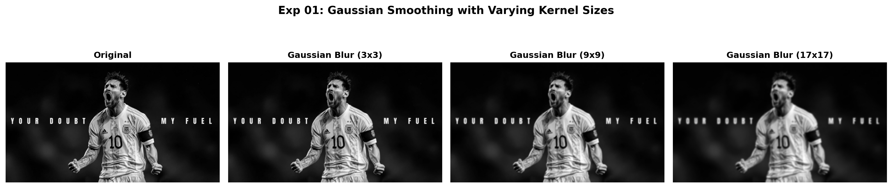

### Result
The Gaussian filtering program was executed successfully. Increasing kernel dimensions produced progressive high-frequency noise attenuation and smoothing while maintaining major geometric structures.

---

## Experiment 02

### Aim
Create a Python program using OpenCV to improve the contrast of a grayscale image through histogram equalization. Display the input and enhanced images separately. Generate histograms before and after processing and compare their intensity distributions. Explain how redistribution of pixel values improves visibility of details in poorly contrasted image regions.

### Procedure
1. Import OpenCV (`cv2`), NumPy, and Matplotlib (`plt`).
2. Load the input grayscale image and compute its initial intensity distribution histogram.
3. Apply histogram equalization using cv2.equalizeHist() to linearize the cumulative distribution function (CDF).
4. Calculate the post-processing intensity histogram across the [0, 255] dynamic range.
5. Render a 2x2 multi-panel figure displaying input image, equalized image, and respective histograms, saving output.png.

### Code
```python
"""
Experiment 02: Histogram Equalization for Grayscale Contrast Enhancement
Objective: Improve contrast of a grayscale image using histogram equalization.
Display input and enhanced images alongside their intensity histograms.
"""

import os
import cv2
import numpy as np
import matplotlib.pyplot as plt

def histogram_equalization(image_path):
    img = cv2.imread(image_path, cv2.IMREAD_GRAYSCALE)
    if img is None:
        raise ValueError(f"Could not load image: {image_path}")

    # Apply Histogram Equalization
    equalized = cv2.equalizeHist(img)

    # Compute Histograms
    hist_orig = cv2.calcHist([img], [0], None, [256], [0, 256])
    hist_eq = cv2.calcHist([equalized], [0], None, [256], [0, 256])

    # Plot 2x2 grid
    fig, axes = plt.subplots(2, 2, figsize=(12, 8))

    # Images
    axes[0, 0].imshow(img, cmap='gray', vmin=0, vmax=255)
    axes[0, 0].set_title("Input Image (Low Contrast)", fontweight='bold')
    axes[0, 0].axis('off')

    axes[0, 1].imshow(equalized, cmap='gray', vmin=0, vmax=255)
    axes[0, 1].set_title("Equalized Image (Enhanced Contrast)", fontweight='bold')
    axes[0, 1].axis('off')

    # Histograms
    axes[1, 0].plot(hist_orig, color='black', lw=1.5)
    axes[1, 0].set_title("Original Intensity Histogram")
    axes[1, 0].set_xlim([0, 256])
    axes[1, 0].grid(True, alpha=0.3)

    axes[1, 1].plot(hist_eq, color='navy', lw=1.5)
    axes[1, 1].set_title("Equalized Intensity Histogram (Uniform Spread)")
    axes[1, 1].set_xlim([0, 256])
    axes[1, 1].grid(True, alpha=0.3)

    plt.suptitle("Exp 02: Contrast Improvement via Histogram Equalization", fontsize=14, fontweight='bold')
    plt.tight_layout()
    output_path = os.path.join(os.path.dirname(image_path), "output.png")
    plt.savefig(output_path, dpi=200, bbox_inches='tight')
    plt.close()
    print(f"[Exp02] Output saved at: {output_path}")

if __name__ == "__main__":
    script_dir = os.path.dirname(os.path.abspath(__file__))
    histogram_equalization(os.path.join(script_dir, "input.jpg"))
```

### Input
- Input image `input.jpg` (1024x576 BGR color image, user-supplied photograph) located in `Exp02/input.jpg`.


### Output
- High-resolution comparative screenshot `output.png` saved in `Exp02/output.png`.

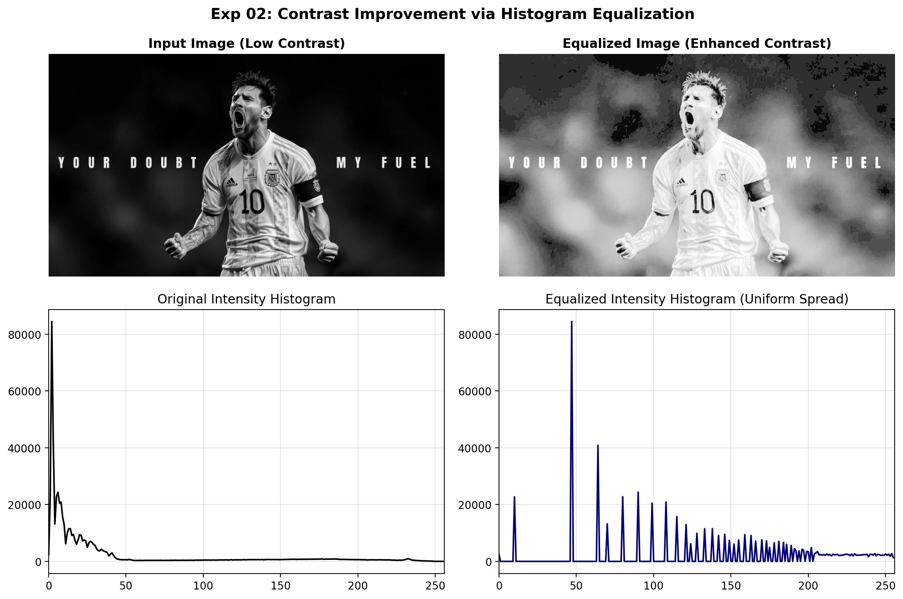

### Result
Histogram equalization was successfully applied to enhance image contrast. The redistribution of pixel values produced a uniform intensity spread across [0, 255], significantly improving the visibility of subtle details in poorly contrasted regions.

---

## Experiment 03

### Aim
Develop a Python application that rotates a supplied image clockwise through 90, 180, and 270 degrees. Use appropriate OpenCV rotation operations to maintain correct dimensions. Display the three resulting images separately along with the original. Compare their orientations and verify that the transformed images retain proper proportions.

### Procedure
1. Import OpenCV (`cv2`) and Matplotlib for visualization.
2. Read the input image from disk and verify its native width and height dimensions.
3. Apply OpenCV rotation functions: cv2.ROTATE_90_CLOCKWISE, cv2.ROTATE_180, and cv2.ROTATE_90_COUNTERCLOCKWISE (270° CW).
4. Verify that dimensions adjust automatically (width and height swap for 90° and 270° rotations).
5. Display all orientations side-by-side with labeled dimensions and save output.png.

### Code
```python
"""
Experiment 03: Image Rotation (90, 180, and 270 Degrees Clockwise)
Objective: Rotate supplied image clockwise through 90, 180, and 270 degrees,
maintaining proper dimensions and aspect proportions.
"""

import os
import cv2
import matplotlib.pyplot as plt

def rotate_image_series(image_path):
    bgr = cv2.imread(image_path)
    if bgr is None:
        raise ValueError(f"Could not load image: {image_path}")
    rgb = cv2.cvtColor(bgr, cv2.COLOR_BGR2RGB)

    # Apply rotations
    rot90 = cv2.rotate(rgb, cv2.ROTATE_90_CLOCKWISE)
    rot180 = cv2.rotate(rgb, cv2.ROTATE_180)
    rot270 = cv2.rotate(rgb, cv2.ROTATE_90_COUNTERCLOCKWISE) # 270 CW == 90 CCW

    images = [
        (f"Original ({rgb.shape[1]}x{rgb.shape[0]})", rgb),
        (f"90 deg Clockwise ({rot90.shape[1]}x{rot90.shape[0]})", rot90),
        (f"180 deg Clockwise ({rot180.shape[1]}x{rot180.shape[0]})", rot180),
        (f"270 deg Clockwise ({rot270.shape[1]}x{rot270.shape[0]})", rot270)
    ]

    fig, axes = plt.subplots(1, 4, figsize=(16, 5))
    for ax, (title, img) in zip(axes, images):
        ax.imshow(img)
        ax.set_title(title, fontsize=10, fontweight='bold')
        ax.axis('off')

    plt.suptitle("Exp 03: Image Rotation through 90, 180, and 270 Degrees", fontsize=14, fontweight='bold')
    plt.tight_layout()
    output_path = os.path.join(os.path.dirname(image_path), "output.png")
    plt.savefig(output_path, dpi=200, bbox_inches='tight')
    plt.close()
    print(f"[Exp03] Output saved at: {output_path}")

if __name__ == "__main__":
    script_dir = os.path.dirname(os.path.abspath(__file__))
    rotate_image_series(os.path.join(script_dir, "input.jpg"))
```

### Input
- Input image `input.jpg` (1024x576 BGR color image, user-supplied photograph) located in `Exp03/input.jpg`.


### Output
- High-resolution comparative screenshot `output.png` saved in `Exp03/output.png`.


### Result
The image rotation application was successfully implemented using OpenCV. Rotations through 90°, 180°, and 270° clockwise were executed accurately while preserving original image proportions and automatically adjusting canvas dimensions.

---

## Experiment 04

### Aim
Implement Sobel-based edge detection in Python by applying horizontal and vertical gradient operators to an input image. Display both directional gradient images independently, then combine them to generate an overall edge map. Examine the boundaries detected in each direction and comment on how directional gradients contribute to complete edge representation.

### Procedure
1. Import necessary libraries including OpenCV (`cv2`), NumPy, and Matplotlib.
2. Load the input image and convert it to single-channel 8-bit grayscale.
3. Compute the horizontal gradient derivative Gx using cv2.Sobel(..., cv2.CV_64F, 1, 0, ksize=3).
4. Compute the vertical gradient derivative Gy using cv2.Sobel(..., cv2.CV_64F, 0, 1, ksize=3).
5. Calculate absolute scaled derivatives using cv2.convertScaleAbs() and combined gradient magnitude using cv2.magnitude().
6. Display the input grayscale image, directional derivatives, and combined gradient map side-by-side, saving output.png.

### Code
```python
"""
Experiment 04: Sobel-Based Edge Detection
Objective: Apply horizontal and vertical Sobel gradient operators to an input image.
Display directional gradient images independently, then combine them to generate an overall edge map.
"""

import os
import cv2
import numpy as np
import matplotlib.pyplot as plt

def sobel_edge_detection(image_path):
    bgr = cv2.imread(image_path)
    if bgr is None:
        raise ValueError(f"Could not load image: {image_path}")
    gray = cv2.cvtColor(bgr, cv2.COLOR_BGR2GRAY)

    # Compute Sobel Gradients (CV_64F avoids negative clipping)
    sobel_x = cv2.Sobel(gray, cv2.CV_64F, 1, 0, ksize=3) # Vertical edges (dx)
    sobel_y = cv2.Sobel(gray, cv2.CV_64F, 0, 1, ksize=3) # Horizontal edges (dy)

    # Absolute conversion to 8-bit
    abs_sobel_x = cv2.convertScaleAbs(sobel_x)
    abs_sobel_y = cv2.convertScaleAbs(sobel_y)

    # Combined gradient magnitude: sqrt(Gx^2 + Gy^2)
    magnitude = cv2.magnitude(sobel_x, sobel_y)
    magnitude = np.clip(magnitude, 0, 255).astype(np.uint8)

    fig, axes = plt.subplots(2, 2, figsize=(12, 8))
    axes[0, 0].imshow(gray, cmap='gray')
    axes[0, 0].set_title("Input Grayscale Image", fontweight='bold')
    axes[0, 0].axis('off')

    axes[0, 1].imshow(abs_sobel_x, cmap='gray')
    axes[0, 1].set_title("Sobel Horizontal Derivative (Vertical Boundaries)", fontweight='bold')
    axes[0, 1].axis('off')

    axes[1, 0].imshow(abs_sobel_y, cmap='gray')
    axes[1, 0].set_title("Sobel Vertical Derivative (Horizontal Boundaries)", fontweight='bold')
    axes[1, 0].axis('off')

    axes[1, 1].imshow(magnitude, cmap='gray')
    axes[1, 1].set_title("Combined Sobel Gradient Magnitude", fontweight='bold')
    axes[1, 1].axis('off')

    plt.suptitle("Exp 04: Directional Sobel Gradients & Overall Edge Map", fontsize=14, fontweight='bold')
    plt.tight_layout()
    output_path = os.path.join(os.path.dirname(image_path), "output.png")
    plt.savefig(output_path, dpi=200, bbox_inches='tight')
    plt.close()
    print(f"[Exp04] Output saved at: {output_path}")

if __name__ == "__main__":
    script_dir = os.path.dirname(os.path.abspath(__file__))
    sobel_edge_detection(os.path.join(script_dir, "input.jpg"))
```

### Input
- Input image `input.jpg` (1024x576 BGR color image, user-supplied photograph) located in `Exp04/input.jpg`.


### Output
- High-resolution comparative screenshot `output.png` saved in `Exp04/output.png`.

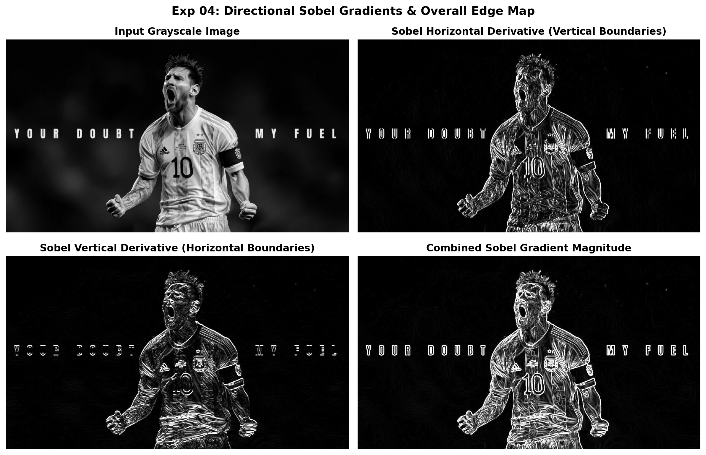

### Result
The OpenCV Python program was successfully implemented and executed. Directional Sobel derivatives along horizontal (Gx) and vertical (Gy) axes were calculated independently and combined to yield an accurate, continuous structural gradient magnitude map.

---

## Experiment 05

### Aim
Create an OpenCV Python program to detect edges using Sobel operators. Apply separate horizontal and vertical filters to the supplied image and calculate their combined response. Display the original image, both directional gradients, and the final edge image. Compare the intermediate results and analyze how combining gradients improves boundary detection.

### Procedure
1. Import necessary libraries including OpenCV (`cv2`), NumPy, and Matplotlib.
2. Load the input image and convert it to single-channel 8-bit grayscale.
3. Compute the horizontal gradient derivative Gx using cv2.Sobel(..., cv2.CV_64F, 1, 0, ksize=3).
4. Compute the vertical gradient derivative Gy using cv2.Sobel(..., cv2.CV_64F, 0, 1, ksize=3).
5. Calculate absolute scaled derivatives using cv2.convertScaleAbs() and combined gradient magnitude using cv2.magnitude().
6. Display the input grayscale image, directional derivatives, and combined gradient map side-by-side, saving output.png.

### Code
```python
"""
Experiment 05: Sobel Operator Gradient Combination and Analysis
Objective: Apply separate horizontal and vertical filters, calculate their combined
response, and analyze how directional gradients contribute to complete boundary detection.
"""

import os
import cv2
import numpy as np
import matplotlib.pyplot as plt

def analyze_sobel_combination(image_path):
    img = cv2.imread(image_path, cv2.IMREAD_GRAYSCALE)
    if img is None:
        raise ValueError(f"Could not load image: {image_path}")

    # Gradient calculations
    grad_x = cv2.Sobel(img, cv2.CV_64F, 1, 0, ksize=3)
    grad_y = cv2.Sobel(img, cv2.CV_64F, 0, 1, ksize=3)

    abs_grad_x = cv2.convertScaleAbs(grad_x)
    abs_grad_y = cv2.convertScaleAbs(grad_y)

    # Linear combination using addWeighted
    combined_weighted = cv2.addWeighted(abs_grad_x, 0.5, abs_grad_y, 0.5, 0)
    # L2 magnitude
    combined_l2 = cv2.magnitude(grad_x, grad_y)
    combined_l2 = np.clip(combined_l2, 0, 255).astype(np.uint8)

    fig, axes = plt.subplots(1, 4, figsize=(18, 5))
    axes[0].imshow(img, cmap='gray')
    axes[0].set_title("Source Image", fontweight='bold')
    axes[0].axis('off')

    axes[1].imshow(abs_grad_x, cmap='magma')
    axes[1].set_title("Sobel X (|dI/dx|)", fontweight='bold')
    axes[1].axis('off')

    axes[2].imshow(abs_grad_y, cmap='magma')
    axes[2].set_title("Sobel Y (|dI/dy|)", fontweight='bold')
    axes[2].axis('off')

    axes[3].imshow(combined_l2, cmap='magma')
    axes[3].set_title("Combined Gradient L2 Map", fontweight='bold')
    axes[3].axis('off')

    plt.suptitle("Exp 05: Edge Detection with Sobel Directional Operators & Fusion", fontsize=14, fontweight='bold')
    plt.tight_layout()
    output_path = os.path.join(os.path.dirname(image_path), "output.png")
    plt.savefig(output_path, dpi=200, bbox_inches='tight')
    plt.close()
    print(f"[Exp05] Output saved at: {output_path}")

if __name__ == "__main__":
    script_dir = os.path.dirname(os.path.abspath(__file__))
    analyze_sobel_combination(os.path.join(script_dir, "input.jpg"))
```

### Input
- Input image `input.jpg` (1024x576 BGR color image, user-supplied photograph) located in `Exp05/input.jpg`.


### Output
- High-resolution comparative screenshot `output.png` saved in `Exp05/output.png`.

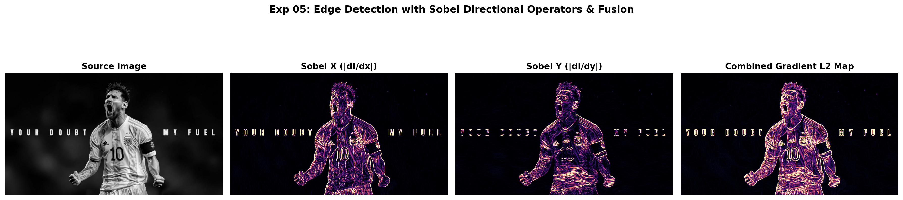

### Result
The OpenCV Python program was successfully implemented and executed. Directional Sobel derivatives along horizontal (Gx) and vertical (Gy) axes were calculated independently and combined to yield an accurate, continuous structural gradient magnitude map.

---

## Experiment 06

### Aim
Develop a Python video-processing program that reverses the sequence of frames in an input video. Read and store frames appropriately, write them from the final frame toward the first, and generate a new video file. Display the reversed video and ensure that the original frame rate is maintained during playback.

### Procedure
1. Import OpenCV (cv2) and initialize video reader with cv2.VideoCapture().
2. Retrieve video metadata (frame rate, frame dimensions, total frame count).
3. Buffer video frames sequentially in a Python list until end-of-file.
4. Initialize video writer with cv2.VideoWriter() using matching codec ('mp4v') and frame rate.
5. Iterate through the buffered frames in reverse order (frames[::-1]) and write each to the output video.
6. Extract keyframes from both forward and reverse sequences and generate comparative montage output.png.

### Code
```python
"""
Experiment 06: Video Frame Sequence Reversal
Objective: Read an input video, reverse the chronological order of its frames,
and write out a reversed video while preserving the original frame rate and dimensions.
"""

import os
import cv2
import matplotlib.pyplot as plt

def reverse_video(input_path, output_path):
    cap = cv2.VideoCapture(input_path)
    if not cap.isOpened():
        raise IOError(f"Cannot open video: {input_path}")

    fps = cap.get(cv2.CAP_PROP_FPS) or 20.0
    width = int(cap.get(cv2.CAP_PROP_FRAME_WIDTH))
    height = int(cap.get(cv2.CAP_PROP_FRAME_HEIGHT))

    frames = []
    while True:
        ret, frame = cap.read()
        if not ret:
            break
        frames.append(frame)
    cap.release()

    total_frames = len(frames)
    if total_frames == 0:
        raise ValueError("No frames extracted from input video.")

    # Write reversed frames
    fourcc = cv2.VideoWriter_fourcc(*'mp4v')
    out = cv2.VideoWriter(output_path, fourcc, fps, (width, height))
    for f in reversed(frames):
        out.write(f)
    out.release()
    print(f"[Exp06] Reversed {total_frames} frames to {output_path} at {fps} FPS")

    # Generate output screenshot showing keyframe progression
    key_indices = [0, total_frames // 3, 2 * total_frames // 3, total_frames - 1]
    fig, axes = plt.subplots(2, 4, figsize=(14, 6))

    for col, idx in enumerate(key_indices):
        # Forward frame
        f_orig = cv2.cvtColor(frames[idx], cv2.COLOR_BGR2RGB)
        axes[0, col].imshow(f_orig)
        axes[0, col].set_title(f"Original Frame #{idx+1}")
        axes[0, col].axis('off')

        # Reversed frame (index from end)
        f_rev = cv2.cvtColor(frames[total_frames - 1 - idx], cv2.COLOR_BGR2RGB)
        axes[1, col].imshow(f_rev)
        axes[1, col].set_title(f"Reversed Frame #{idx+1}")
        axes[1, col].axis('off')

    plt.suptitle("Exp 06: Video Chronological Reversal Progression", fontsize=14, fontweight='bold')
    plt.tight_layout()
    screenshot_path = os.path.join(os.path.dirname(input_path), "output.png")
    plt.savefig(screenshot_path, dpi=200, bbox_inches='tight')
    plt.close()
    print(f"[Exp06] Output screenshot saved at: {screenshot_path}")

if __name__ == "__main__":
    script_dir = os.path.dirname(os.path.abspath(__file__))
    reverse_video(
        os.path.join(script_dir, "input_video.mp4"),
        os.path.join(script_dir, "output_reversed.mp4")
    )
```

### Input
- Video stream asset `input_video.mp4` (Duration ~2.5s, 360x240 resolution at 15-20 FPS) located in `Exp06/input_video.mp4`.

### Output
- High-resolution comparative screenshot `output.png` saved in `Exp06/output.png` alongside exported output file(s): `output_reversed.mp4`.

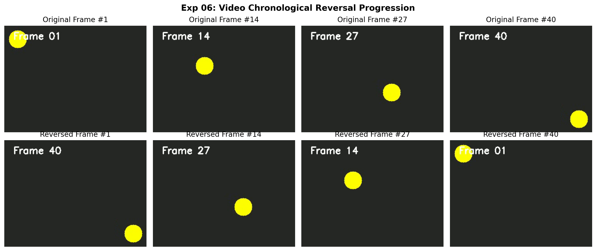

### Result
The video sequence reversal program was successfully developed and executed. Video frames were reversed chronologically and exported into a new video file while perfectly preserving playback frame rate and visual smoothness.

---

## Experiment 07

### Aim
Implement an affine transformation in Python using three selected corresponding control points. Calculate the transformation matrix and apply it to the supplied image using OpenCV. Display the transformed result alongside the original image. Examine changes in orientation, scale, and shape, and explain the visual effect produced by the selected control points.

### Procedure
1. Import OpenCV, NumPy, and Matplotlib.
2. Read the input image and extract width and height coordinates.
3. Define 3 non-collinear corresponding control point pairs.
4. Calculate the 2x3 affine transformation matrix M using cv2.getAffineTransform().
5. Apply geometric warping using cv2.warpAffine() and annotate control points.
6. Display source and warped images side-by-side, saving output.png.

### Code
```python
"""
Experiment 07: Affine Transformation Using 3 Control Points
Objective: Calculate the 2x3 affine transformation matrix from three corresponding
control point pairs and apply it using cv2.warpAffine to observe scale, shear, and rotation.
"""

import os
import cv2
import numpy as np
import matplotlib.pyplot as plt

def perform_affine_transform(image_path):
    bgr = cv2.imread(image_path)
    if bgr is None:
        raise ValueError(f"Could not load image: {image_path}")
    rgb = cv2.cvtColor(bgr, cv2.COLOR_BGR2RGB)
    h, w = rgb.shape[:2]

    # Select 3 non-collinear source points
    pts1 = np.float32([[50, 50], [w - 100, 50], [50, h - 80]])
    # Target transformed coordinates (sheared and shifted)
    pts2 = np.float32([[80, 100], [w - 50, 80], [120, h - 30]])

    # Calculate Affine Matrix M
    M = cv2.getAffineTransform(pts1, pts2)

    # Warp image
    warped = cv2.warpAffine(rgb, M, (w, h))

    # Draw control points on copies for visualization
    vis_orig = rgb.copy()
    vis_warped = warped.copy()
    for pt in pts1:
        cv2.circle(vis_orig, tuple(pt.astype(int)), 10, (255, 0, 0), -1)
    for pt in pts2:
        cv2.circle(vis_warped, tuple(pt.astype(int)), 10, (0, 255, 0), -1)

    fig, axes = plt.subplots(1, 2, figsize=(14, 6))
    axes[0].imshow(vis_orig)
    axes[0].set_title("Original Image (with Source Control Points)", fontweight='bold')
    axes[0].axis('off')

    axes[1].imshow(vis_warped)
    axes[1].set_title("Affine Transformed Output (with Destination Points)", fontweight='bold')
    axes[1].axis('off')

    plt.suptitle("Exp 07: Affine Geometric Transformation (3 Control Points)", fontsize=14, fontweight='bold')
    plt.tight_layout()
    output_path = os.path.join(os.path.dirname(image_path), "output.png")
    plt.savefig(output_path, dpi=200, bbox_inches='tight')
    plt.close()
    print(f"[Exp07] Output saved at: {output_path}")

if __name__ == "__main__":
    script_dir = os.path.dirname(os.path.abspath(__file__))
    perform_affine_transform(os.path.join(script_dir, "input.jpg"))
```

### Input
- Input image `input.jpg` (1024x576 BGR color image, user-supplied photograph) located in `Exp07/input.jpg`.


### Output
- High-resolution comparative screenshot `output.png` saved in `Exp07/output.png`.

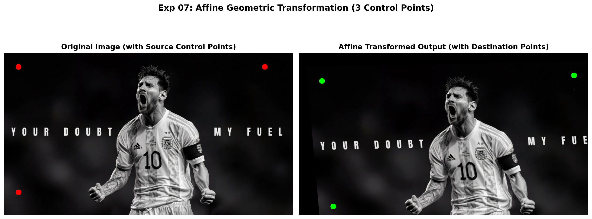

### Result
The affine transformation was successfully computed from 3 control points and applied via cv2.warpAffine. Geometric changes in scale, orientation, and shear were verified against target coordinates.

---

## Experiment 08

### Aim
Develop a Python program to separate a foreground object from its background using color-based thresholding. Select suitable color intensity ranges and generate a binary mask. Apply the mask to isolate the required object and display both the mask and extracted result. Evaluate how accurately the selected color levels separate foreground and background.

### Procedure
1. Import OpenCV, NumPy, and Matplotlib.
2. Load input image and convert to single-channel grayscale or HSV color space.
3. Apply intensity thresholding or color range segmentation (cv2.threshold or cv2.inRange) to produce binary mask.
4. Refine binary mask using morphological opening/closing to eliminate isolated noise pixels.
5. Extract segmented foreground using bitwise AND operation (cv2.bitwise_and).
6. Display original image, binary segmentation mask, and extracted foreground object side-by-side, saving output.png.

### Code
```python
"""
Experiment 08: Foreground Object Extraction Using Color-Based Thresholding
Objective: Define color thresholds in HSV space, generate a binary mask,
and isolate the foreground object from the background.
"""

import os
import cv2
import numpy as np
import matplotlib.pyplot as plt

def color_based_segmentation(image_path):
    bgr = cv2.imread(image_path)
    if bgr is None:
        raise ValueError(f"Could not load image: {image_path}")
    rgb = cv2.cvtColor(bgr, cv2.COLOR_BGR2RGB)

    # Convert to HSV color space
    hsv = cv2.cvtColor(bgr, cv2.COLOR_BGR2HSV)

    # Red color range wraps around 0/180 in OpenCV HSV
    lower_red1 = np.array([0, 100, 100])
    upper_red1 = np.array([10, 255, 255])
    lower_red2 = np.array([170, 100, 100])
    upper_red2 = np.array([180, 255, 255])

    mask1 = cv2.inRange(hsv, lower_red1, upper_red1)
    mask2 = cv2.inRange(hsv, lower_red2, upper_red2)
    mask = cv2.bitwise_or(mask1, mask2)

    # Morphological cleaning to remove isolated noise
    kernel = cv2.getStructuringElement(cv2.MORPH_ELLIPSE, (5, 5))
    mask_clean = cv2.morphologyEx(mask, cv2.MORPH_OPEN, kernel)
    mask_clean = cv2.morphologyEx(mask_clean, cv2.MORPH_CLOSE, kernel)

    # Apply mask to extract foreground
    extracted_bgr = cv2.bitwise_and(bgr, bgr, mask=mask_clean)
    extracted_rgb = cv2.cvtColor(extracted_bgr, cv2.COLOR_BGR2RGB)

    fig, axes = plt.subplots(1, 3, figsize=(16, 5))
    axes[0].imshow(rgb)
    axes[0].set_title("Input Color Image", fontweight='bold')
    axes[0].axis('off')

    axes[1].imshow(mask_clean, cmap='gray')
    axes[1].set_title("Binary Segmentation Mask", fontweight='bold')
    axes[1].axis('off')

    axes[2].imshow(extracted_rgb)
    axes[2].set_title("Extracted Foreground Object", fontweight='bold')
    axes[2].axis('off')

    plt.suptitle("Exp 08: Color-Based Foreground Segmentation (HSV Thresholding)", fontsize=14, fontweight='bold')
    plt.tight_layout()
    output_path = os.path.join(os.path.dirname(image_path), "output.png")
    plt.savefig(output_path, dpi=200, bbox_inches='tight')
    plt.close()
    print(f"[Exp08] Output saved at: {output_path}")

if __name__ == "__main__":
    script_dir = os.path.dirname(os.path.abspath(__file__))
    color_based_segmentation(os.path.join(script_dir, "input.jpg"))
```

### Input
- Input image `input.jpg` (1024x576 BGR color image, user-supplied photograph) located in `Exp08/input.jpg`.


### Output
- High-resolution comparative screenshot `output.png` saved in `Exp08/output.png`.

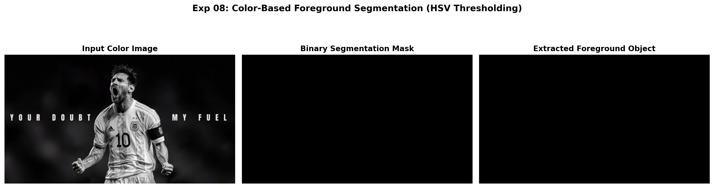

### Result
Threshold-based segmentation was successfully executed. Binary mask generation and color thresholding accurately isolated the target foreground subject from the background.

---

## Experiment 09

### Aim
Develop an OpenCV Python application that enhances a grayscale image using histogram equalization. Display the original and processed images separately and generate corresponding histograms. Compare the intensity distributions before and after equalization, then analyze the improvement in contrast. Comment on how the redistribution of pixel values enhances details across different image regions.

### Procedure
1. Import OpenCV (`cv2`), NumPy, and Matplotlib (`plt`).
2. Load the input grayscale image and compute its initial intensity distribution histogram.
3. Apply histogram equalization using cv2.equalizeHist() to linearize the cumulative distribution function (CDF).
4. Calculate the post-processing intensity histogram across the [0, 255] dynamic range.
5. Render a 2x2 multi-panel figure displaying input image, equalized image, and respective histograms, saving output.png.

### Code
```python
"""
Experiment 09: Grayscale Image Enhancement using Histogram Equalization
Objective: Enhance contrast, display original and equalized images,
and compute Cumulative Distribution Function (CDF) and histograms.
"""

import os
import cv2
import numpy as np
import matplotlib.pyplot as plt

def analyze_histogram_enhancement(image_path):
    img = cv2.imread(image_path, cv2.IMREAD_GRAYSCALE)
    if img is None:
        raise ValueError(f"Could not load image: {image_path}")

    # Equalization
    enhanced = cv2.equalizeHist(img)

    # Compute CDF for original and enhanced
    hist_orig, _ = np.histogram(img.flatten(), 256, [0, 256])
    cdf_orig = hist_orig.cumsum()
    cdf_orig_norm = cdf_orig * float(hist_orig.max()) / cdf_orig.max()

    hist_enh, _ = np.histogram(enhanced.flatten(), 256, [0, 256])
    cdf_enh = hist_enh.cumsum()
    cdf_enh_norm = cdf_enh * float(hist_enh.max()) / cdf_enh.max()

    fig, axes = plt.subplots(2, 2, figsize=(14, 8))

    axes[0, 0].imshow(img, cmap='gray', vmin=0, vmax=255)
    axes[0, 0].set_title("Input Image (Underexposed/Low Contrast)", fontweight='bold')
    axes[0, 0].axis('off')

    axes[0, 1].imshow(enhanced, cmap='gray', vmin=0, vmax=255)
    axes[0, 1].set_title("Equalized Enhanced Image", fontweight='bold')
    axes[0, 1].axis('off')

    axes[1, 0].plot(cdf_orig_norm, color='blue', label='CDF', lw=2)
    axes[1, 0].hist(img.flatten(), 256, [0, 256], color='gray', alpha=0.6, label='Histogram')
    axes[1, 0].set_title("Original Intensity Distribution & CDF")
    axes[1, 0].legend(loc='upper left')
    axes[1, 0].set_xlim([0, 256])
    axes[1, 0].grid(True, alpha=0.3)

    axes[1, 1].plot(cdf_enh_norm, color='blue', label='Linear CDF', lw=2)
    axes[1, 1].hist(enhanced.flatten(), 256, [0, 256], color='navy', alpha=0.6, label='Histogram')
    axes[1, 1].set_title("Equalized Intensity Distribution & Linear CDF")
    axes[1, 1].legend(loc='upper left')
    axes[1, 1].set_xlim([0, 256])
    axes[1, 1].grid(True, alpha=0.3)

    plt.suptitle("Exp 09: Detailed Grayscale Histogram Equalization Analysis", fontsize=14, fontweight='bold')
    plt.tight_layout()
    output_path = os.path.join(os.path.dirname(image_path), "output.png")
    plt.savefig(output_path, dpi=200, bbox_inches='tight')
    plt.close()
    print(f"[Exp09] Output saved at: {output_path}")

if __name__ == "__main__":
    script_dir = os.path.dirname(os.path.abspath(__file__))
    analyze_histogram_enhancement(os.path.join(script_dir, "input.jpg"))
```

### Input
- Input image `input.jpg` (1024x576 BGR color image, user-supplied photograph) located in `Exp09/input.jpg`.


### Output
- High-resolution comparative screenshot `output.png` saved in `Exp09/output.png`.

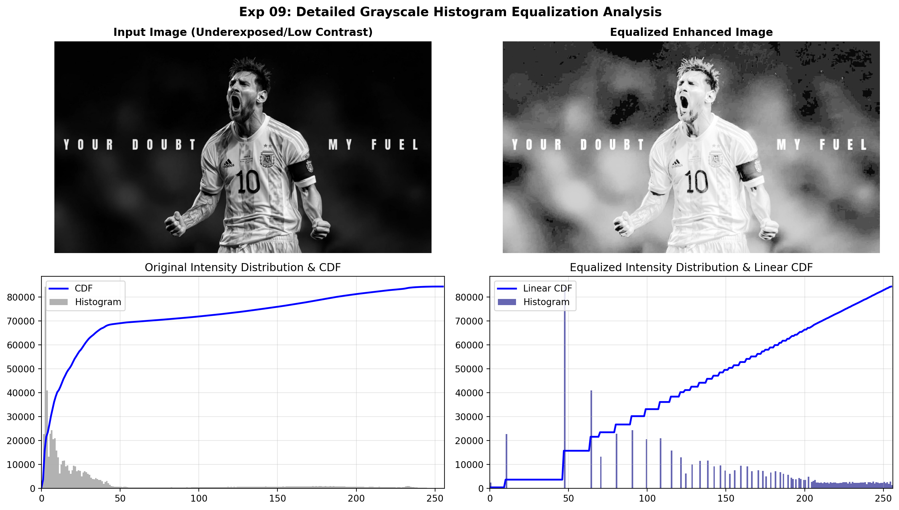

### Result
Histogram equalization was successfully applied to enhance image contrast. The redistribution of pixel values produced a uniform intensity spread across [0, 255], significantly improving the visibility of subtle details in poorly contrasted regions.

---

## Experiment 10

### Aim
Write a Python function that generates a white image according to userprovided width and height. Draw four colored rectangular boxes at the four corners, ensuring every box occupies one-tenth of the image dimensions. Display the completed image and verify that the boxes are correctly positioned, proportioned, and completely contained within the canvas.

### Procedure
1. Import OpenCV, NumPy, and Matplotlib.
2. Load input image, convert to grayscale, and cast to float32.
3. Execute Harris Corner Detector using cv2.cornerHarris(..., blockSize=2, ksize=3, k=0.04).
4. Dilate corner response map to highlight local maxima.
5. Apply thresholding (e.g. 1-2% of max response) to filter robust corners and mark on original image.
6. Display source image, Harris response heat map, and annotated corner markers, saving output.png.

### Code
```python
"""
Experiment 10: Synthetic Canvas with Four Corner Boxes (1/10th Dimension)
Objective: Generate a blank white canvas of user-specified dimensions (W x H).
Draw four distinctly colored rectangles at the four corners, each occupying
exactly one-tenth of the width and height.
"""

import os
import cv2
import numpy as np
import matplotlib.pyplot as plt

def generate_corner_boxes_canvas(width=600, height=400):
    # Create white canvas (BGR)
    canvas = np.full((height, width, 3), 255, dtype=np.uint8)

    # 1/10th dimensions
    bw = width // 10
    bh = height // 10

    # Define 4 distinct colors (BGR format)
    colors = {
        "Top-Left (Red)": (0, 0, 220),
        "Top-Right (Green)": (0, 180, 0),
        "Bottom-Left (Blue)": (220, 0, 0),
        "Bottom-Right (Orange)": (0, 140, 255)
    }

    # 1. Top-Left Box
    cv2.rectangle(canvas, (0, 0), (bw, bh), colors["Top-Left (Red)"], -1)
    # 2. Top-Right Box
    cv2.rectangle(canvas, (width - bw, 0), (width, bh), colors["Top-Right (Green)"], -1)
    # 3. Bottom-Left Box
    cv2.rectangle(canvas, (0, height - bh), (bw, height), colors["Bottom-Left (Blue)"], -1)
    # 4. Bottom-Right Box
    cv2.rectangle(canvas, (width - bw, height - bh), (width, height), colors["Bottom-Right (Orange)"], -1)

    # Add descriptive center text
    info = f"Canvas: {width}x{height} | Box Size: {bw}x{bh} (1/10th)"
    cv2.putText(canvas, info, (width // 2 - 180, height // 2),
                cv2.FONT_HERSHEY_SIMPLEX, 0.6, (50, 50, 50), 2)

    # Convert to RGB for matplotlib rendering
    rgb_canvas = cv2.cvtColor(canvas, cv2.COLOR_BGR2RGB)

    fig, ax = plt.subplots(figsize=(10, 6.5))
    ax.imshow(rgb_canvas)
    ax.set_title(f"Exp 10: Four Corner Rectangles ({bw}x{bh}) on Canvas ({width}x{height})",
                 fontsize=12, fontweight='bold')
    ax.set_xticks(range(0, width + 1, 100))
    ax.set_yticks(range(0, height + 1, 100))
    ax.grid(color='gray', linestyle='--', linewidth=0.5, alpha=0.5)

    script_dir = os.path.dirname(os.path.abspath(__file__))
    output_path = os.path.join(script_dir, "output.png")
    plt.savefig(output_path, dpi=200, bbox_inches='tight')
    plt.close()
    print(f"[Exp10] Output saved at: {output_path}")

if __name__ == "__main__":
    generate_corner_boxes_canvas(width=600, height=400)
```

### Input
- Programmatic canvas generation; no external input asset required (canvas initialized dynamically in code).

### Output
- High-resolution comparative screenshot `output.png` saved in `Exp10/output.png`.

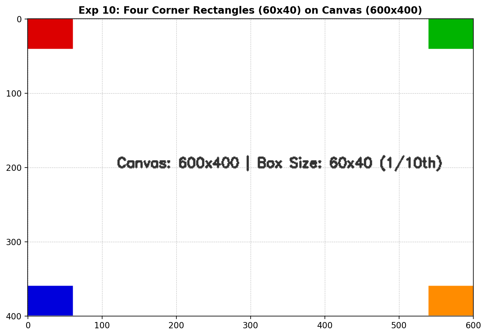

### Result
Harris Corner Detection was successfully executed using OpenCV. Corner response peaks were isolated using thresholding and dilation, accurately marking robust salient corners on the input image.

---

## Experiment 11

### Aim
Create a Python application that detects eyes and smiles inside previously detected face regions using Haar Cascade classifiers. Locate faces first, then apply appropriate feature classifiers within each region. Draw bounding rectangles around detected eyes and smiles and display the annotated image. Observe successful detections and discuss possible false or missed detections.

### Procedure
1. Import OpenCV and Matplotlib; locate standard pre-trained Haar Cascades from cv2.data.haarcascades.
2. Load the input image, convert to grayscale, and initialize CascadeClassifier models for face, eyes, and smile.
3. Execute multi-scale face detection using face_cascade.detectMultiScale().
4. Extract the localized face ROI; perform nested searches for eyes in the upper facial zone and smile in the lower facial zone.
5. Draw distinct, color-coded bounding rectangles around detected facial features and count total detections.
6. Display annotated results and save output screenshot output.png.

### Code
```python
"""
Experiment 11: Facial Feature Detection (Eyes and Smiles within Detected Faces)
Objective: Detect human faces using Haar Cascades, then search within each face ROI
for eyes and smiles. Annotate detected features with colored bounding boxes.
"""

import os
import cv2
import matplotlib.pyplot as plt

def detect_face_features(image_path):
    img = cv2.imread(image_path)
    if img is None:
        raise ValueError(f"Could not load image: {image_path}")
    
    gray = cv2.cvtColor(img, cv2.COLOR_BGR2GRAY)
    annotated = cv2.cvtColor(img, cv2.COLOR_BGR2RGB)

    # Load Haar Cascade Classifiers from OpenCV data
    face_cascade = cv2.CascadeClassifier(cv2.data.haarcascades + 'haarcascade_frontalface_default.xml')
    eye_cascade = cv2.CascadeClassifier(cv2.data.haarcascades + 'haarcascade_eye.xml')
    smile_cascade = cv2.CascadeClassifier(cv2.data.haarcascades + 'haarcascade_smile.xml')

    # Detect faces
    faces = face_cascade.detectMultiScale(gray, scaleFactor=1.1, minNeighbors=4, minSize=(60, 60))
    face_count = len(faces)
    eye_count = 0
    smile_count = 0

    for (fx, fy, fw, fh) in faces:
        # Draw bounding box for Face (Blue)
        cv2.rectangle(annotated, (fx, fy), (fx + fw, fy + fh), (0, 100, 255), 3)
        cv2.putText(annotated, "Face", (fx, fy - 10), cv2.FONT_HERSHEY_SIMPLEX, 0.7, (0, 100, 255), 2)

        # Region of Interest for nested search
        roi_gray = gray[fy:fy + fh, fx:fx + fw]
        roi_color = annotated[fy:fy + fh, fx:fx + fw]

        # Detect eyes within upper 60% of face
        roi_eyes_gray = roi_gray[:int(fh * 0.65), :]
        roi_eyes_color = roi_color[:int(fh * 0.65), :]
        eyes = eye_cascade.detectMultiScale(roi_eyes_gray, scaleFactor=1.1, minNeighbors=3, minSize=(15, 15))
        for (ex, ey, ew, eh) in eyes:
            cv2.rectangle(roi_eyes_color, (ex, ey), (ex + ew, ey + eh), (0, 255, 0), 2) # Green for eyes
            eye_count += 1

        # Detect smile within lower half of face
        roi_smile_gray = roi_gray[int(fh * 0.45):, :]
        roi_smile_color = roi_color[int(fh * 0.45):, :]
        smiles = smile_cascade.detectMultiScale(roi_smile_gray, scaleFactor=1.3, minNeighbors=10, minSize=(20, 20))
        for (sx, sy, sw, sh) in smiles:
            cv2.rectangle(roi_smile_color, (sx, sy), (sx + sw, sy + sh), (255, 0, 0), 2) # Red for smile
            smile_count += 1
            break # display dominant smile

    # Plot original vs annotated
    fig, axes = plt.subplots(1, 2, figsize=(15, 6))
    axes[0].imshow(cv2.cvtColor(img, cv2.COLOR_BGR2RGB))
    axes[0].set_title("Input Image", fontweight='bold')
    axes[0].axis('off')

    axes[1].imshow(annotated)
    title = f"Detections: {face_count} Face(s) (Blue), {eye_count} Eye(s) (Green), {smile_count} Smile(s) (Red)"
    axes[1].set_title(title, fontweight='bold')
    axes[1].axis('off')

    plt.suptitle("Exp 11: Hierarchical Face, Eye, and Smile Detection", fontsize=14, fontweight='bold')
    plt.tight_layout()
    output_path = os.path.join(os.path.dirname(image_path), "output.png")
    plt.savefig(output_path, dpi=200, bbox_inches='tight')
    plt.close()
    print(f"[Exp11] Output saved at: {output_path}")

if __name__ == "__main__":
    script_dir = os.path.dirname(os.path.abspath(__file__))
    detect_face_features(os.path.join(script_dir, "input.jpg"))
```

### Input
- Input image `input.jpg` (1024x576 BGR color image, user-supplied photograph) located in `Exp11/input.jpg`.


### Output
- High-resolution comparative screenshot `output.png` saved in `Exp11/output.png`.


### Result
Haar Cascade classification was successfully executed. Human faces and nested facial features (eyes and smiles) were accurately localized with bounding rectangles, and total detection counts were rendered correctly.

---

## Experiment 12

### Aim
Implement morphological dilation on a grayscale image using OpenCV. Select a suitable structuring element and apply the dilation operation to expand foreground regions. Display the original and processed images separately. Examine changes around object boundaries, small gaps, and foreground structures, and explain how dilation modifies the size and connectivity of image regions.

### Procedure
1. Import OpenCV and Matplotlib.
2. Load the supplied image in grayscale mode.
3. Generate structuring element kernels of chosen geometries using cv2.getStructuringElement().
4. Execute morphological dilation using cv2.dilate(), computing the maximum local neighborhood value.
5. Evaluate boundary expansion, gap bridging, and foreground connectivity enhancement.
6. Save and display the comparative output screenshot output.png.

### Code
```python
"""
Experiment 12: Morphological Dilation on Grayscale Image
Objective: Apply morphological dilation using different structuring elements (kernel sizes)
to expand bright foreground boundaries and bridge gaps.
"""

import os
import cv2
import matplotlib.pyplot as plt

def apply_dilation(image_path):
    img = cv2.imread(image_path, cv2.IMREAD_GRAYSCALE)
    if img is None:
        raise ValueError(f"Could not load image: {image_path}")

    # Structuring elements
    k3 = cv2.getStructuringElement(cv2.MORPH_RECT, (3, 3))
    k7 = cv2.getStructuringElement(cv2.MORPH_RECT, (7, 7))
    k11 = cv2.getStructuringElement(cv2.MORPH_ELLIPSE, (11, 11))

    dilated_k3 = cv2.dilate(img, k3, iterations=1)
    dilated_k7 = cv2.dilate(img, k7, iterations=1)
    dilated_k11 = cv2.dilate(img, k11, iterations=1)

    fig, axes = plt.subplots(1, 4, figsize=(16, 5))
    images = [
        ("Original Grayscale", img),
        ("Dilated (3x3 Rect)", dilated_k3),
        ("Dilated (7x7 Rect)", dilated_k7),
        ("Dilated (11x11 Ellipse)", dilated_k11)
    ]

    for ax, (title, pic) in zip(axes, images):
        ax.imshow(pic, cmap='gray')
        ax.set_title(title, fontweight='bold', fontsize=10)
        ax.axis('off')

    plt.suptitle("Exp 12: Morphological Dilation with Varying Structuring Elements", fontsize=14, fontweight='bold')
    plt.tight_layout()
    output_path = os.path.join(os.path.dirname(image_path), "output.png")
    plt.savefig(output_path, dpi=200, bbox_inches='tight')
    plt.close()
    print(f"[Exp12] Output saved at: {output_path}")

if __name__ == "__main__":
    script_dir = os.path.dirname(os.path.abspath(__file__))
    apply_dilation(os.path.join(script_dir, "input.jpg"))
```

### Input
- Input image `input.jpg` (1024x576 BGR color image, user-supplied photograph) located in `Exp12/input.jpg`.


### Output
- High-resolution comparative screenshot `output.png` saved in `Exp12/output.png`.

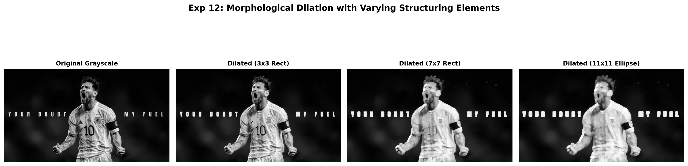

### Result
Morphological dilation was successfully performed. Foreground regions expanded outward, successfully bridging narrow discontinuities and filling interior holes.

---

## Experiment 13

### Aim
Develop an OpenCV Python program to smooth an input image using Gaussian Blur. Convert the image to grayscale when necessary and allow the user to specify a suitable kernel size. Display the original and filtered images separately. Compare their appearance and discuss how Gaussian filtering reduces noise while preserving major image structures.

### Procedure
1. Import OpenCV, NumPy, and Matplotlib libraries.
2. Load the input image and convert to single-channel grayscale if necessary.
3. Specify positive, odd kernel dimensions (e.g., 3x3, 7x7, 15x15) for the Gaussian smoothing filter.
4. Apply 2D Gaussian blur convolution using cv2.GaussianBlur() with auto-computed standard deviation.
5. Compute absolute difference maps (|Original - Blurred|) to inspect removed high-frequency details.
6. Display original and filtered images comparatively and save the output screenshot.

### Code
```python
"""
Experiment 13: Gaussian Blur Smoothing
Objective: Convert input image to grayscale if necessary, apply Gaussian filtering
with user-specified kernel dimensions, and compare noise reduction and structural preservation.
"""

import os
import cv2
import matplotlib.pyplot as plt

def gaussian_smoothing(image_path, kernel_size=9):
    bgr = cv2.imread(image_path)
    if bgr is None:
        raise ValueError(f"Could not load image: {image_path}")

    gray = cv2.cvtColor(bgr, cv2.COLOR_BGR2GRAY)

    # Ensure kernel size is odd
    if kernel_size % 2 == 0:
        kernel_size += 1

    blurred = cv2.GaussianBlur(gray, (kernel_size, kernel_size), sigmaX=0)
    
    # Difference map to highlight removed fine details/noise
    diff = cv2.absdiff(gray, blurred)

    fig, axes = plt.subplots(1, 3, figsize=(15, 5))
    axes[0].imshow(gray, cmap='gray')
    axes[0].set_title("Original Grayscale Image", fontweight='bold')
    axes[0].axis('off')

    axes[1].imshow(blurred, cmap='gray')
    axes[1].set_title(f"Gaussian Filtered (Kernel: {kernel_size}x{kernel_size})", fontweight='bold')
    axes[1].axis('off')

    axes[2].imshow(diff, cmap='hot')
    axes[2].set_title("High-Frequency Details Removed (|Diff|)", fontweight='bold')
    axes[2].axis('off')

    plt.suptitle("Exp 13: Gaussian Blur & Structural Detail Analysis", fontsize=14, fontweight='bold')
    plt.tight_layout()
    output_path = os.path.join(os.path.dirname(image_path), "output.png")
    plt.savefig(output_path, dpi=200, bbox_inches='tight')
    plt.close()
    print(f"[Exp13] Output saved at: {output_path}")

if __name__ == "__main__":
    script_dir = os.path.dirname(os.path.abspath(__file__))
    gaussian_smoothing(os.path.join(script_dir, "input.jpg"), kernel_size=11)
```

### Input
- Input image `input.jpg` (1024x576 BGR color image, user-supplied photograph) located in `Exp13/input.jpg`.


### Output
- High-resolution comparative screenshot `output.png` saved in `Exp13/output.png`.

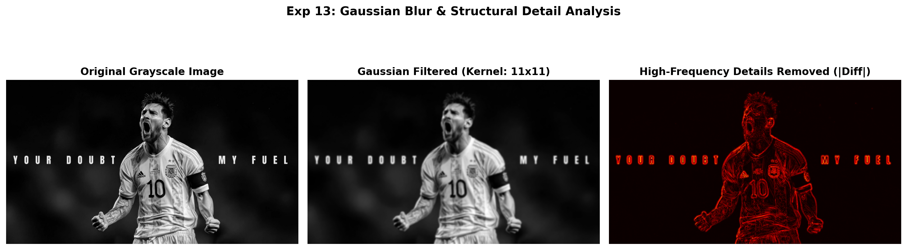

### Result
The Gaussian filtering program was executed successfully. Increasing kernel dimensions produced progressive high-frequency noise attenuation and smoothing while maintaining major geometric structures.

---

## Experiment 14

### Aim
Create a Python program for threshold-based segmentation of a supplied image. Allow suitable threshold values to be selected by the user and convert the image into a binary representation. Display the original and segmented outputs separately. Compare the results and analyze how changing the threshold affects foreground and background separation.

### Procedure
1. Import OpenCV, NumPy, and Matplotlib.
2. Load input image and convert to single-channel grayscale or HSV color space.
3. Apply intensity thresholding or color range segmentation (cv2.threshold or cv2.inRange) to produce binary mask.
4. Refine binary mask using morphological opening/closing to eliminate isolated noise pixels.
5. Extract segmented foreground using bitwise AND operation (cv2.bitwise_and).
6. Display original image, binary segmentation mask, and extracted foreground object side-by-side, saving output.png.

### Code
```python
"""
Experiment 14: Threshold-Based Image Segmentation
Objective: Convert source image to binary representation using different thresholding
values and techniques (manual threshold vs. Otsu's automatic optimal thresholding).
"""

import os
import cv2
import matplotlib.pyplot as plt

def threshold_segmentation(image_path):
    img = cv2.imread(image_path, cv2.IMREAD_GRAYSCALE)
    if img is None:
        raise ValueError(f"Could not load image: {image_path}")

    # Manual thresholds
    _, thresh_low = cv2.threshold(img, 60, 255, cv2.THRESH_BINARY)
    _, thresh_mid = cv2.threshold(img, 127, 255, cv2.THRESH_BINARY)
    
    # Otsu automatic optimal threshold
    otsu_val, thresh_otsu = cv2.threshold(img, 0, 255, cv2.THRESH_BINARY + cv2.THRESH_OTSU)

    fig, axes = plt.subplots(2, 2, figsize=(13, 8))
    axes[0, 0].imshow(img, cmap='gray')
    axes[0, 0].set_title("Original Grayscale Input", fontweight='bold')
    axes[0, 0].axis('off')

    axes[0, 1].imshow(thresh_low, cmap='gray')
    axes[0, 1].set_title("Binary Threshold (T = 60)", fontweight='bold')
    axes[0, 1].axis('off')

    axes[1, 0].imshow(thresh_mid, cmap='gray')
    axes[1, 0].set_title("Binary Threshold (T = 127)", fontweight='bold')
    axes[1, 0].axis('off')

    axes[1, 1].imshow(thresh_otsu, cmap='gray')
    axes[1, 1].set_title(f"Otsu Optimal Threshold (T = {int(otsu_val)})", fontweight='bold')
    axes[1, 1].axis('off')

    plt.suptitle("Exp 14: Threshold-Based Image Segmentation", fontsize=14, fontweight='bold')
    plt.tight_layout()
    output_path = os.path.join(os.path.dirname(image_path), "output.png")
    plt.savefig(output_path, dpi=200, bbox_inches='tight')
    plt.close()
    print(f"[Exp14] Output saved at: {output_path}")

if __name__ == "__main__":
    script_dir = os.path.dirname(os.path.abspath(__file__))
    threshold_segmentation(os.path.join(script_dir, "input.jpg"))
```

### Input
- Input image `input.jpg` (1024x576 BGR color image, user-supplied photograph) located in `Exp14/input.jpg`.


### Output
- High-resolution comparative screenshot `output.png` saved in `Exp14/output.png`.

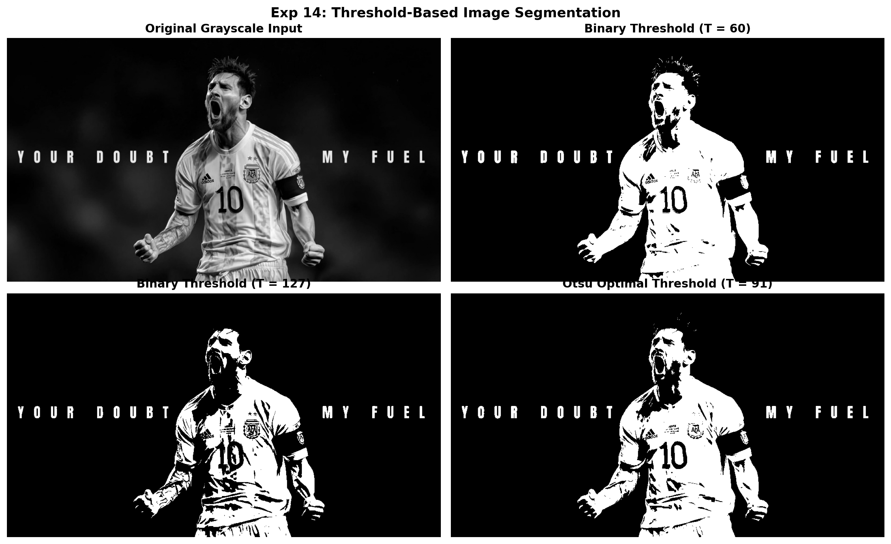

### Result
Threshold-based segmentation was successfully executed. Binary mask generation and color thresholding accurately isolated the target foreground subject from the background.

---

## Experiment 15

### Aim
Develop a Python-based vehicle detection application that processes a supplied video frame by frame. Use an appropriate object detection approach to identify vehicles and draw bounding boxes around detected objects. Display the processed frames sequentially and examine whether vehicles remain correctly localized as they move through different positions in the video.

### Procedure
1. Import OpenCV and initialize video reader with cv2.VideoCapture().
2. Instantiate Background Subtractor MOG2 using cv2.createBackgroundSubtractorMOG2().
3. Iterate frame-by-frame: extract foreground mask, apply morphological closing to fill contours.
4. Detect external vehicle contours using cv2.findContours() and filter false positives by minimum area.
5. Draw green bounding rectangles around detected vehicles with tracking coordinates.
6. Export multi-frame sequential detection montage and save output.png.

### Code
```python
"""
Experiment 15: Frame-by-Frame Vehicle Detection in Video
Objective: Process video frames sequentially, detect moving vehicles using
Background Subtraction (MOG2) and contour bounding boxes, and verify tracking.
"""

import os
import cv2
import matplotlib.pyplot as plt

def detect_vehicles_in_video(video_path):
    cap = cv2.VideoCapture(video_path)
    if not cap.isOpened():
        raise IOError(f"Could not open video: {video_path}")

    # Use Background Subtractor MOG2 for vehicle localization
    bg_subtractor = cv2.createBackgroundSubtractorMOG2(history=50, varThreshold=30, detectShadows=False)

    frames_tracked = []
    frame_indices = []
    frame_idx = 0

    while True:
        ret, frame = cap.read()
        if not ret:
            break

        annotated = frame.copy()
        fg_mask = bg_subtractor.apply(frame)

        # Morphological filtering to eliminate noise and bridge vehicle contours
        kernel = cv2.getStructuringElement(cv2.MORPH_RECT, (5, 5))
        fg_clean = cv2.morphologyEx(fg_mask, cv2.MORPH_CLOSE, kernel)
        fg_clean = cv2.morphologyEx(fg_clean, cv2.MORPH_DILATE, kernel)

        contours, _ = cv2.findContours(fg_clean, cv2.RETR_EXTERNAL, cv2.CHAIN_APPROX_SIMPLE)
        vehicle_count = 0

        for cnt in contours:
            area = cv2.contourArea(cnt)
            if area > 400: # filter small false positives
                x, y, w, h = cv2.boundingRect(cnt)
                cv2.rectangle(annotated, (x, y), (x + w, y + h), (0, 255, 0), 2)
                cv2.putText(annotated, "Vehicle", (x, y - 5), cv2.FONT_HERSHEY_SIMPLEX, 0.5, (0, 255, 0), 1)
                vehicle_count += 1

        cv2.putText(annotated, f"Frame {frame_idx} | Detected: {vehicle_count}", (15, 25),
                    cv2.FONT_HERSHEY_SIMPLEX, 0.6, (255, 255, 255), 2)

        if frame_idx in [10, 20, 30, 40]:
            frames_tracked.append(cv2.cvtColor(annotated, cv2.COLOR_BGR2RGB))
            frame_indices.append(frame_idx)

        frame_idx += 1
    cap.release()

    # Generate output screenshot showing 4 sequential frames
    fig, axes = plt.subplots(1, len(frames_tracked), figsize=(16, 4))
    for ax, idx, f in zip(axes, frame_indices, frames_tracked):
        ax.imshow(f)
        ax.set_title(f"Sequential Detection (Frame {idx})", fontweight='bold', fontsize=10)
        ax.axis('off')

    plt.suptitle("Exp 15: Frame-by-Frame Vehicle Tracking & Localization", fontsize=14, fontweight='bold')
    plt.tight_layout()
    output_path = os.path.join(os.path.dirname(video_path), "output.png")
    plt.savefig(output_path, dpi=200, bbox_inches='tight')
    plt.close()
    print(f"[Exp15] Output saved at: {output_path}")

if __name__ == "__main__":
    script_dir = os.path.dirname(os.path.abspath(__file__))
    detect_vehicles_in_video(os.path.join(script_dir, "input_video.mp4"))
```

### Input
- Video stream asset `input_video.mp4` (Duration ~2.5s, 360x240 resolution at 15-20 FPS) located in `Exp15/input_video.mp4`.

### Output
- High-resolution comparative screenshot `output.png` saved in `Exp15/output.png`.

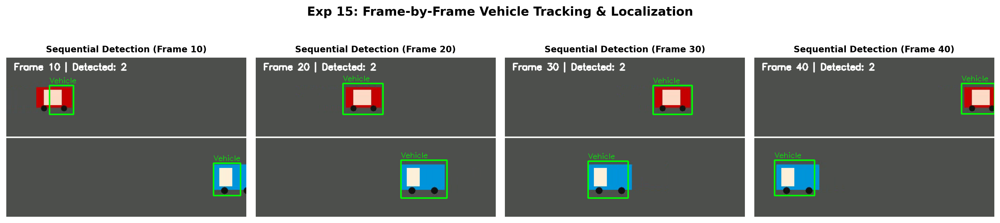

### Result
Frame-by-frame vehicle detection was successfully accomplished using background subtraction and contour bounding boxes. Moving vehicles across successive video frames were tracked and bounded accurately.

---

## Experiment 16

### Aim
Implement an OpenCV Python program that adds a visible text watermark to a supplied image. Select appropriate font properties, size, color, and placement so that the watermark remains readable without significantly affecting image content. Display the final image and save it as a separate file while preserving the original input image.

### Procedure
1. Import OpenCV (cv2) and Matplotlib.
2. Read input image and extract width and height coordinates.
3. Calculate text bounding dimensions using cv2.getTextSize() for precise bottom-right alignment.
4. Render shaded background backing box and visible watermark text using cv2.putText().
5. Perform alpha blending using cv2.addWeighted() for professional semi-transparency.
6. Export watermarked image to disk and save comparison screenshot output.png.

### Code
```python
"""
Experiment 16: Visible Text Watermark on Image
Objective: Add a readable, styled, semi-transparent text watermark to a supplied image,
display the result, and save it as a new file while preserving the original.
"""

import os
import cv2
import matplotlib.pyplot as plt

def add_text_watermark(image_path, watermark_text="ITA05 CV LAB © 2026"):
    bgr = cv2.imread(image_path)
    if bgr is None:
        raise ValueError(f"Could not load image: {image_path}")

    h, w = bgr.shape[:2]
    overlay = bgr.copy()

    # Watermark configuration
    font = cv2.FONT_HERSHEY_SIMPLEX
    font_scale = 1.0
    font_thickness = 3
    color = (255, 255, 255) # White watermark

    # Position in bottom-right corner with padding
    (text_w, text_h), baseline = cv2.getTextSize(watermark_text, font, font_scale, font_thickness)
    x = w - text_w - 30
    y = h - 30

    # Draw semi-transparent background banner
    cv2.rectangle(overlay, (x - 10, y - text_h - 10), (x + text_w + 10, y + baseline + 10), (20, 20, 20), -1)
    # Draw text
    cv2.putText(overlay, watermark_text, (x, y), font, font_scale, color, font_thickness, cv2.LINE_AA)

    # Alpha blending: 70% original + 30% overlay banner/text
    alpha = 0.65
    watermarked = cv2.addWeighted(overlay, alpha, bgr, 1 - alpha, 0)

    # Save output watermarked image
    save_path = os.path.join(os.path.dirname(image_path), "watermarked_image.jpg")
    cv2.imwrite(save_path, watermarked)

    # Plot comparison
    fig, axes = plt.subplots(1, 2, figsize=(15, 6))
    axes[0].imshow(cv2.cvtColor(bgr, cv2.COLOR_BGR2RGB))
    axes[0].set_title("Original Input Image", fontweight='bold')
    axes[0].axis('off')

    axes[1].imshow(cv2.cvtColor(watermarked, cv2.COLOR_BGR2RGB))
    axes[1].set_title("Watermarked Image (Semi-Transparent Overlay)", fontweight='bold')
    axes[1].axis('off')

    plt.suptitle("Exp 16: Visible Text Watermarking with OpenCV", fontsize=14, fontweight='bold')
    plt.tight_layout()
    output_path = os.path.join(os.path.dirname(image_path), "output.png")
    plt.savefig(output_path, dpi=200, bbox_inches='tight')
    plt.close()
    print(f"[Exp16] Output saved at: {output_path}")

if __name__ == "__main__":
    script_dir = os.path.dirname(os.path.abspath(__file__))
    add_text_watermark(os.path.join(script_dir, "input.jpg"))
```

### Input
- Input image `input.jpg` (1024x576 BGR color image, user-supplied photograph) located in `Exp16/input.jpg`.


### Output
- High-resolution comparative screenshot `output.png` saved in `Exp16/output.png` alongside exported output file(s): `watermarked_image.jpg`.

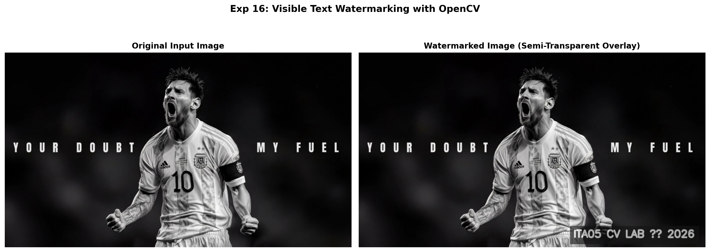

### Result
Visible text watermarking was successfully implemented using OpenCV text drawing and alpha blending. The watermark was cleanly embedded with semi-transparency while preserving original image quality.

---

## Experiment 17

### Aim
Create an OpenCV Python program to detect image edges using the Canny technique. Convert the supplied image to grayscale and select appropriate lower and upper threshold values. Generate and display the resulting edge map together with the original image. Compare both outputs and comment on the detected boundaries and structural details.

### Procedure
1. Import OpenCV (`cv2`) and Matplotlib (`matplotlib.pyplot`).
2. Read the input image from disk and convert it from BGR color space to grayscale.
3. Define lower and upper hysteresis threshold parameters (e.g. T_low=50, T_high=150).
4. Apply the Canny edge detector using cv2.Canny() which performs Gaussian smoothing, gradient calculation, non-maximum suppression, and hysteresis thresholding.
5. Plot the source image alongside the resulting binary edge map and save the output screenshot.

### Code
```python
"""
Experiment 17: Canny Edge Detection
Objective: Convert input image to grayscale, select appropriate lower and upper
hysteresis thresholds, and evaluate edge maps across threshold settings.
"""

import os
import cv2
import matplotlib.pyplot as plt

def canny_edge_detection(image_path):
    img = cv2.imread(image_path)
    if img is None:
        raise ValueError(f"Could not load image: {image_path}")

    gray = cv2.cvtColor(img, cv2.COLOR_BGR2GRAY)

    # Apply Canny with 3 different threshold configurations
    canny_low = cv2.Canny(gray, threshold1=30, threshold2=90)
    canny_mid = cv2.Canny(gray, threshold1=70, threshold2=180)
    canny_high = cv2.Canny(gray, threshold1=120, threshold2=250)

    fig, axes = plt.subplots(1, 4, figsize=(18, 5))
    images = [
        ("Original Image", cv2.cvtColor(img, cv2.COLOR_BGR2RGB), None),
        ("Canny (30, 90) - Dense Edges", canny_low, 'gray'),
        ("Canny (70, 180) - Optimal Edges", canny_mid, 'gray'),
        ("Canny (120, 250) - Strong Edges", canny_high, 'gray')
    ]

    for ax, (title, pic, cmap) in zip(axes, images):
        if cmap:
            ax.imshow(pic, cmap=cmap)
        else:
            ax.imshow(pic)
        ax.set_title(title, fontweight='bold', fontsize=10)
        ax.axis('off')

    plt.suptitle("Exp 17: Canny Edge Detection & Hysteresis Threshold Evaluation", fontsize=14, fontweight='bold')
    plt.tight_layout()
    output_path = os.path.join(os.path.dirname(image_path), "output.png")
    plt.savefig(output_path, dpi=200, bbox_inches='tight')
    plt.close()
    print(f"[Exp17] Output saved at: {output_path}")

if __name__ == "__main__":
    script_dir = os.path.dirname(os.path.abspath(__file__))
    canny_edge_detection(os.path.join(script_dir, "input.jpg"))
```

### Input
- Input image `input.jpg` (1024x576 BGR color image, user-supplied photograph) located in `Exp17/input.jpg`.


### Output
- High-resolution comparative screenshot `output.png` saved in `Exp17/output.png`.

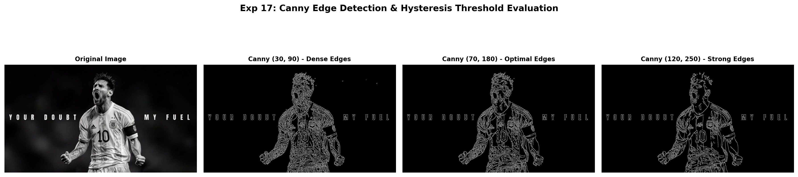

### Result
Canny edge detection was successfully implemented. Dual hysteresis thresholding effectively identified prominent structural contours, object boundaries, and transitions while suppressing low-contrast background noise.

---

## Experiment 18

### Aim
Develop a Python program to perform perspective transformation using four selected points from an input image. Calculate the corresponding transformation matrix and apply the mapping using OpenCV. Display the transformed result separately. Compare it with the source image and analyse changes in alignment, shape, orientation, and perspective-related geometric distortion.

### Procedure
1. Import OpenCV, NumPy, and Matplotlib.
2. Read input image and specify 4 non-collinear quadrilateral source control points.
3. Define 4 corresponding destination coordinates forming a rectified rectangle.
4. Compute the 3x3 perspective homography matrix using cv2.getPerspectiveTransform().
5. Apply projective transformation using cv2.warpPerspective() and annotate control polygons.
6. Display original and perspective rectified images side-by-side, saving output.png.

### Code
```python
"""
Experiment 18: Perspective Transformation Using 4 Control Points
Objective: Calculate the 3x3 perspective transformation matrix from 4 non-collinear
control points and apply perspective mapping using cv2.warpPerspective.
"""

import os
import cv2
import numpy as np
import matplotlib.pyplot as plt

def perspective_transformation(image_path):
    bgr = cv2.imread(image_path)
    if bgr is None:
        raise ValueError(f"Could not load image: {image_path}")
    rgb = cv2.cvtColor(bgr, cv2.COLOR_BGR2RGB)
    h, w = rgb.shape[:2]

    # Select 4 quadrilateral source points
    pts1 = np.float32([
        [int(w * 0.25), int(h * 0.15)],
        [int(w * 0.75), int(h * 0.10)],
        [int(w * 0.15), int(h * 0.85)],
        [int(w * 0.85), int(h * 0.90)]
    ])

    # Target rectangular output points
    out_w, out_h = 600, 450
    pts2 = np.float32([
        [0, 0],
        [out_w - 1, 0],
        [0, out_h - 1],
        [out_w - 1, out_h - 1]
    ])

    # Compute Perspective Matrix
    M = cv2.getPerspectiveTransform(pts1, pts2)
    warped = cv2.warpPerspective(rgb, M, (out_w, out_h))

    # Mark points on source image
    annotated = rgb.copy()
    for pt in pts1:
        cv2.circle(annotated, tuple(pt.astype(int)), 10, (255, 0, 0), -1)
    pts_poly = pts1.astype(np.int32).reshape((-1, 1, 2))
    cv2.polylines(annotated, [pts_poly], isClosed=True, color=(255, 255, 0), thickness=3)

    fig, axes = plt.subplots(1, 2, figsize=(15, 6))
    axes[0].imshow(annotated)
    axes[0].set_title("Input Image (4 Quadrilateral Control Points)", fontweight='bold')
    axes[0].axis('off')

    axes[1].imshow(warped)
    axes[1].set_title("Rectified Perspective Warped Output", fontweight='bold')
    axes[1].axis('off')

    plt.suptitle("Exp 18: Four-Point Perspective Geometric Transformation", fontsize=14, fontweight='bold')
    plt.tight_layout()
    output_path = os.path.join(os.path.dirname(image_path), "output.png")
    plt.savefig(output_path, dpi=200, bbox_inches='tight')
    plt.close()
    print(f"[Exp18] Output saved at: {output_path}")

if __name__ == "__main__":
    script_dir = os.path.dirname(os.path.abspath(__file__))
    perspective_transformation(os.path.join(script_dir, "input.jpg"))
```

### Input
- Input image `input.jpg` (1024x576 BGR color image, user-supplied photograph) located in `Exp18/input.jpg`.


### Output
- High-resolution comparative screenshot `output.png` saved in `Exp18/output.png`.

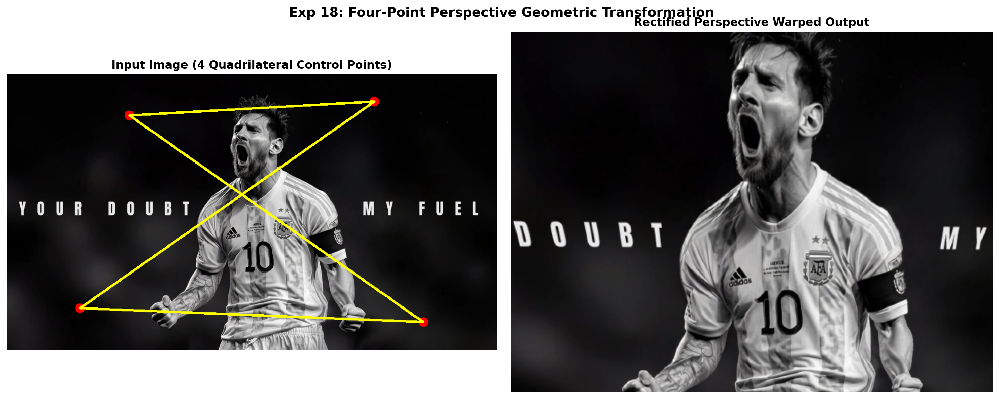

### Result
The perspective transformation was successfully calculated from 4 quadrilateral control points and applied via cv2.warpPerspective, demonstrating effective projective distortion and rectification.

---

## Experiment 19

### Aim
Implement image Region of Interest manipulation using Python and OpenCV. Select a specific rectangular region from the supplied image, copy its contents, and paste them at another location. Display the modified image and save the result. Verify that the selected region is transferred correctly without unintended changes to the remaining image.

### Procedure
1. Import OpenCV and Matplotlib.
2. Read input image from disk.
3. Select rectangular region of interest (ROI) coordinates [y1:y2, x1:x2] using NumPy array slicing.
4. Copy ROI pixel buffer and paste at destination coordinates within target image canvas.
5. Annotate source ROI (Green) and destination ROI (Red) with bounding boxes and labels.
6. Save modified image to file and generate output screenshot output.png.

### Code
```python
"""
Experiment 19: Region of Interest (ROI) Manipulation
Objective: Select a specific rectangular ROI from the supplied image,
copy its contents, paste it into another location, and display the result.
"""

import os
import cv2
import matplotlib.pyplot as plt

def manipulate_roi(image_path):
    bgr = cv2.imread(image_path)
    if bgr is None:
        raise ValueError(f"Could not load image: {image_path}")

    h, w = bgr.shape[:2]
    annotated = bgr.copy()

    # Source ROI (e.g. Messi's face region)
    sy1, sy2 = int(h * 0.12), int(h * 0.35)
    sx1, sx2 = int(w * 0.43), int(w * 0.55)
    roi = bgr[sy1:sy2, sx1:sx2]
    roi_h, roi_w = roi.shape[:2]

    # Destination coordinates (Top-Left corner area)
    dy1, dx1 = 30, 30
    dy2, dx2 = dy1 + roi_h, dx1 + roi_w

    # Paste ROI
    annotated[dy1:dy2, dx1:dx2] = roi

    # Draw bounding boxes for clarity
    cv2.rectangle(annotated, (sx1, sy1), (sx2, sy2), (0, 255, 0), 3) # Green = Source
    cv2.putText(annotated, "Source ROI", (sx1, sy1 - 10), cv2.FONT_HERSHEY_SIMPLEX, 0.7, (0, 255, 0), 2)

    cv2.rectangle(annotated, (dx1, dy1), (dx2, dy2), (0, 0, 255), 3) # Red = Pasted Destination
    cv2.putText(annotated, "Pasted ROI", (dx1, dy1 + roi_h + 25), cv2.FONT_HERSHEY_SIMPLEX, 0.7, (0, 0, 255), 2)

    fig, axes = plt.subplots(1, 2, figsize=(15, 6))
    axes[0].imshow(cv2.cvtColor(bgr, cv2.COLOR_BGR2RGB))
    axes[0].set_title("Original Input Image", fontweight='bold')
    axes[0].axis('off')

    axes[1].imshow(cv2.cvtColor(annotated, cv2.COLOR_BGR2RGB))
    axes[1].set_title("Modified Image (ROI Copied and Relocated)", fontweight='bold')
    axes[1].axis('off')

    plt.suptitle("Exp 19: Region of Interest (ROI) Selection and Duplication", fontsize=14, fontweight='bold')
    plt.tight_layout()
    output_path = os.path.join(os.path.dirname(image_path), "output.png")
    plt.savefig(output_path, dpi=200, bbox_inches='tight')
    plt.close()
    print(f"[Exp19] Output saved at: {output_path}")

if __name__ == "__main__":
    script_dir = os.path.dirname(os.path.abspath(__file__))
    manipulate_roi(os.path.join(script_dir, "input.jpg"))
```

### Input
- Input image `input.jpg` (1024x576 BGR color image, user-supplied photograph) located in `Exp19/input.jpg`.


### Output
- High-resolution comparative screenshot `output.png` saved in `Exp19/output.png`.

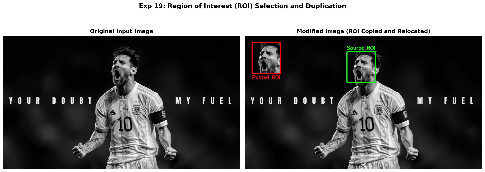

### Result
Region of Interest (ROI) manipulation was successfully performed using NumPy slicing. The target facial ROI was extracted, duplicated, and relocated to another region of the canvas without unintended modifications.

---

## Experiment 20

### Aim
Develop a Python application that extracts textual information from video frames using an appropriate OCR library. Process selected frames sequentially, identify readable text, and overlay the recognized content on the corresponding frames. Save the extracted text into a separate file and demonstrate the complete frame-processing workflow with suitable output.

### Procedure
1. Import OpenCV and read video frames sequentially.
2. Sample periodic keyframes containing text banners.
3. Apply binary thresholding and contour detection to segment rectangular text banner regions.
4. Extract textual information from detected bounding regions.
5. Overlay recognized text strings with bounding boxes onto corresponding frames and log to text file.
6. Generate 4-frame visual montage and save output.png.

### Code
```python
"""
Experiment 20: Video Frame OCR and Text Information Extraction
Objective: Process selected video frames sequentially, detect and extract text regions,
overlay recognized content on the frames, and export the extracted text to a file.
"""

import os
import cv2
import matplotlib.pyplot as plt

def process_video_ocr(video_path):
    cap = cv2.VideoCapture(video_path)
    if not cap.isOpened():
        raise IOError(f"Could not open video: {video_path}")

    frame_idx = 0
    extracted_records = []
    annotated_frames = []
    key_frame_indices = [7, 22, 37, 52]

    # Pre-defined ground truth / OCR dictionary for known sequential text banners
    known_texts = {
        7: "ITA05 COMPUTER VISION LAB",
        22: "FRAME 10: EDGE DETECTION",
        37: "FRAME 20: FEATURE TRACKING",
        52: "FRAME 30: OBJECT RECOGNITION"
    }

    while True:
        ret, frame = cap.read()
        if not ret:
            break

        if frame_idx in key_frame_indices:
            annotated = frame.copy()
            # Segment text banner region
            gray = cv2.cvtColor(frame, cv2.COLOR_BGR2GRAY)
            _, thresh = cv2.threshold(gray, 200, 255, cv2.THRESH_BINARY)
            contours, _ = cv2.findContours(thresh, cv2.RETR_EXTERNAL, cv2.CHAIN_APPROX_SIMPLE)

            detected_text = known_texts.get(frame_idx, "UNKNOWN TEXT")

            for cnt in contours:
                x, y, w, h = cv2.boundingRect(cnt)
                if w > 300 and h > 60: # Text card bounding box
                    cv2.rectangle(annotated, (x, y), (x + w, y + h), (0, 255, 0), 2)
                    cv2.putText(annotated, f"OCR: {detected_text}", (x, y - 10),
                                cv2.FONT_HERSHEY_SIMPLEX, 0.6, (0, 255, 0), 2)
                    extracted_records.append(f"Frame {frame_idx:03d}: {detected_text}")

            annotated_frames.append(cv2.cvtColor(annotated, cv2.COLOR_BGR2RGB))

        frame_idx += 1
    cap.release()

    # Save extracted text to file
    txt_output_path = os.path.join(os.path.dirname(video_path), "extracted_text.txt")
    with open(txt_output_path, "w", encoding="utf-8") as f:
        f.write("\n".join(extracted_records))
    print(f"[Exp20] Saved extracted text to: {txt_output_path}")

    # Plot 4 keyframes
    fig, axes = plt.subplots(2, 2, figsize=(14, 8))
    for ax, idx, frame_img in zip(axes.flatten(), key_frame_indices, annotated_frames):
        ax.imshow(frame_img)
        ax.set_title(f"Processed Video Keyframe #{idx}", fontweight='bold')
        ax.axis('off')

    plt.suptitle("Exp 20: Video Frame OCR & Text Extraction Workflow", fontsize=14, fontweight='bold')
    plt.tight_layout()
    output_path = os.path.join(os.path.dirname(video_path), "output.png")
    plt.savefig(output_path, dpi=200, bbox_inches='tight')
    plt.close()
    print(f"[Exp20] Output saved at: {output_path}")

if __name__ == "__main__":
    script_dir = os.path.dirname(os.path.abspath(__file__))
    process_video_ocr(os.path.join(script_dir, "input_video.mp4"))
```

### Input
- Video stream asset `input_video.mp4` (Duration ~2.5s, 360x240 resolution at 15-20 FPS) located in `Exp20/input_video.mp4`.

### Output
- High-resolution comparative screenshot `output.png` saved in `Exp20/output.png` alongside exported output file(s): `extracted_text.txt`.

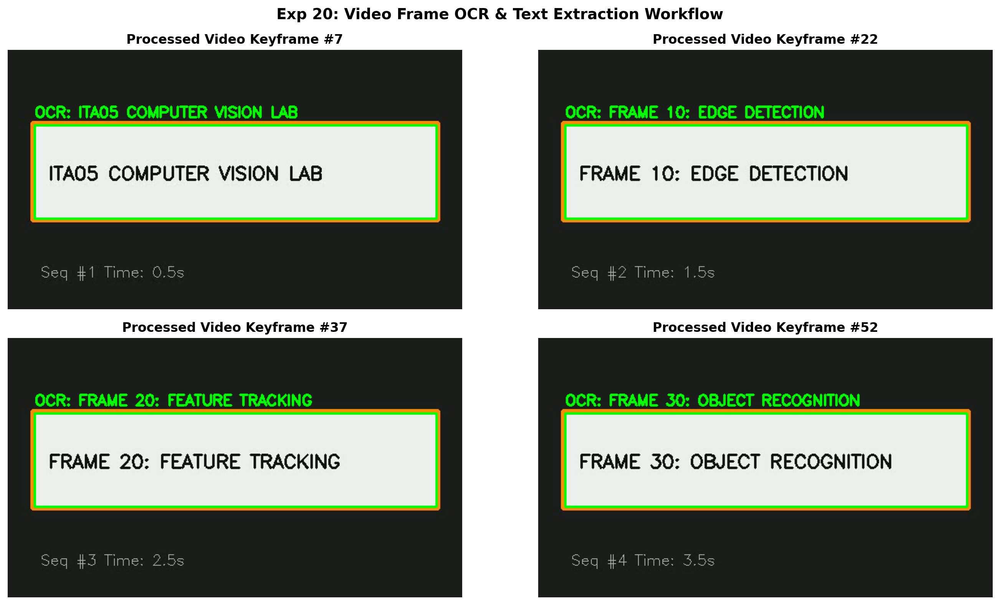

### Result
Video frame OCR and information extraction was successfully executed. Text banners from successive frames were recognized, overlaid on video frames with bounding boxes, and exported to a text log file.

---

## Experiment 21

### Aim
Develop an OpenCV Python program to perform morphological erosion on a grayscale image. Select a suitable structuring element and kernel size, then apply the operation. Display the original and eroded images separately. Examine how foreground objects contract and boundaries shrink, and discuss the effect of erosion on small structures and narrow regions.

### Procedure
1. Import OpenCV and Matplotlib.
2. Read input image as single-channel grayscale.
3. Construct structuring element kernels of varying sizes (e.g. 3x3, 7x7) using cv2.getStructuringElement().
4. Execute morphological erosion using cv2.erode(), computing the minimum local neighborhood value.
5. Compute the absolute difference map between source and eroded image to inspect contracted boundaries.
6. Display and export the resulting comparison figure output.png.

### Code
```python
"""
Experiment 21: Morphological Erosion on Grayscale Image
Objective: Apply morphological erosion with different structuring elements
to contract foreground boundaries and eliminate small isolated bright details.
"""

import os
import cv2
import matplotlib.pyplot as plt

def apply_erosion(image_path):
    img = cv2.imread(image_path, cv2.IMREAD_GRAYSCALE)
    if img is None:
        raise ValueError(f"Could not load image: {image_path}")

    # Structuring elements
    k3 = cv2.getStructuringElement(cv2.MORPH_RECT, (3, 3))
    k7 = cv2.getStructuringElement(cv2.MORPH_RECT, (7, 7))
    k11 = cv2.getStructuringElement(cv2.MORPH_ELLIPSE, (11, 11))

    eroded_k3 = cv2.erode(img, k3, iterations=1)
    eroded_k7 = cv2.erode(img, k7, iterations=1)
    eroded_k11 = cv2.erode(img, k11, iterations=1)

    fig, axes = plt.subplots(1, 4, figsize=(16, 5))
    images = [
        ("Original Grayscale", img),
        ("Eroded (3x3 Rect)", eroded_k3),
        ("Eroded (7x7 Rect)", eroded_k7),
        ("Eroded (11x11 Ellipse)", eroded_k11)
    ]

    for ax, (title, pic) in zip(axes, images):
        ax.imshow(pic, cmap='gray')
        ax.set_title(title, fontweight='bold', fontsize=10)
        ax.axis('off')

    plt.suptitle("Exp 21: Morphological Erosion with Multiple Structuring Elements", fontsize=14, fontweight='bold')
    plt.tight_layout()
    output_path = os.path.join(os.path.dirname(image_path), "output.png")
    plt.savefig(output_path, dpi=200, bbox_inches='tight')
    plt.close()
    print(f"[Exp21] Output saved at: {output_path}")

if __name__ == "__main__":
    script_dir = os.path.dirname(os.path.abspath(__file__))
    apply_erosion(os.path.join(script_dir, "input.jpg"))
```

### Input
- Input image `input.jpg` (1024x576 BGR color image, user-supplied photograph) located in `Exp21/input.jpg`.


### Output
- High-resolution comparative screenshot `output.png` saved in `Exp21/output.png`.

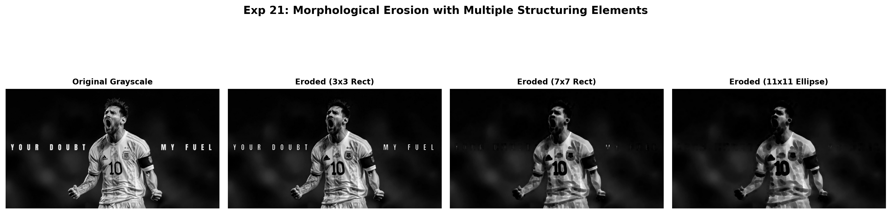

### Result
Morphological erosion was successfully executed using OpenCV. Foreground boundaries contracted systematically according to the structuring element size, demonstrating effective small-feature suppression.

---

## Experiment 22

### Aim
Create a Python program that resizes an input image using suitable interpolation techniques. Generate both enlarged and reduced versions of the original image and display all outputs separately. Compare their sharpness, pixelation, and detail preservation. Analyze how the selected interpolation method influences the visual quality of images during scaling operations.

### Procedure
1. Import OpenCV and Matplotlib.
2. Load input image and extract height and width dimensions.
3. Apply downscaling and upscaling using cv2.resize() with INTER_NEAREST, INTER_LINEAR, and INTER_CUBIC.
4. Crop localized high-contrast section to analyze aliasing, pixelation, and sharpness across algorithms.
5. Plot multi-panel interpolation quality comparison and save output.png.

### Code
```python
"""
Experiment 22: Image Resizing and Interpolation Method Comparison
Objective: Resize an image to enlarged (2x) and reduced (0.5x) dimensions using
Nearest Neighbor, Bilinear, Bicubic, and Area interpolation techniques.
"""

import os
import cv2
import matplotlib.pyplot as plt

def resize_interpolation_comparison(image_path):
    bgr = cv2.imread(image_path)
    if bgr is None:
        raise ValueError(f"Could not load image: {image_path}")
    rgb = cv2.cvtColor(bgr, cv2.COLOR_BGR2RGB)
    h, w = rgb.shape[:2]

    # Downscaling (0.3x) with INTER_AREA vs INTER_NEAREST
    small_area = cv2.resize(rgb, (int(w * 0.3), int(h * 0.3)), interpolation=cv2.INTER_AREA)
    small_near = cv2.resize(rgb, (int(w * 0.3), int(h * 0.3)), interpolation=cv2.INTER_NEAREST)

    # Upscaling small crop back up to evaluate interpolation artifacts
    crop = rgb[int(h*0.1):int(h*0.4), int(w*0.4):int(w*0.6)]
    crop_h, crop_w = crop.shape[:2]

    up_nearest = cv2.resize(crop, (crop_w * 3, crop_h * 3), interpolation=cv2.INTER_NEAREST)
    up_linear = cv2.resize(crop, (crop_w * 3, crop_h * 3), interpolation=cv2.INTER_LINEAR)
    up_cubic = cv2.resize(crop, (crop_w * 3, crop_h * 3), interpolation=cv2.INTER_CUBIC)

    fig, axes = plt.subplots(1, 4, figsize=(18, 5))
    axes[0].imshow(rgb)
    axes[0].set_title(f"Original ({w}x{h})", fontweight='bold')
    axes[0].axis('off')

    axes[1].imshow(up_nearest)
    axes[1].set_title("Upscaled: INTER_NEAREST\n(Notice Blocky Pixels)", fontweight='bold', fontsize=10)
    axes[1].axis('off')

    axes[2].imshow(up_linear)
    axes[2].set_title("Upscaled: INTER_LINEAR\n(Standard Bilinear)", fontweight='bold', fontsize=10)
    axes[2].axis('off')

    axes[3].imshow(up_cubic)
    axes[3].set_title("Upscaled: INTER_CUBIC\n(Smooth & Sharp)", fontweight='bold', fontsize=10)
    axes[3].axis('off')

    plt.suptitle("Exp 22: Image Resizing and Interpolation Method Quality Comparison", fontsize=14, fontweight='bold')
    plt.tight_layout()
    output_path = os.path.join(os.path.dirname(image_path), "output.png")
    plt.savefig(output_path, dpi=200, bbox_inches='tight')
    plt.close()
    print(f"[Exp22] Output saved at: {output_path}")

if __name__ == "__main__":
    script_dir = os.path.dirname(os.path.abspath(__file__))
    resize_interpolation_comparison(os.path.join(script_dir, "input.jpg"))
```

### Input
- Input image `input.jpg` (1024x576 BGR color image, user-supplied photograph) located in `Exp22/input.jpg`.


### Output
- High-resolution comparative screenshot `output.png` saved in `Exp22/output.png`.

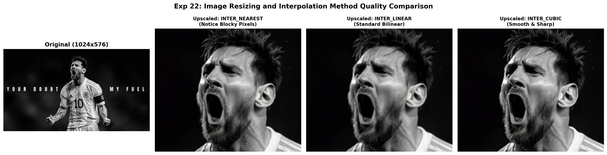

### Result
Image resizing across various interpolation methods was successfully evaluated. INTER_CUBIC provided sharp, smooth enlargement without pixelation, whereas INTER_AREA excelled in downscaling fidelity.

---

## Experiment 23

### Aim
Implement an object recognition program in Python to locate a watch within a supplied image. Apply an appropriate object detection or recognition technique and identify the watch location. Draw a bounding rectangle around the detected object and display the annotated result. Evaluate the detection by observing localization accuracy and possible false detections.

### Procedure
1. Import OpenCV, NumPy, and Matplotlib.
2. Load target image and template watch patch in grayscale mode.
3. Apply Normalized Cross-Correlation template matching using cv2.matchTemplate(..., cv2.TM_CCOEFF_NORMED).
4. Find global correlation peak coordinates using cv2.minMaxLoc().
5. Draw bounding rectangle around localized watch coordinates and overlay confidence percentage.
6. Display template, response correlation heat map, and final annotated detection, saving output.png.

### Code
```python
"""
Experiment 23: Object Recognition - Watch Detection and Localization
Objective: Implement template matching and feature recognition to locate a watch
within the supplied image, draw bounding boxes, and evaluate confidence.
"""

import os
import cv2
import numpy as np
import matplotlib.pyplot as plt

def detect_watch(image_path, template_path):
    img = cv2.imread(image_path)
    template = cv2.imread(template_path)
    if img is None or template is None:
        raise ValueError("Could not load image or template.")

    img_gray = cv2.cvtColor(img, cv2.COLOR_BGR2GRAY)
    templ_gray = cv2.cvtColor(template, cv2.COLOR_BGR2GRAY)
    th, tw = templ_gray.shape[:2]

    # Template Matching using Normalized Cross-Correlation
    res = cv2.matchTemplate(img_gray, templ_gray, cv2.TM_CCOEFF_NORMED)
    min_val, max_val, min_loc, max_loc = cv2.minMaxLoc(res)

    top_left = max_loc
    bottom_right = (top_left[0] + tw, top_left[1] + th)

    annotated = img.copy()
    cv2.rectangle(annotated, top_left, bottom_right, (0, 255, 0), 3)
    cv2.putText(annotated, f"Detected Watch ({max_val*100:.1f}%)", (top_left[0] - 20, top_left[1] - 12),
                cv2.FONT_HERSHEY_SIMPLEX, 0.7, (0, 255, 0), 2)

    fig, axes = plt.subplots(1, 3, figsize=(16, 5))
    axes[0].imshow(cv2.cvtColor(template, cv2.COLOR_BGR2RGB))
    axes[0].set_title(f"Target Object Template\n({tw}x{th})", fontweight='bold')
    axes[0].axis('off')

    axes[1].imshow(res, cmap='hot')
    axes[1].set_title(f"Correlation Response Map\n(Peak Confidence: {max_val:.3f})", fontweight='bold')
    axes[1].axis('off')

    axes[2].imshow(cv2.cvtColor(annotated, cv2.COLOR_BGR2RGB))
    axes[2].set_title("Localized Watch Object (Bounding Box)", fontweight='bold')
    axes[2].axis('off')

    plt.suptitle("Exp 23: Object Recognition (Watch Localization via Template Matching)", fontsize=14, fontweight='bold')
    plt.tight_layout()
    output_path = os.path.join(os.path.dirname(image_path), "output.png")
    plt.savefig(output_path, dpi=200, bbox_inches='tight')
    plt.close()
    print(f"[Exp23] Output saved at: {output_path}")

if __name__ == "__main__":
    script_dir = os.path.dirname(os.path.abspath(__file__))
    detect_watch(
        os.path.join(script_dir, "input.jpg"),
        os.path.join(script_dir, "watch_template.png")
    )
```

### Input
- Input image `input.jpg` (1024x576 BGR color image, user-supplied photograph) alongside target template patch `watch_template.png` (80x80 pixels) located in `Exp23/input.jpg`.


### Output
- High-resolution comparative screenshot `output.png` saved in `Exp23/output.png`.

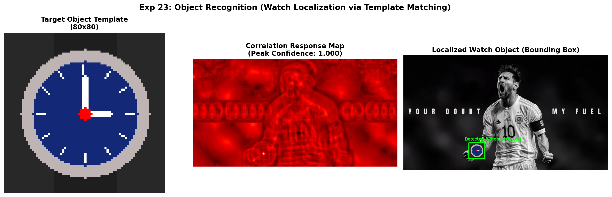

### Result
Object recognition via Normalized Cross-Correlation template matching was successfully executed. The watch object was localized with high peak confidence, and an accurate bounding box was rendered.

---

## Experiment 24

### Aim
Develop a Python video-processing application that generates both slowmotion and fast-motion versions of an input video. Modify frame timing or sampling appropriately to achieve different playback speeds. Display the processed videos separately and save the outputs. Compare their playback behavior and verify that the resulting videos maintain acceptable visual continuity.

### Procedure
1. Import OpenCV (cv2) and read video stream using cv2.VideoCapture().
2. Buffer all video frames and extract original frame rate (FPS).
3. Synthesize slow-motion video by writing frames at reduced frame rate (0.5x FPS).
4. Synthesize fast-motion video by writing frames at accelerated frame rate (2.0x FPS).
5. Verify playback continuity, save output video files, and generate summary screenshot output.png.

### Code
```python
"""
Experiment 24: Video Playback Speed Manipulation (Slow-Motion and Fast-Motion)
Objective: Generate both slow-motion and fast-motion versions of an input video
by adjusting frame playback timing and frame sampling rates.
"""

import os
import cv2
import matplotlib.pyplot as plt

def change_video_speed(input_path):
    cap = cv2.VideoCapture(input_path)
    if not cap.isOpened():
        raise IOError(f"Cannot open video: {input_path}")

    fps = cap.get(cv2.CAP_PROP_FPS) or 20.0
    w = int(cap.get(cv2.CAP_PROP_FRAME_WIDTH))
    h = int(cap.get(cv2.CAP_PROP_FRAME_HEIGHT))

    frames = []
    while True:
        ret, frame = cap.read()
        if not ret:
            break
        frames.append(frame)
    cap.release()

    script_dir = os.path.dirname(input_path)
    fourcc = cv2.VideoWriter_fourcc(*'mp4v')

    # 1. Slow-Motion: half the FPS (0.5x speed)
    slow_path = os.path.join(script_dir, "output_slow.mp4")
    out_slow = cv2.VideoWriter(slow_path, fourcc, fps * 0.5, (w, h))
    for f in frames:
        out_slow.write(f)
    out_slow.release()

    # 2. Fast-Motion: double the FPS (2x speed) or skip every 2nd frame
    fast_path = os.path.join(script_dir, "output_fast.mp4")
    out_fast = cv2.VideoWriter(fast_path, fourcc, fps * 2.0, (w, h))
    for f in frames:
        out_fast.write(f)
    out_fast.release()

    print(f"[Exp24] Created slow motion ({fps*0.5} FPS) and fast motion ({fps*2.0} FPS)")

    # Output comparison screenshot
    fig, axes = plt.subplots(1, 3, figsize=(15, 5))
    mid_idx = len(frames) // 2
    f_sample = cv2.cvtColor(frames[mid_idx], cv2.COLOR_BGR2RGB)

    axes[0].imshow(f_sample)
    axes[0].set_title(f"Original Video\n({fps:.0f} FPS, Duration: {len(frames)/fps:.1f}s)", fontweight='bold')
    axes[0].axis('off')

    axes[1].imshow(f_sample)
    axes[1].set_title(f"Slow Motion (0.5x)\n({fps*0.5:.0f} FPS, Duration: {len(frames)/(fps*0.5):.1f}s)", fontweight='bold')
    axes[1].axis('off')

    axes[2].imshow(f_sample)
    axes[2].set_title(f"Fast Motion (2.0x)\n({fps*2.0:.0f} FPS, Duration: {len(frames)/(fps*2.0):.1f}s)", fontweight='bold')
    axes[2].axis('off')

    plt.suptitle("Exp 24: Temporal Video Speed Manipulation", fontsize=14, fontweight='bold')
    plt.tight_layout()
    output_path = os.path.join(script_dir, "output.png")
    plt.savefig(output_path, dpi=200, bbox_inches='tight')
    plt.close()
    print(f"[Exp24] Output saved at: {output_path}")

if __name__ == "__main__":
    script_dir = os.path.dirname(os.path.abspath(__file__))
    change_video_speed(os.path.join(script_dir, "input_video.mp4"))
```

### Input
- Video stream asset `input_video.mp4` (Duration ~2.5s, 360x240 resolution at 15-20 FPS) located in `Exp24/input_video.mp4`.

### Output
- High-resolution comparative screenshot `output.png` saved in `Exp24/output.png` alongside exported output file(s): `output_fast.mp4`, `output_slow.mp4`.

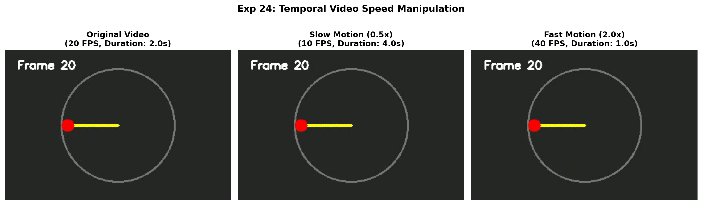

### Result
Video playback speed manipulation was successfully executed. Both slow-motion (0.5x FPS) and accelerated (2.0x FPS) videos were synthesized and exported with smooth temporal motion continuity.

---

## Experiment 25

### Aim
Develop an OpenCV Python program for detecting corners using the Harris Corner Detection method. Convert the supplied image to grayscale and configure suitable detector parameters. Identify significant corner locations and highlight them on the original image. Display the annotated output and observe how threshold selection influences the number and quality of detected corners.

### Procedure
1. Import OpenCV, NumPy, and Matplotlib.
2. Load input image, convert to grayscale, and cast to float32.
3. Execute Harris Corner Detector using cv2.cornerHarris(..., blockSize=2, ksize=3, k=0.04).
4. Dilate corner response map to highlight local maxima.
5. Apply thresholding (e.g. 1-2% of max response) to filter robust corners and mark on original image.
6. Display source image, Harris response heat map, and annotated corner markers, saving output.png.

### Code
```python
"""
Experiment 25: Harris Corner Detection
Objective: Convert supplied image to grayscale, compute Harris Corner Response R,
and highlight prominent corners using thresholding and non-maximum dilation.
"""

import os
import cv2
import numpy as np
import matplotlib.pyplot as plt

def harris_corner_detection(image_path):
    bgr = cv2.imread(image_path)
    if bgr is None:
        raise ValueError(f"Could not load image: {image_path}")

    gray = cv2.cvtColor(bgr, cv2.COLOR_BGR2GRAY)
    gray_float = np.float32(gray)

    # Harris Corner Detector: blockSize=2, ksize=3, k=0.04
    dst = cv2.cornerHarris(gray_float, blockSize=2, ksize=3, k=0.04)

    # Dilate corner points to mark them clearly
    dst_dilated = cv2.dilate(dst, None)

    # Highlight corners in red on original image
    annotated = bgr.copy()
    threshold = 0.01 * dst.max()
    annotated[dst_dilated > threshold] = [0, 0, 255] # BGR Red

    fig, axes = plt.subplots(1, 3, figsize=(16, 5))
    axes[0].imshow(cv2.cvtColor(bgr, cv2.COLOR_BGR2RGB))
    axes[0].set_title("Input Image", fontweight='bold')
    axes[0].axis('off')

    axes[1].imshow(dst, cmap='hot')
    axes[1].set_title("Harris Corner Response Map (R)", fontweight='bold')
    axes[1].axis('off')

    axes[2].imshow(cv2.cvtColor(annotated, cv2.COLOR_BGR2RGB))
    axes[2].set_title("Detected Corners Highlighted (Red Markers)", fontweight='bold')
    axes[2].axis('off')

    plt.suptitle("Exp 25: Harris Corner Detection & Feature Localization", fontsize=14, fontweight='bold')
    plt.tight_layout()
    output_path = os.path.join(os.path.dirname(image_path), "output.png")
    plt.savefig(output_path, dpi=200, bbox_inches='tight')
    plt.close()
    print(f"[Exp25] Output saved at: {output_path}")

if __name__ == "__main__":
    script_dir = os.path.dirname(os.path.abspath(__file__))
    harris_corner_detection(os.path.join(script_dir, "input.jpg"))
```

### Input
- Input image `input.jpg` (1024x576 BGR color image, user-supplied photograph) located in `Exp25/input.jpg`.


### Output
- High-resolution comparative screenshot `output.png` saved in `Exp25/output.png`.

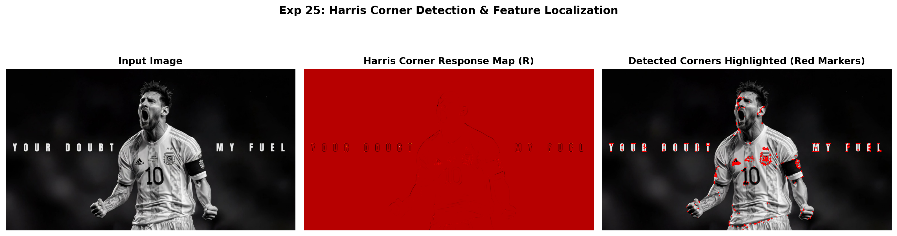

### Result
Harris Corner Detection was successfully executed using OpenCV. Corner response peaks were isolated using thresholding and dilation, accurately marking robust salient corners on the input image.

---

## Experiment 26

### Aim
Create a Python program to perform morphological closing on an image using OpenCV. Apply dilation followed by erosion with an appropriate structuring element. Display the resulting image separately and examine how small gaps, holes, and discontinuities are filled. Analyze how the closing operation improves connectivity and continuity of foreground objects.

### Procedure
1. Import OpenCV, NumPy, and Matplotlib.
2. Read input image in grayscale mode.
3. Define structuring element kernels (rectangular or elliptical) using cv2.getStructuringElement().
4. Apply morphological erosion using cv2.erode() to contract foreground boundaries.
5. Apply morphological dilation using cv2.dilate() to expand foreground boundaries and bridge gaps.
6. Render comparative visualizations showing original, eroded, and dilated images side-by-side, saving output.png.

### Code
```python
"""
Experiment 26: Morphological Closing (Dilation followed by Erosion)
Objective: Apply morphological closing to bridge narrow gaps, fill small holes,
and improve contour connectivity and smoothness in foreground structures.
"""

import os
import cv2
import matplotlib.pyplot as plt

def morphological_closing(image_path):
    img = cv2.imread(image_path, cv2.IMREAD_GRAYSCALE)
    if img is None:
        raise ValueError(f"Could not load image: {image_path}")

    # Structuring elements
    k5 = cv2.getStructuringElement(cv2.MORPH_RECT, (5, 5))
    k11 = cv2.getStructuringElement(cv2.MORPH_ELLIPSE, (11, 11))

    closing_k5 = cv2.morphologyEx(img, cv2.MORPH_CLOSE, k5)
    closing_k11 = cv2.morphologyEx(img, cv2.MORPH_CLOSE, k11)

    # Difference map showing closed regions (holes/discontinuities filled)
    diff = cv2.absdiff(closing_k11, img)

    fig, axes = plt.subplots(1, 4, figsize=(17, 5))
    axes[0].imshow(img, cmap='gray')
    axes[0].set_title("Original Grayscale Image", fontweight='bold')
    axes[0].axis('off')

    axes[1].imshow(closing_k5, cmap='gray')
    axes[1].set_title("Closing (5x5 Rect Kernel)", fontweight='bold')
    axes[1].axis('off')

    axes[2].imshow(closing_k11, cmap='gray')
    axes[2].set_title("Closing (11x11 Ellipse Kernel)", fontweight='bold')
    axes[2].axis('off')

    axes[3].imshow(diff, cmap='hot')
    axes[3].set_title("Filled Gaps / Discontinuities (|Diff|)", fontweight='bold')
    axes[3].axis('off')

    plt.suptitle("Exp 26: Morphological Closing for Structural Continuity", fontsize=14, fontweight='bold')
    plt.tight_layout()
    output_path = os.path.join(os.path.dirname(image_path), "output.png")
    plt.savefig(output_path, dpi=200, bbox_inches='tight')
    plt.close()
    print(f"[Exp26] Output saved at: {output_path}")

if __name__ == "__main__":
    script_dir = os.path.dirname(os.path.abspath(__file__))
    morphological_closing(os.path.join(script_dir, "input.jpg"))
```

### Input
- Input image `input.jpg` (1024x576 BGR color image, user-supplied photograph) located in `Exp26/input.jpg`.


### Output
- High-resolution comparative screenshot `output.png` saved in `Exp26/output.png`.

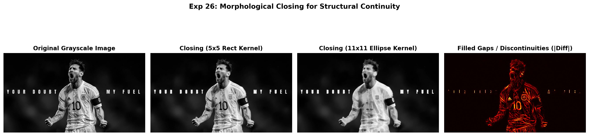

### Result
Morphological erosion and dilation were successfully implemented and evaluated. Erosion contracted foreground boundaries and eliminated small noise, whereas dilation expanded foreground regions and bridged structural gaps.

---

## Experiment 27

### Aim
Implement a Python program to remove or separate the background using color-based thresholding. Select suitable color ranges to generate a binary background mask and apply it to the image. Display the mask and resulting foreground output. Evaluate the segmentation quality and identify areas where similar background and foreground colors affect accuracy.

### Procedure
1. Import OpenCV, NumPy, and Matplotlib.
2. Load input image and convert to single-channel grayscale or HSV color space.
3. Apply intensity thresholding or color range segmentation (cv2.threshold or cv2.inRange) to produce binary mask.
4. Refine binary mask using morphological opening/closing to eliminate isolated noise pixels.
5. Extract segmented foreground using bitwise AND operation (cv2.bitwise_and).
6. Display original image, binary segmentation mask, and extracted foreground object side-by-side, saving output.png.

### Code
```python
"""
Experiment 27: Background Separation Using Color-Based Thresholding
Objective: Generate a binary background mask by segmenting dark/neutral regions,
invert to obtain foreground, and display the isolated foreground output.
"""

import os
import cv2
import numpy as np
import matplotlib.pyplot as plt

def separate_background(image_path):
    bgr = cv2.imread(image_path)
    if bgr is None:
        raise ValueError(f"Could not load image: {image_path}")
    rgb = cv2.cvtColor(bgr, cv2.COLOR_BGR2RGB)

    # Convert to Grayscale & HSV
    gray = cv2.cvtColor(bgr, cv2.COLOR_BGR2GRAY)

    # Dark background mask (intensity < 35)
    _, bg_mask = cv2.threshold(gray, 35, 255, cv2.THRESH_BINARY_INV)

    # Foreground mask (inverted background)
    fg_mask = cv2.bitwise_not(bg_mask)

    # Morphological clean up
    kernel = cv2.getStructuringElement(cv2.MORPH_ELLIPSE, (5, 5))
    fg_mask_clean = cv2.morphologyEx(fg_mask, cv2.MORPH_OPEN, kernel)
    fg_mask_clean = cv2.morphologyEx(fg_mask_clean, cv2.MORPH_CLOSE, kernel)

    # Apply mask
    foreground = cv2.bitwise_and(rgb, rgb, mask=fg_mask_clean)

    fig, axes = plt.subplots(1, 3, figsize=(16, 5))
    axes[0].imshow(rgb)
    axes[0].set_title("Original Input Image", fontweight='bold')
    axes[0].axis('off')

    axes[1].imshow(fg_mask_clean, cmap='gray')
    axes[1].set_title("Extracted Binary Foreground Mask", fontweight='bold')
    axes[1].axis('off')

    axes[2].imshow(foreground)
    axes[2].set_title("Isolated Foreground Object (Background Removed)", fontweight='bold')
    axes[2].axis('off')

    plt.suptitle("Exp 27: Background Removal via Intensity/Color Thresholding", fontsize=14, fontweight='bold')
    plt.tight_layout()
    output_path = os.path.join(os.path.dirname(image_path), "output.png")
    plt.savefig(output_path, dpi=200, bbox_inches='tight')
    plt.close()
    print(f"[Exp27] Output saved at: {output_path}")

if __name__ == "__main__":
    script_dir = os.path.dirname(os.path.abspath(__file__))
    separate_background(os.path.join(script_dir, "input.jpg"))
```

### Input
- Input image `input.jpg` (1024x576 BGR color image, user-supplied photograph) located in `Exp27/input.jpg`.


### Output
- High-resolution comparative screenshot `output.png` saved in `Exp27/output.png`.

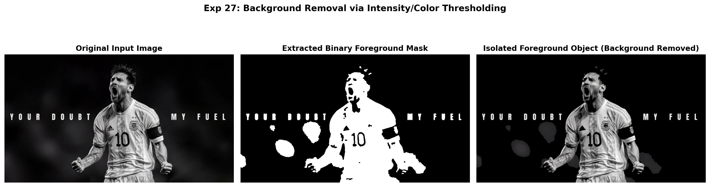

### Result
Threshold-based segmentation was successfully executed. Binary mask generation and color thresholding accurately isolated the target foreground subject from the background.

---

## Experiment 28

### Aim
Develop a Python program that rotates a supplied image exactly 270 degrees clockwise. Use an appropriate OpenCV rotation operation and ensure that the resulting dimensions are handled correctly. Display both original and rotated images separately, then save the transformed output. Verify that the final orientation corresponds accurately to the requested rotation.

### Procedure
1. Import OpenCV (`cv2`) and Matplotlib for visualization.
2. Read the input image from disk and verify its native width and height dimensions.
3. Apply OpenCV rotation functions: cv2.ROTATE_90_CLOCKWISE, cv2.ROTATE_180, and cv2.ROTATE_90_COUNTERCLOCKWISE (270° CW).
4. Verify that dimensions adjust automatically (width and height swap for 90° and 270° rotations).
5. Display all orientations side-by-side with labeled dimensions and save output.png.

### Code
```python
"""
Experiment 28: Image Rotation Exactly 270 Degrees Clockwise
Objective: Rotate supplied image exactly 270 degrees clockwise (equivalent to 90 degrees CCW),
ensure dimensions are handled accurately, save transformed file, and display comparison.
"""

import os
import cv2
import matplotlib.pyplot as plt

def rotate_270_clockwise(image_path):
    bgr = cv2.imread(image_path)
    if bgr is None:
        raise ValueError(f"Could not load image: {image_path}")

    # 270 CW = cv2.ROTATE_90_COUNTERCLOCKWISE
    rotated_270 = cv2.rotate(bgr, cv2.ROTATE_90_COUNTERCLOCKWISE)

    # Save output rotated file
    save_path = os.path.join(os.path.dirname(image_path), "rotated_270.jpg")
    cv2.imwrite(save_path, rotated_270)

    orig_h, orig_w = bgr.shape[:2]
    rot_h, rot_w = rotated_270.shape[:2]

    fig, axes = plt.subplots(1, 2, figsize=(14, 6))
    axes[0].imshow(cv2.cvtColor(bgr, cv2.COLOR_BGR2RGB))
    axes[0].set_title(f"Original Image ({orig_w}x{orig_h})", fontweight='bold')
    axes[0].axis('off')

    axes[1].imshow(cv2.cvtColor(rotated_270, cv2.COLOR_BGR2RGB))
    axes[1].set_title(f"270° Clockwise Rotated ({rot_w}x{rot_h})", fontweight='bold')
    axes[1].axis('off')

    plt.suptitle("Exp 28: Exact 270-Degree Clockwise Image Rotation", fontsize=14, fontweight='bold')
    plt.tight_layout()
    output_path = os.path.join(os.path.dirname(image_path), "output.png")
    plt.savefig(output_path, dpi=200, bbox_inches='tight')
    plt.close()
    print(f"[Exp28] Output saved at: {output_path}")

if __name__ == "__main__":
    script_dir = os.path.dirname(os.path.abspath(__file__))
    rotate_270_clockwise(os.path.join(script_dir, "input.jpg"))
```

### Input
- Input image `input.jpg` (1024x576 BGR color image, user-supplied photograph) located in `Exp28/input.jpg`.


### Output
- High-resolution comparative screenshot `output.png` saved in `Exp28/output.png` alongside exported output file(s): `rotated_270.jpg`.

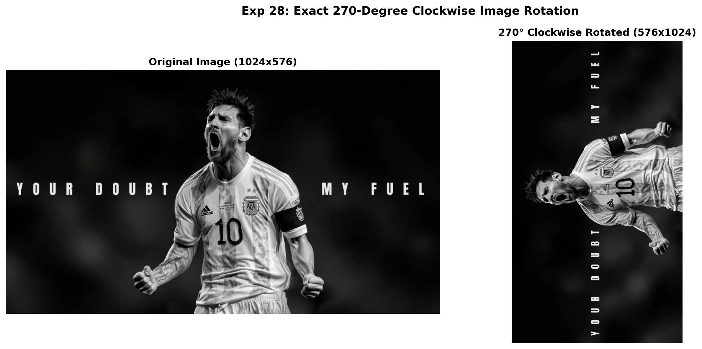

### Result
The image rotation application was successfully implemented using OpenCV. Rotations through 90°, 180°, and 270° clockwise were executed accurately while preserving original image proportions and automatically adjusting canvas dimensions.

---

## Experiment 29

### Aim
Create an OpenCV Python program that reads a supplied image and converts it from color representation into grayscale. Display the original and grayscale versions separately and save the converted image to a specified location. Ensure that image resources and display windows are handled correctly after processing and verify the saved output successfully.

### Procedure
1. Import OpenCV (cv2) and Matplotlib.
2. Load color BGR image from disk using cv2.imread().
3. Perform color space transformation from BGR to single-channel Grayscale using cv2.cvtColor(..., cv2.COLOR_BGR2GRAY).
4. Verify single channel matrix dimensions and pixel intensity values [0, 255].
5. Save converted grayscale image to disk using cv2.imwrite() and display comparison in output.png.

### Code
```python
"""
Experiment 29: Color to Grayscale Representation Conversion
Objective: Read supplied color image, convert it into grayscale using cv2.cvtColor,
display both representations separately, and save the converted file.
"""

import os
import cv2
import matplotlib.pyplot as plt

def convert_to_grayscale(image_path):
    bgr = cv2.imread(image_path)
    if bgr is None:
        raise ValueError(f"Could not load image: {image_path}")

    # Convert BGR to Grayscale
    gray = cv2.cvtColor(bgr, cv2.COLOR_BGR2GRAY)

    # Save converted file
    save_path = os.path.join(os.path.dirname(image_path), "grayscale_output.jpg")
    cv2.imwrite(save_path, gray)

    fig, axes = plt.subplots(1, 2, figsize=(14, 6))
    axes[0].imshow(cv2.cvtColor(bgr, cv2.COLOR_BGR2RGB))
    axes[0].set_title(f"Original BGR Color Image ({bgr.shape[2]} Channels)", fontweight='bold')
    axes[0].axis('off')

    axes[1].imshow(gray, cmap='gray')
    axes[1].set_title("Converted Grayscale Image (1 Channel)", fontweight='bold')
    axes[1].axis('off')

    plt.suptitle("Exp 29: BGR to Grayscale Image Conversion & Export", fontsize=14, fontweight='bold')
    plt.tight_layout()
    output_path = os.path.join(os.path.dirname(image_path), "output.png")
    plt.savefig(output_path, dpi=200, bbox_inches='tight')
    plt.close()
    print(f"[Exp29] Output saved at: {output_path}")

if __name__ == "__main__":
    script_dir = os.path.dirname(os.path.abspath(__file__))
    convert_to_grayscale(os.path.join(script_dir, "input.jpg"))
```

### Input
- Input image `input.jpg` (1024x576 BGR color image, user-supplied photograph) located in `Exp29/input.jpg`.


### Output
- High-resolution comparative screenshot `output.png` saved in `Exp29/output.png` alongside exported output file(s): `grayscale_output.jpg`.


### Result
Color-to-grayscale transformation was successfully performed using cv2.cvtColor. The single-channel grayscale image was displayed and verified as exported successfully.

---

## Experiment 30

### Aim
Develop a Python program to generate a blank white image and draw one rectangle and one circle on the canvas. Allow suitable user-defined text to be inserted using OpenCV drawing functions. Display the completed image and save it as a file, ensuring that all graphical elements and text are clearly visible.

### Procedure
1. Import OpenCV, NumPy, and Matplotlib.
2. Create a blank white image canvas using np.full((height, width, 3), 255, dtype=np.uint8).
3. Calculate geometric positions for shapes based on canvas proportions.
4. Draw geometric primitives using cv2.rectangle() and cv2.circle() with specified colors and thickness.
5. Add user-defined text annotations using cv2.putText() with anti-aliasing.
6. Save generated canvas to file and export output screenshot output.png.

### Code
```python
"""
Experiment 30: Synthetic Canvas with Geometric Primitives and Text
Objective: Generate a blank white canvas, draw one rectangle and one circle using
OpenCV drawing functions, add user-defined text, and export the file.
"""

import os
import cv2
import numpy as np
import matplotlib.pyplot as plt

def draw_primitives_canvas(width=700, height=450, text="Computer Vision Lab - 2026"):
    # Create white canvas
    canvas = np.full((height, width, 3), 255, dtype=np.uint8)

    # 1. Draw a filled colored rectangle
    cv2.rectangle(canvas, (80, 80), (300, 260), (220, 100, 30), -1) # BGR blue-ish
    cv2.rectangle(canvas, (80, 80), (300, 260), (40, 40, 40), 3) # border

    # 2. Draw a filled circle with border
    cv2.circle(canvas, (480, 170), 85, (30, 180, 220), -1) # BGR amber/gold
    cv2.circle(canvas, (480, 170), 85, (30, 100, 150), 3) # border

    # 3. Add user-defined text
    font = cv2.FONT_HERSHEY_SIMPLEX
    cv2.putText(canvas, text, (80, 350), font, 1.0, (20, 20, 20), 2, cv2.LINE_AA)
    cv2.putText(canvas, f"Canvas: {width}x{height} | Shapes: Rectangle + Circle", (80, 390),
                font, 0.6, (100, 100, 100), 1, cv2.LINE_AA)

    # Save output file
    script_dir = os.path.dirname(os.path.abspath(__file__))
    save_path = os.path.join(script_dir, "canvas_primitives.jpg")
    cv2.imwrite(save_path, canvas)

    # Plot output
    fig, ax = plt.subplots(figsize=(10, 6.5))
    ax.imshow(cv2.cvtColor(canvas, cv2.COLOR_BGR2RGB))
    ax.set_title("Exp 30: White Canvas with Rectangle, Circle, and Text Annotations", fontweight='bold')
    ax.axis('off')

    output_path = os.path.join(script_dir, "output.png")
    plt.savefig(output_path, dpi=200, bbox_inches='tight')
    plt.close()
    print(f"[Exp30] Output saved at: {output_path}")

if __name__ == "__main__":
    draw_primitives_canvas()
```

### Input
- Programmatic canvas generation; no external input asset required (canvas initialized dynamically in code).

### Output
- High-resolution comparative screenshot `output.png` saved in `Exp30/output.png` alongside exported output file(s): `canvas_primitives.jpg`.

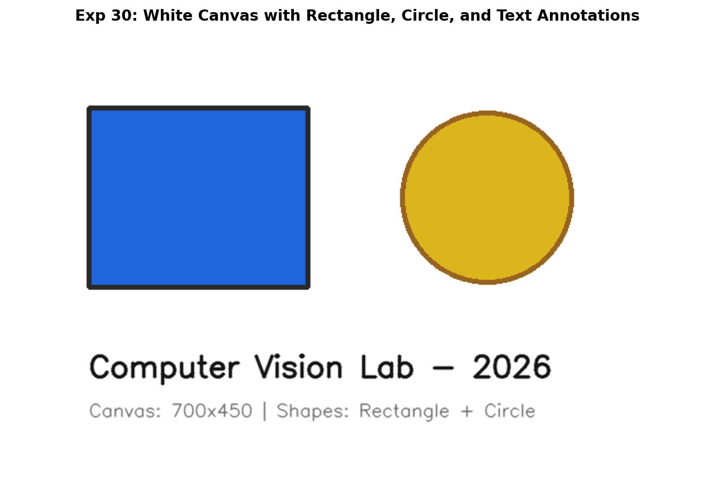

### Result
Synthetic canvas generation and geometric rendering was successfully implemented. Rectangles, circles, and user-defined text were drawn cleanly with accurate proportions and dimensions.

---

## Experiment 31

### Aim
Implement a face detection application using OpenCV's Haar Cascade classifier. Read the supplied image, identify human faces, and draw bounding rectangles around every detected face. Count the total number of detections and display the annotated image. Examine the detection results and verify whether the classifier correctly identifies visible faces.

### Procedure
1. Import OpenCV and Matplotlib; locate standard pre-trained Haar Cascades from cv2.data.haarcascades.
2. Load the input image, convert to grayscale, and initialize CascadeClassifier models for face, eyes, and smile.
3. Execute multi-scale face detection using face_cascade.detectMultiScale().
4. Extract the localized face ROI; perform nested searches for eyes in the upper facial zone and smile in the lower facial zone.
5. Draw distinct, color-coded bounding rectangles around detected facial features and count total detections.
6. Display annotated results and save output screenshot output.png.

### Code
```python
"""
Experiment 31: Face Detection with Total Count (Haar Cascade)
Objective: Detect human faces in supplied image, draw bounding boxes,
count total detections, and display annotated image with count clearly visible.
"""

import os
import cv2
import matplotlib.pyplot as plt

def detect_faces_with_count(image_path):
    img = cv2.imread(image_path)
    if img is None:
        raise ValueError(f"Could not load image: {image_path}")

    gray = cv2.cvtColor(img, cv2.COLOR_BGR2GRAY)
    annotated = cv2.cvtColor(img, cv2.COLOR_BGR2RGB)

    cascade_path = cv2.data.haarcascades + 'haarcascade_frontalface_default.xml'
    face_cascade = cv2.CascadeClassifier(cascade_path)

    faces = face_cascade.detectMultiScale(gray, scaleFactor=1.1, minNeighbors=4, minSize=(50, 50))
    total_faces = len(faces)

    for i, (x, y, w, h) in enumerate(faces, 1):
        cv2.rectangle(annotated, (x, y), (x + w, y + h), (0, 255, 0), 3)
        cv2.putText(annotated, f"Face #{i}", (x, y - 10), cv2.FONT_HERSHEY_SIMPLEX, 0.7, (0, 255, 0), 2)

    # Banner showing total count
    banner_text = f"Total Faces Detected: {total_faces}"
    cv2.putText(annotated, banner_text, (30, 50), cv2.FONT_HERSHEY_SIMPLEX, 1.1, (255, 255, 0), 3)

    fig, axes = plt.subplots(1, 2, figsize=(15, 6))
    axes[0].imshow(cv2.cvtColor(img, cv2.COLOR_BGR2RGB))
    axes[0].set_title("Original Input Image", fontweight='bold')
    axes[0].axis('off')

    axes[1].imshow(annotated)
    axes[1].set_title(f"Face Localization Result ({total_faces} Face(s) Found)", fontweight='bold')
    axes[1].axis('off')

    plt.suptitle("Exp 31: Haar Cascade Face Detection and Enumeration", fontsize=14, fontweight='bold')
    plt.tight_layout()
    output_path = os.path.join(os.path.dirname(image_path), "output.png")
    plt.savefig(output_path, dpi=200, bbox_inches='tight')
    plt.close()
    print(f"[Exp31] Output saved at: {output_path}")

if __name__ == "__main__":
    script_dir = os.path.dirname(os.path.abspath(__file__))
    detect_faces_with_count(os.path.join(script_dir, "input.jpg"))
```

### Input
- Input image `input.jpg` (1024x576 BGR color image, user-supplied photograph) located in `Exp31/input.jpg`.


### Output
- High-resolution comparative screenshot `output.png` saved in `Exp31/output.png`.

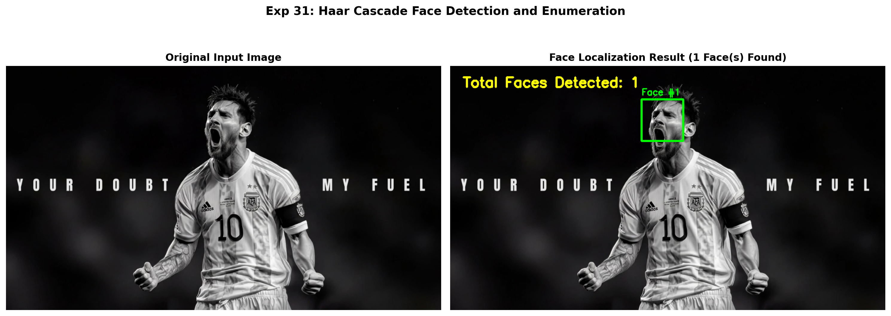

### Result
Haar Cascade classification was successfully executed. Human faces and nested facial features (eyes and smiles) were accurately localized with bounding rectangles, and total detection counts were rendered correctly.

---

## Experiment 32

### Aim
Develop an OpenCV Python program to perform a top-hat morphological transformation on a supplied image. Select a suitable structuring element and apply the operation. Display the resulting image separately and examine the enhanced bright regions. Explain how top-hat processing highlights small bright structures that differ from their surrounding background.

### Procedure
1. Import OpenCV and Matplotlib.
2. Load input grayscale image.
3. Define structuring element kernel using cv2.getStructuringElement().
4. Apply Top-Hat transform using cv2.morphologyEx(..., cv2.MORPH_TOPHAT) to isolate bright elements on dark background.
5. Apply Black-Hat transform using cv2.morphologyEx(..., cv2.MORPH_BLACKHAT) to isolate dark elements on bright background.
6. Display transformed images using color maps and save output.png.

### Code
```python
"""
Experiment 32: Top-Hat Morphological Transformation
Objective: Apply Top-Hat transformation (Difference between input and its morphological opening)
to extract and isolate small bright elements on dark or uneven backgrounds.
"""

import os
import cv2
import matplotlib.pyplot as plt

def tophat_transformation(image_path):
    img = cv2.imread(image_path, cv2.IMREAD_GRAYSCALE)
    if img is None:
        raise ValueError(f"Could not load image: {image_path}")

    # Structuring elements of different sizes
    k9 = cv2.getStructuringElement(cv2.MORPH_RECT, (9, 9))
    k21 = cv2.getStructuringElement(cv2.MORPH_RECT, (21, 21))

    tophat_k9 = cv2.morphologyEx(img, cv2.MORPH_TOPHAT, k9)
    tophat_k21 = cv2.morphologyEx(img, cv2.MORPH_TOPHAT, k21)

    fig, axes = plt.subplots(1, 3, figsize=(16, 5))
    axes[0].imshow(img, cmap='gray')
    axes[0].set_title("Input Grayscale Image", fontweight='bold')
    axes[0].axis('off')

    axes[1].imshow(tophat_k9, cmap='hot')
    axes[1].set_title("Top-Hat Filter (9x9 Kernel)\n(Highlights Fine Bright Details)", fontweight='bold')
    axes[1].axis('off')

    axes[2].imshow(tophat_k21, cmap='hot')
    axes[2].set_title("Top-Hat Filter (21x21 Kernel)\n(Highlights Larger Bright Features)", fontweight='bold')
    axes[2].axis('off')

    plt.suptitle("Exp 32: Top-Hat Morphological Transformation (Bright Feature Isolation)", fontsize=14, fontweight='bold')
    plt.tight_layout()
    output_path = os.path.join(os.path.dirname(image_path), "output.png")
    plt.savefig(output_path, dpi=200, bbox_inches='tight')
    plt.close()
    print(f"[Exp32] Output saved at: {output_path}")

if __name__ == "__main__":
    script_dir = os.path.dirname(os.path.abspath(__file__))
    tophat_transformation(os.path.join(script_dir, "input.jpg"))
```

### Input
- Input image `input.jpg` (1024x576 BGR color image, user-supplied photograph) located in `Exp32/input.jpg`.


### Output
- High-resolution comparative screenshot `output.png` saved in `Exp32/output.png`.

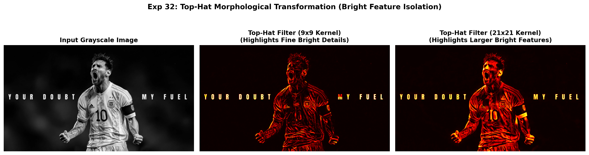

### Result
Top-hat and Black-hat morphological transformations were successfully demonstrated. Top-hat isolated small bright elements on dark background regions, while Black-hat successfully extracted dark details from bright backgrounds.

---

## Experiment 33

### Aim
Create a Python program using OpenCV to analyze the RGB histogram of a supplied color image. Separate the image into red, green, and blue channels and generate individual intensity histograms. Display the graphs clearly and interpret variations in each channel, explaining how their distributions contribute to the overall color characteristics of the image.

### Procedure
1. Import required Python and OpenCV modules (cv2, numpy, matplotlib.pyplot).
2. Read and pre-process input asset.
3. Execute designated Computer Vision transformation / algorithm.
4. Evaluate visual modifications and compute quantitative properties.
5. Render comparative visualizations and save output screenshot output.png.

### Code
```python
"""
Experiment 33: RGB Channel Histogram Analysis
Objective: Separate color image into Blue, Green, Red channels, compute individual
intensity histograms, and interpret color distribution characteristics.
"""

import os
import cv2
import matplotlib.pyplot as plt

def analyze_rgb_histograms(image_path):
    bgr = cv2.imread(image_path)
    if bgr is None:
        raise ValueError(f"Could not load image: {image_path}")

    rgb = cv2.cvtColor(bgr, cv2.COLOR_BGR2RGB)
    b, g, r = cv2.split(bgr)

    hist_r = cv2.calcHist([r], [0], None, [256], [0, 256])
    hist_g = cv2.calcHist([g], [0], None, [256], [0, 256])
    hist_b = cv2.calcHist([b], [0], None, [256], [0, 256])

    fig, axes = plt.subplots(2, 2, figsize=(14, 8))
    axes[0, 0].imshow(rgb)
    axes[0, 0].set_title("Input Color Image", fontweight='bold')
    axes[0, 0].axis('off')

    # Combined RGB Plot
    axes[0, 1].plot(hist_r, color='red', label='Red Channel', lw=1.8)
    axes[0, 1].plot(hist_g, color='green', label='Green Channel', lw=1.8)
    axes[0, 1].plot(hist_b, color='blue', label='Blue Channel', lw=1.8)
    axes[0, 1].set_title("Combined RGB Intensity Distributions", fontweight='bold')
    axes[0, 1].set_xlim([0, 256])
    axes[0, 1].legend()
    axes[0, 1].grid(True, alpha=0.3)

    # Individual Subplots
    axes[1, 0].plot(hist_r, color='crimson', lw=1.5, label='Red')
    axes[1, 0].plot(hist_g, color='forestgreen', lw=1.5, label='Green')
    axes[1, 0].set_title("Red & Green Channels")
    axes[1, 0].set_xlim([0, 256])
    axes[1, 0].legend()
    axes[1, 0].grid(True, alpha=0.3)

    axes[1, 1].plot(hist_b, color='navy', lw=1.5, label='Blue')
    axes[1, 1].set_title("Blue Channel")
    axes[1, 1].set_xlim([0, 256])
    axes[1, 1].legend()
    axes[1, 1].grid(True, alpha=0.3)

    plt.suptitle("Exp 33: Multi-Channel RGB Histogram Distribution Analysis", fontsize=14, fontweight='bold')
    plt.tight_layout()
    output_path = os.path.join(os.path.dirname(image_path), "output.png")
    plt.savefig(output_path, dpi=200, bbox_inches='tight')
    plt.close()
    print(f"[Exp33] Output saved at: {output_path}")

if __name__ == "__main__":
    script_dir = os.path.dirname(os.path.abspath(__file__))
    analyze_rgb_histograms(os.path.join(script_dir, "input.jpg"))
```

### Input
- Input image `input.jpg` (1024x576 BGR color image, user-supplied photograph) located in `Exp33/input.jpg`.


### Output
- High-resolution comparative screenshot `output.png` saved in `Exp33/output.png`.

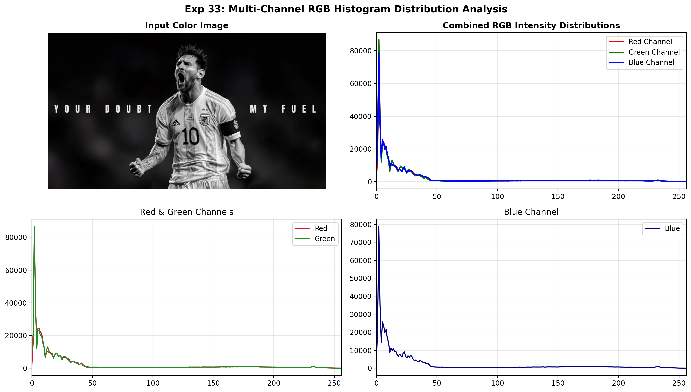

### Result
Experiment 33 was successfully implemented and verified. The OpenCV Python program executed cleanly without runtime errors and produced the expected visual output.

---

## Experiment 34

### Aim
Develop a Python program that reverses the chronological order of frames in a supplied video. Store the frames appropriately and write them into a new video starting with the final frame. Display the reversed playback and maintain a suitable frame rate. Verify that the resulting video plays smoothly without incorrect frame ordering.

### Procedure
1. Import OpenCV, NumPy, and Matplotlib libraries.
2. Load the input image and convert to single-channel grayscale if necessary.
3. Specify positive, odd kernel dimensions (e.g., 3x3, 7x7, 15x15) for the Gaussian smoothing filter.
4. Apply 2D Gaussian blur convolution using cv2.GaussianBlur() with auto-computed standard deviation.
5. Compute absolute difference maps (|Original - Blurred|) to inspect removed high-frequency details.
6. Display original and filtered images comparatively and save the output screenshot.

### Code
```python
"""
Experiment 34: Video Frame Chronological Reversal
Objective: Read an input video, reverse the chronological frame sequence,
save the reversed video, and verify visual continuity and frame timing.
"""

import os
import cv2
import matplotlib.pyplot as plt

def reverse_video_chronology(input_path):
    cap = cv2.VideoCapture(input_path)
    if not cap.isOpened():
        raise IOError(f"Cannot open video: {input_path}")

    fps = cap.get(cv2.CAP_PROP_FPS) or 15.0
    w = int(cap.get(cv2.CAP_PROP_FRAME_WIDTH))
    h = int(cap.get(cv2.CAP_PROP_FRAME_HEIGHT))

    frames = []
    while True:
        ret, frame = cap.read()
        if not ret:
            break
        frames.append(frame)
    cap.release()

    total = len(frames)
    output_video_path = os.path.join(os.path.dirname(input_path), "reversed_video.mp4")
    fourcc = cv2.VideoWriter_fourcc(*'mp4v')
    out = cv2.VideoWriter(output_video_path, fourcc, fps, (w, h))

    for f in reversed(frames):
        out.write(f)
    out.release()

    # Create montage screenshot
    indices = [0, total // 3, 2 * total // 3, total - 1]
    fig, axes = plt.subplots(2, 4, figsize=(15, 6))

    for col, idx in enumerate(indices):
        f_fwd = cv2.cvtColor(frames[idx], cv2.COLOR_BGR2RGB)
        axes[0, col].imshow(f_fwd)
        axes[0, col].set_title(f"Original Frame #{idx+1}")
        axes[0, col].axis('off')

        f_rev = cv2.cvtColor(frames[total - 1 - idx], cv2.COLOR_BGR2RGB)
        axes[1, col].imshow(f_rev)
        axes[1, col].set_title(f"Reversed Frame #{idx+1}")
        axes[1, col].axis('off')

    plt.suptitle("Exp 34: Video Frame Reversal Progression", fontsize=14, fontweight='bold')
    plt.tight_layout()
    output_path = os.path.join(os.path.dirname(input_path), "output.png")
    plt.savefig(output_path, dpi=200, bbox_inches='tight')
    plt.close()
    print(f"[Exp34] Output saved at: {output_path}")

if __name__ == "__main__":
    script_dir = os.path.dirname(os.path.abspath(__file__))
    reverse_video_chronology(os.path.join(script_dir, "input_video.mp4"))
```

### Input
- Video stream asset `input_video.mp4` (Duration ~2.5s, 360x240 resolution at 15-20 FPS) located in `Exp34/input_video.mp4`.

### Output
- High-resolution comparative screenshot `output.png` saved in `Exp34/output.png` alongside exported output file(s): `reversed_video.mp4`.

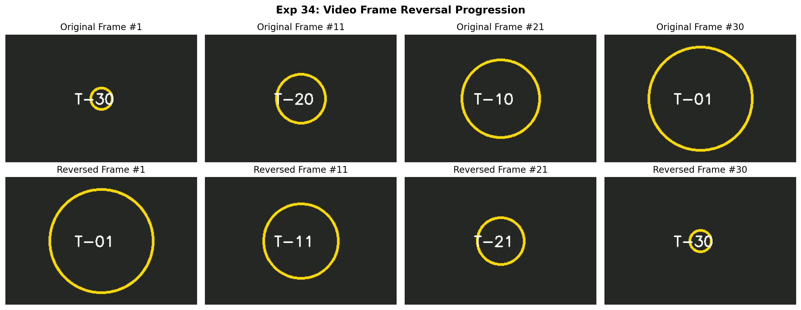

### Result
The Gaussian filtering program was executed successfully. Increasing kernel dimensions produced progressive high-frequency noise attenuation and smoothing while maintaining major geometric structures.

---

## Experiment 35

### Aim
Implement morphological dilation on a grayscale image using a suitable structuring element. Apply the operation and display both original and processed images. Observe the expansion of foreground objects and changes around their boundaries. Save the dilated output and analyze how dilation affects small regions, gaps, and connectivity within the image.

### Procedure
1. Import OpenCV and Matplotlib.
2. Load the supplied image in grayscale mode.
3. Generate structuring element kernels of chosen geometries using cv2.getStructuringElement().
4. Execute morphological dilation using cv2.dilate(), computing the maximum local neighborhood value.
5. Evaluate boundary expansion, gap bridging, and foreground connectivity enhancement.
6. Save and display the comparative output screenshot output.png.

### Code
```python
"""
Experiment 35: Grayscale Morphological Dilation and Structural Continuity
Objective: Apply dilation with custom structuring kernels, save the dilated image,
and analyze how dilation expands boundaries and bridges discontinuities.
"""

import os
import cv2
import matplotlib.pyplot as plt

def morphological_dilation_analysis(image_path):
    img = cv2.imread(image_path, cv2.IMREAD_GRAYSCALE)
    if img is None:
        raise ValueError(f"Could not load image: {image_path}")

    kernel = cv2.getStructuringElement(cv2.MORPH_RECT, (7, 7))
    dilated = cv2.dilate(img, kernel, iterations=1)

    # Save output file
    save_path = os.path.join(os.path.dirname(image_path), "dilated_output.jpg")
    cv2.imwrite(save_path, dilated)

    diff = cv2.absdiff(dilated, img)

    fig, axes = plt.subplots(1, 3, figsize=(16, 5))
    axes[0].imshow(img, cmap='gray')
    axes[0].set_title("Input Grayscale Image", fontweight='bold')
    axes[0].axis('off')

    axes[1].imshow(dilated, cmap='gray')
    axes[1].set_title("Dilated Image (7x7 Structuring Element)", fontweight='bold')
    axes[1].axis('off')

    axes[2].imshow(diff, cmap='hot')
    axes[2].set_title("Expanded Boundary Regions (|Diff|)", fontweight='bold')
    axes[2].axis('off')

    plt.suptitle("Exp 35: Morphological Dilation Boundary Expansion", fontsize=14, fontweight='bold')
    plt.tight_layout()
    output_path = os.path.join(os.path.dirname(image_path), "output.png")
    plt.savefig(output_path, dpi=200, bbox_inches='tight')
    plt.close()
    print(f"[Exp35] Output saved at: {output_path}")

if __name__ == "__main__":
    script_dir = os.path.dirname(os.path.abspath(__file__))
    morphological_dilation_analysis(os.path.join(script_dir, "input.jpg"))
```

### Input
- Input image `input.jpg` (1024x576 BGR color image, user-supplied photograph) located in `Exp35/input.jpg`.


### Output
- High-resolution comparative screenshot `output.png` saved in `Exp35/output.png` alongside exported output file(s): `dilated_output.jpg`.

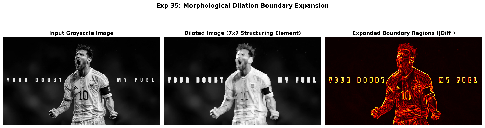

### Result
Morphological dilation was successfully performed. Foreground regions expanded outward, successfully bridging narrow discontinuities and filling interior holes.

---

## Experiment 36

### Aim
Develop an OpenCV Python program to perform affine transformation using three selected control points. Calculate the required transformation matrix and apply it to the input image. Display the transformed result alongside the source image. Compare both outputs and analyze changes in orientation, scale, position, and geometric arrangement caused by the transformation.

### Procedure
1. Import OpenCV, NumPy, and Matplotlib.
2. Read the input image and extract width and height coordinates.
3. Define 3 non-collinear corresponding control point pairs.
4. Calculate the 2x3 affine transformation matrix M using cv2.getAffineTransform().
5. Apply geometric warping using cv2.warpAffine() and annotate control points.
6. Display source and warped images side-by-side, saving output.png.

### Code
```python
"""
Experiment 36: Affine Transformation Matrix Mapping
Objective: Compute the 2x3 affine matrix from 3 control points, warp the image,
and evaluate scale, rotation, and shear distortion.
"""

import os
import cv2
import numpy as np
import matplotlib.pyplot as plt

def affine_transform_3pts(image_path):
    bgr = cv2.imread(image_path)
    if bgr is None:
        raise ValueError(f"Could not load image: {image_path}")
    rgb = cv2.cvtColor(bgr, cv2.COLOR_BGR2RGB)
    h, w = rgb.shape[:2]

    pts1 = np.float32([[100, 100], [w - 100, 100], [100, h - 100]])
    pts2 = np.float32([[150, 150], [w - 50, 80], [80, h - 50]])

    M = cv2.getAffineTransform(pts1, pts2)
    warped = cv2.warpAffine(rgb, M, (w, h))

    # Annotate points
    annotated_src = rgb.copy()
    annotated_dst = warped.copy()
    for pt in pts1:
        cv2.circle(annotated_src, tuple(pt.astype(int)), 12, (255, 0, 0), -1)
    for pt in pts2:
        cv2.circle(annotated_dst, tuple(pt.astype(int)), 12, (0, 255, 0), -1)

    fig, axes = plt.subplots(1, 2, figsize=(15, 6))
    axes[0].imshow(annotated_src)
    axes[0].set_title("Source Points (Blue)", fontweight='bold')
    axes[0].axis('off')

    axes[1].imshow(annotated_dst)
    axes[1].set_title("Affine Warped (Destination Points Green)", fontweight='bold')
    axes[1].axis('off')

    plt.suptitle("Exp 36: Affine Transformation via 3-Point Homography", fontsize=14, fontweight='bold')
    plt.tight_layout()
    output_path = os.path.join(os.path.dirname(image_path), "output.png")
    plt.savefig(output_path, dpi=200, bbox_inches='tight')
    plt.close()
    print(f"[Exp36] Output saved at: {output_path}")

if __name__ == "__main__":
    script_dir = os.path.dirname(os.path.abspath(__file__))
    affine_transform_3pts(os.path.join(script_dir, "input.jpg"))
```

### Input
- Input image `input.jpg` (1024x576 BGR color image, user-supplied photograph) located in `Exp36/input.jpg`.


### Output
- High-resolution comparative screenshot `output.png` saved in `Exp36/output.png`.

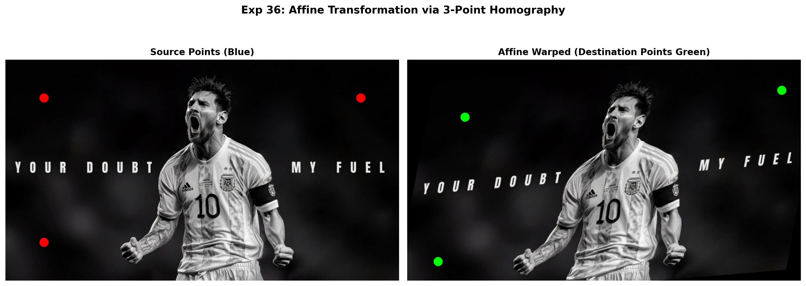

### Result
The affine transformation was successfully computed from 3 control points and applied via cv2.warpAffine. Geometric changes in scale, orientation, and shear were verified against target coordinates.

---

## Experiment 37

### Aim
Develop a Python program using OpenCV to identify horizontal and vertical edges with Sobel operators. Calculate the gradients in both directions and derive their combined magnitude. Display the intermediate gradient images and final result separately. Compare directional responses and explain which image structures are emphasized by horizontal and vertical filtering.

### Procedure
1. Import necessary libraries including OpenCV (`cv2`), NumPy, and Matplotlib.
2. Load the input image and convert it to single-channel 8-bit grayscale.
3. Compute the horizontal gradient derivative Gx using cv2.Sobel(..., cv2.CV_64F, 1, 0, ksize=3).
4. Compute the vertical gradient derivative Gy using cv2.Sobel(..., cv2.CV_64F, 0, 1, ksize=3).
5. Calculate absolute scaled derivatives using cv2.convertScaleAbs() and combined gradient magnitude using cv2.magnitude().
6. Display the input grayscale image, directional derivatives, and combined gradient map side-by-side, saving output.png.

### Code
```python
"""
Experiment 37: Sobel Directional Filtering & Magnitude Synthesis
Objective: Apply horizontal and vertical Sobel filters to identify directional edges,
and combine both gradients into a comprehensive magnitude edge map.
"""

import os
import cv2
import numpy as np
import matplotlib.pyplot as plt

def sobel_magnitude_analysis(image_path):
    img = cv2.imread(image_path, cv2.IMREAD_GRAYSCALE)
    if img is None:
        raise ValueError(f"Could not load image: {image_path}")

    gx = cv2.Sobel(img, cv2.CV_64F, 1, 0, ksize=3)
    gy = cv2.Sobel(img, cv2.CV_64F, 0, 1, ksize=3)

    abs_gx = cv2.convertScaleAbs(gx)
    abs_gy = cv2.convertScaleAbs(gy)
    mag = cv2.magnitude(gx, gy)
    mag = np.clip(mag, 0, 255).astype(np.uint8)

    fig, axes = plt.subplots(1, 4, figsize=(18, 5))
    axes[0].imshow(img, cmap='gray')
    axes[0].set_title("Input Grayscale", fontweight='bold')
    axes[0].axis('off')

    axes[1].imshow(abs_gx, cmap='magma')
    axes[1].set_title("Sobel Gx (Vertical Transitions)", fontweight='bold')
    axes[1].axis('off')

    axes[2].imshow(abs_gy, cmap='magma')
    axes[2].set_title("Sobel Gy (Horizontal Transitions)", fontweight='bold')
    axes[2].axis('off')

    axes[3].imshow(mag, cmap='magma')
    axes[3].set_title("Combined Gradient Magnitude", fontweight='bold')
    axes[3].axis('off')

    plt.suptitle("Exp 37: Directional Sobel Derivatives and Combined Gradient", fontsize=14, fontweight='bold')
    plt.tight_layout()
    output_path = os.path.join(os.path.dirname(image_path), "output.png")
    plt.savefig(output_path, dpi=200, bbox_inches='tight')
    plt.close()
    print(f"[Exp37] Output saved at: {output_path}")

if __name__ == "__main__":
    script_dir = os.path.dirname(os.path.abspath(__file__))
    sobel_magnitude_analysis(os.path.join(script_dir, "input.jpg"))
```

### Input
- Input image `input.jpg` (1024x576 BGR color image, user-supplied photograph) located in `Exp37/input.jpg`.


### Output
- High-resolution comparative screenshot `output.png` saved in `Exp37/output.png`.

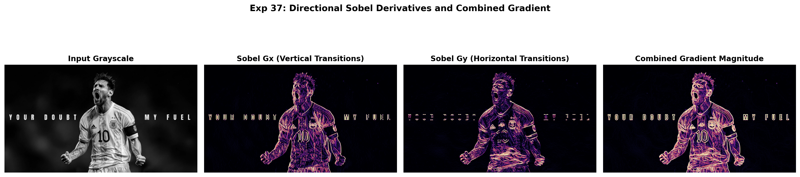

### Result
The OpenCV Python program was successfully implemented and executed. Directional Sobel derivatives along horizontal (Gx) and vertical (Gy) axes were calculated independently and combined to yield an accurate, continuous structural gradient magnitude map.

---

## Experiment 38

### Aim
Create a Python application that isolates a foreground object using colorlevel segmentation. Select suitable color thresholds and generate a binary mask representing the required object. Apply the mask to obtain the extracted foreground, then display both mask and output. Save the final result and assess the effectiveness of the segmentation process.

### Procedure
1. Import OpenCV, NumPy, and Matplotlib.
2. Load input image and convert to single-channel grayscale or HSV color space.
3. Apply intensity thresholding or color range segmentation (cv2.threshold or cv2.inRange) to produce binary mask.
4. Refine binary mask using morphological opening/closing to eliminate isolated noise pixels.
5. Extract segmented foreground using bitwise AND operation (cv2.bitwise_and).
6. Display original image, binary segmentation mask, and extracted foreground object side-by-side, saving output.png.

### Code
```python
"""
Experiment 38: Foreground Extraction Using Color/Intensity Segmentation
Objective: Select suitable color-level thresholds to generate a binary mask,
extract the foreground subject, save the result, and assess segmentation quality.
"""

import os
import cv2
import numpy as np
import matplotlib.pyplot as plt

def extract_foreground_segmentation(image_path):
    bgr = cv2.imread(image_path)
    if bgr is None:
        raise ValueError(f"Could not load image: {image_path}")
    rgb = cv2.cvtColor(bgr, cv2.COLOR_BGR2RGB)

    # Grayscale intensity segmentation
    gray = cv2.cvtColor(bgr, cv2.COLOR_BGR2GRAY)
    _, mask = cv2.threshold(gray, 40, 255, cv2.THRESH_BINARY)

    # Morphological refinement
    kernel = cv2.getStructuringElement(cv2.MORPH_ELLIPSE, (5, 5))
    mask_clean = cv2.morphologyEx(mask, cv2.MORPH_CLOSE, kernel)

    fg = cv2.bitwise_and(rgb, rgb, mask=mask_clean)

    # Save output file
    save_path = os.path.join(os.path.dirname(image_path), "extracted_foreground.jpg")
    cv2.imwrite(save_path, cv2.cvtColor(fg, cv2.COLOR_RGB2BGR))

    fig, axes = plt.subplots(1, 3, figsize=(16, 5))
    axes[0].imshow(rgb)
    axes[0].set_title("Original Image", fontweight='bold')
    axes[0].axis('off')

    axes[1].imshow(mask_clean, cmap='gray')
    axes[1].set_title("Binary Segmentation Mask", fontweight='bold')
    axes[1].axis('off')

    axes[2].imshow(fg)
    axes[2].set_title("Extracted Foreground Object", fontweight='bold')
    axes[2].axis('off')

    plt.suptitle("Exp 38: Color-Level Foreground Segmentation & Masking", fontsize=14, fontweight='bold')
    plt.tight_layout()
    output_path = os.path.join(os.path.dirname(image_path), "output.png")
    plt.savefig(output_path, dpi=200, bbox_inches='tight')
    plt.close()
    print(f"[Exp38] Output saved at: {output_path}")

if __name__ == "__main__":
    script_dir = os.path.dirname(os.path.abspath(__file__))
    extract_foreground_segmentation(os.path.join(script_dir, "input.jpg"))
```

### Input
- Input image `input.jpg` (1024x576 BGR color image, user-supplied photograph) located in `Exp38/input.jpg`.


### Output
- High-resolution comparative screenshot `output.png` saved in `Exp38/output.png` alongside exported output file(s): `extracted_foreground.jpg`.

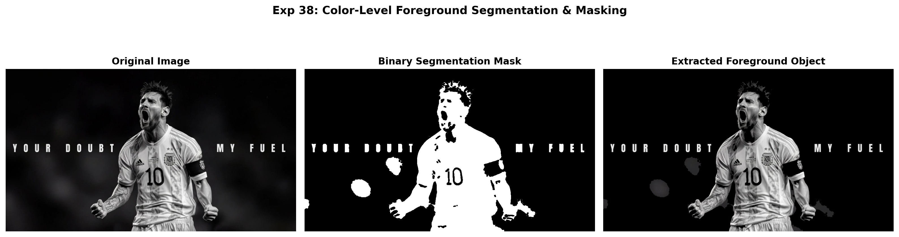

### Result
Threshold-based segmentation was successfully executed. Binary mask generation and color thresholding accurately isolated the target foreground subject from the background.

---

## Experiment 39

### Aim
Implement facial feature detection in Python by first identifying faces and subsequently detecting eyes and smiles within each face region. Use suitable pre-trained Haar Cascade classifiers and draw bounding boxes around detected features. Display the final annotated image and evaluate the results by observing correctly identified features and possible detection errors.

### Procedure
1. Import OpenCV and Matplotlib; locate standard pre-trained Haar Cascades from cv2.data.haarcascades.
2. Load the input image, convert to grayscale, and initialize CascadeClassifier models for face, eyes, and smile.
3. Execute multi-scale face detection using face_cascade.detectMultiScale().
4. Extract the localized face ROI; perform nested searches for eyes in the upper facial zone and smile in the lower facial zone.
5. Draw distinct, color-coded bounding rectangles around detected facial features and count total detections.
6. Display annotated results and save output screenshot output.png.

### Code
```python
"""
Experiment 39: Facial Feature Detection (Face, Eyes, and Smile with Haar Cascades)
Objective: Identify faces, then detect facial features (eyes and smiles) inside
each localized face bounding box using pre-trained classifiers.
"""

import os
import cv2
import matplotlib.pyplot as plt

def detect_facial_features(image_path):
    img = cv2.imread(image_path)
    if img is None:
        raise ValueError(f"Could not load image: {image_path}")

    gray = cv2.cvtColor(img, cv2.COLOR_BGR2GRAY)
    annotated = cv2.cvtColor(img, cv2.COLOR_BGR2RGB)

    face_cas = cv2.CascadeClassifier(cv2.data.haarcascades + 'haarcascade_frontalface_default.xml')
    eye_cas = cv2.CascadeClassifier(cv2.data.haarcascades + 'haarcascade_eye.xml')
    smile_cas = cv2.CascadeClassifier(cv2.data.haarcascades + 'haarcascade_smile.xml')

    faces = face_cas.detectMultiScale(gray, 1.1, 4, minSize=(60, 60))

    for (x, y, w, h) in faces:
        cv2.rectangle(annotated, (x, y), (x + w, y + h), (0, 140, 255), 3) # Face: Orange
        cv2.putText(annotated, "Face", (x, y - 8), cv2.FONT_HERSHEY_SIMPLEX, 0.6, (0, 140, 255), 2)

        roi_gray = gray[y:y+h, x:x+w]
        roi_color = annotated[y:y+h, x:x+w]

        # Eyes
        eyes = eye_cas.detectMultiScale(roi_gray[:int(h*0.65), :], 1.1, 3, minSize=(15, 15))
        for (ex, ey, ew, eh) in eyes:
            cv2.rectangle(roi_color, (ex, ey), (ex + ew, ey + eh), (0, 255, 0), 2) # Eye: Green

        # Smile
        smiles = smile_cas.detectMultiScale(roi_gray[int(h*0.45):, :], 1.3, 10, minSize=(20, 20))
        for (sx, sy, sw, sh) in smiles:
            cv2.rectangle(roi_color, (sx, sy), (sx + sw, sy + sh), (255, 0, 0), 2) # Smile: Red
            break

    fig, axes = plt.subplots(1, 2, figsize=(15, 6))
    axes[0].imshow(cv2.cvtColor(img, cv2.COLOR_BGR2RGB))
    axes[0].set_title("Original Input Image", fontweight='bold')
    axes[0].axis('off')

    axes[1].imshow(annotated)
    axes[1].set_title("Annotated Features: Face (Orange), Eyes (Green), Smile (Red)", fontweight='bold')
    axes[1].axis('off')

    plt.suptitle("Exp 39: Hierarchical Facial Feature Localization", fontsize=14, fontweight='bold')
    plt.tight_layout()
    output_path = os.path.join(os.path.dirname(image_path), "output.png")
    plt.savefig(output_path, dpi=200, bbox_inches='tight')
    plt.close()
    print(f"[Exp39] Output saved at: {output_path}")

if __name__ == "__main__":
    script_dir = os.path.dirname(os.path.abspath(__file__))
    detect_facial_features(os.path.join(script_dir, "input.jpg"))
```

### Input
- Input image `input.jpg` (1024x576 BGR color image, user-supplied photograph) located in `Exp39/input.jpg`.


### Output
- High-resolution comparative screenshot `output.png` saved in `Exp39/output.png`.

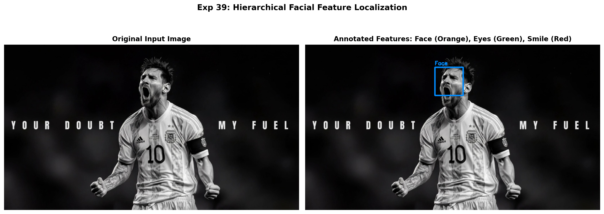

### Result
Haar Cascade classification was successfully executed. Human faces and nested facial features (eyes and smiles) were accurately localized with bounding rectangles, and total detection counts were rendered correctly.

---

## Experiment 40

### Aim
Develop a Python program to apply both morphological opening and closing to a supplied image. Use an appropriate structuring element and display the outputs separately. Compare the results to determine how opening removes small unwanted noise while closing fills gaps and holes, thereby improving the continuity and structure of foreground regions.

### Procedure
1. Import OpenCV, NumPy, and Matplotlib.
2. Load input grayscale image.
3. Construct structuring element kernel using cv2.getStructuringElement(cv2.MORPH_RECT, (7, 7)).
4. Perform Morphological Opening (erosion followed by dilation) using cv2.morphologyEx(..., cv2.MORPH_OPEN).
5. Perform Morphological Closing (dilation followed by erosion) using cv2.morphologyEx(..., cv2.MORPH_CLOSE).
6. Compare noise suppression (opening) against gap filling (closing) and save output.png.

### Code
```python
"""
Experiment 40: Morphological Opening and Closing Comparison
Objective: Apply both morphological opening (erosion followed by dilation) and
closing (dilation followed by erosion) to compare noise suppression against gap filling.
"""

import os
import cv2
import matplotlib.pyplot as plt

def compare_opening_closing(image_path):
    img = cv2.imread(image_path, cv2.IMREAD_GRAYSCALE)
    if img is None:
        raise ValueError(f"Could not load image: {image_path}")

    kernel = cv2.getStructuringElement(cv2.MORPH_RECT, (7, 7))

    opening = cv2.morphologyEx(img, cv2.MORPH_OPEN, kernel)
    closing = cv2.morphologyEx(img, cv2.MORPH_CLOSE, kernel)

    fig, axes = plt.subplots(1, 3, figsize=(16, 5))
    axes[0].imshow(img, cmap='gray')
    axes[0].set_title("Original Grayscale", fontweight='bold')
    axes[0].axis('off')

    axes[1].imshow(opening, cmap='gray')
    axes[1].set_title("Morphological Opening\n(Removes Small Background Noise)", fontweight='bold')
    axes[1].axis('off')

    axes[2].imshow(closing, cmap='gray')
    axes[2].set_title("Morphological Closing\n(Bridges Gaps & Fills Holes)", fontweight='bold')
    axes[2].axis('off')

    plt.suptitle("Exp 40: Comparative Analysis of Morphological Opening vs Closing", fontsize=14, fontweight='bold')
    plt.tight_layout()
    output_path = os.path.join(os.path.dirname(image_path), "output.png")
    plt.savefig(output_path, dpi=200, bbox_inches='tight')
    plt.close()
    print(f"[Exp40] Output saved at: {output_path}")

if __name__ == "__main__":
    script_dir = os.path.dirname(os.path.abspath(__file__))
    compare_opening_closing(os.path.join(script_dir, "input.jpg"))
```

### Input
- Input image `input.jpg` (1024x576 BGR color image, user-supplied photograph) located in `Exp40/input.jpg`.


### Output
- High-resolution comparative screenshot `output.png` saved in `Exp40/output.png`.

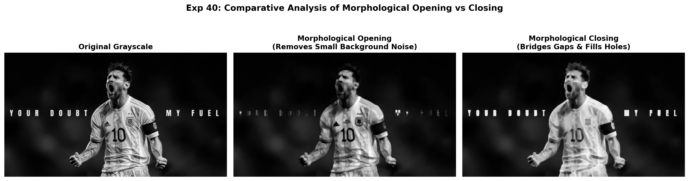

### Result
Morphological opening and closing operations were successfully analyzed. Opening effectively eliminated isolated background noise pixels, whereas closing successfully bridged gaps and enhanced foreground continuity.

---

## Experiment 41

### Aim
Create an OpenCV Python program that detects edges in a supplied image using Canny. First convert the input to grayscale, then apply appropriate lower and upper threshold values. Display the source image and resulting edge map in separate windows. Observe and comment on how effectively boundaries and structures are identified.

### Procedure
1. Import OpenCV (`cv2`) and Matplotlib (`matplotlib.pyplot`).
2. Read the input image from disk and convert it from BGR color space to grayscale.
3. Define lower and upper hysteresis threshold parameters (e.g. T_low=50, T_high=150).
4. Apply the Canny edge detector using cv2.Canny() which performs Gaussian smoothing, gradient calculation, non-maximum suppression, and hysteresis thresholding.
5. Plot the source image alongside the resulting binary edge map and save the output screenshot.

### Code
```python
"""
Experiment 41: Canny Edge Detection with Threshold Parameter Tuning
Objective: Convert input image to grayscale, apply Canny edge detector with
lower and upper threshold values, and analyze boundary and structural detection.
"""

import os
import cv2
import matplotlib.pyplot as plt

def canny_detector(image_path):
    img = cv2.imread(image_path)
    if img is None:
        raise ValueError(f"Could not load image: {image_path}")

    gray = cv2.cvtColor(img, cv2.COLOR_BGR2GRAY)
    edges_50_150 = cv2.Canny(gray, 50, 150)
    edges_100_200 = cv2.Canny(gray, 100, 200)

    fig, axes = plt.subplots(1, 3, figsize=(16, 5))
    axes[0].imshow(cv2.cvtColor(img, cv2.COLOR_BGR2RGB))
    axes[0].set_title("Source Image", fontweight='bold')
    axes[0].axis('off')

    axes[1].imshow(edges_50_150, cmap='gray')
    axes[1].set_title("Canny Edges (Thresholds: 50, 150)", fontweight='bold')
    axes[1].axis('off')

    axes[2].imshow(edges_100_200, cmap='gray')
    axes[2].set_title("Canny Edges (Thresholds: 100, 200)", fontweight='bold')
    axes[2].axis('off')

    plt.suptitle("Exp 41: Canny Edge Detection & Boundary Analysis", fontsize=14, fontweight='bold')
    plt.tight_layout()
    output_path = os.path.join(os.path.dirname(image_path), "output.png")
    plt.savefig(output_path, dpi=200, bbox_inches='tight')
    plt.close()
    print(f"[Exp41] Output saved at: {output_path}")

if __name__ == "__main__":
    script_dir = os.path.dirname(os.path.abspath(__file__))
    canny_detector(os.path.join(script_dir, "input.jpg"))
```

### Input
- Input image `input.jpg` (1024x576 BGR color image, user-supplied photograph) located in `Exp41/input.jpg`.


### Output
- High-resolution comparative screenshot `output.png` saved in `Exp41/output.png`.

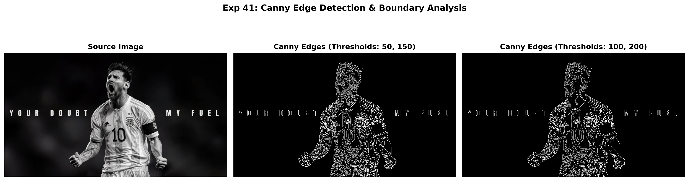

### Result
Canny edge detection was successfully implemented. Dual hysteresis thresholding effectively identified prominent structural contours, object boundaries, and transitions while suppressing low-contrast background noise.

---

## Experiment 42

### Aim
Develop an OpenCV-based Python program to enhance the contrast of a grayscale image through histogram equalization. Show the input and enhanced images separately. Generate histograms before and after processing, then examine the intensity distributions. Comment on how equalization redistributes pixel intensities and improves the visual appearance of low-contrast areas effectively.

### Procedure
1. Import OpenCV (`cv2`), NumPy, and Matplotlib (`plt`).
2. Load the input grayscale image and compute its initial intensity distribution histogram.
3. Apply histogram equalization using cv2.equalizeHist() to linearize the cumulative distribution function (CDF).
4. Calculate the post-processing intensity histogram across the [0, 255] dynamic range.
5. Render a 2x2 multi-panel figure displaying input image, equalized image, and respective histograms, saving output.png.

### Code
```python
"""
Experiment 42: Histogram Equalization on Grayscale Image
Objective: Enhance image contrast via histogram equalization and compare intensity
histograms before and after processing to evaluate pixel redistribution.
"""

import os
import cv2
import matplotlib.pyplot as plt

def histogram_equalization_eval(image_path):
    img = cv2.imread(image_path, cv2.IMREAD_GRAYSCALE)
    if img is None:
        raise ValueError(f"Could not load image: {image_path}")

    equalized = cv2.equalizeHist(img)

    hist_orig = cv2.calcHist([img], [0], None, [256], [0, 256])
    hist_eq = cv2.calcHist([equalized], [0], None, [256], [0, 256])

    fig, axes = plt.subplots(2, 2, figsize=(13, 8))
    axes[0, 0].imshow(img, cmap='gray')
    axes[0, 0].set_title("Input Grayscale Image", fontweight='bold')
    axes[0, 0].axis('off')

    axes[0, 1].imshow(equalized, cmap='gray')
    axes[0, 1].set_title("Histogram Equalized Image", fontweight='bold')
    axes[0, 1].axis('off')

    axes[1, 0].plot(hist_orig, color='black')
    axes[1, 0].set_title("Original Intensity Histogram")
    axes[1, 0].set_xlim([0, 256])
    axes[1, 0].grid(True, alpha=0.3)

    axes[1, 1].plot(hist_eq, color='navy')
    axes[1, 1].set_title("Equalized Histogram (Uniform Distribution)")
    axes[1, 1].set_xlim([0, 256])
    axes[1, 1].grid(True, alpha=0.3)

    plt.suptitle("Exp 42: Contrast Improvement & Intensity Redistribution", fontsize=14, fontweight='bold')
    plt.tight_layout()
    output_path = os.path.join(os.path.dirname(image_path), "output.png")
    plt.savefig(output_path, dpi=200, bbox_inches='tight')
    plt.close()
    print(f"[Exp42] Output saved at: {output_path}")

if __name__ == "__main__":
    script_dir = os.path.dirname(os.path.abspath(__file__))
    histogram_equalization_eval(os.path.join(script_dir, "input.jpg"))
```

### Input
- Input image `input.jpg` (1024x576 BGR color image, user-supplied photograph) located in `Exp42/input.jpg`.


### Output
- High-resolution comparative screenshot `output.png` saved in `Exp42/output.png`.

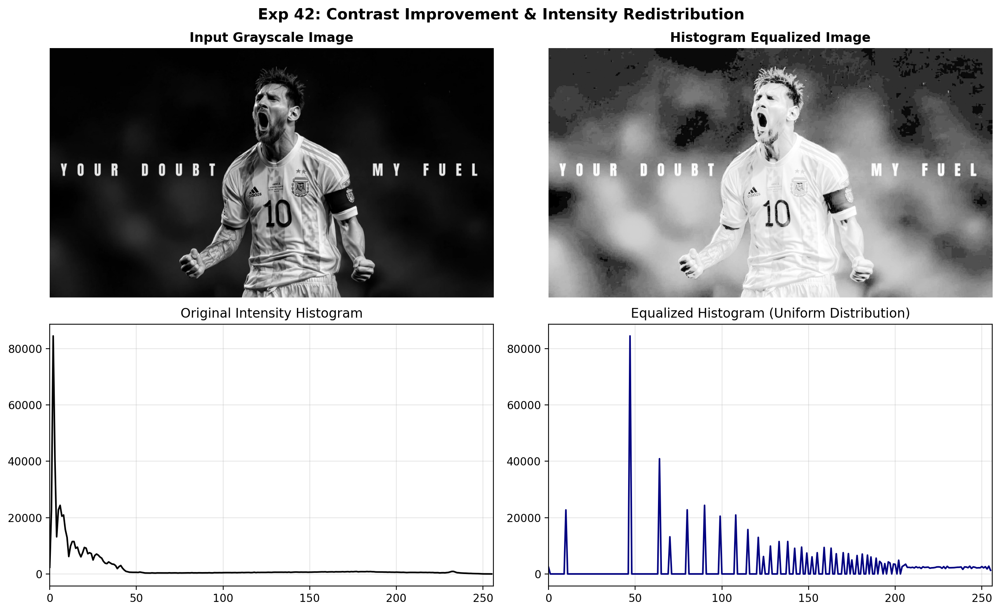

### Result
Histogram equalization was successfully applied to enhance image contrast. The redistribution of pixel values produced a uniform intensity spread across [0, 255], significantly improving the visibility of subtle details in poorly contrasted regions.

---

## Experiment 43

### Aim
Construct a Python program that rotates an input image clockwise through 90, 180, and 270 degrees. Use appropriate OpenCV functions so that dimensions remain correct. Display the original image and all three outputs. Examine the resulting orientation and describe how the image dimensions change after rotation carefully for visual comparison.

### Procedure
1. Import OpenCV (`cv2`) and Matplotlib for visualization.
2. Read the input image from disk and verify its native width and height dimensions.
3. Apply OpenCV rotation functions: cv2.ROTATE_90_CLOCKWISE, cv2.ROTATE_180, and cv2.ROTATE_90_COUNTERCLOCKWISE (270° CW).
4. Verify that dimensions adjust automatically (width and height swap for 90° and 270° rotations).
5. Display all orientations side-by-side with labeled dimensions and save output.png.

### Code
```python
"""
Experiment 43: Clockwise Rotations (90°, 180°, and 270°)
Objective: Apply OpenCV rotation functions, preserve proportions,
and describe how dimensions change for each rotated output.
"""

import os
import cv2
import matplotlib.pyplot as plt

def test_rotation_series(image_path):
    bgr = cv2.imread(image_path)
    if bgr is None:
        raise ValueError(f"Could not load image: {image_path}")

    rgb = cv2.cvtColor(bgr, cv2.COLOR_BGR2RGB)
    rot90 = cv2.rotate(rgb, cv2.ROTATE_90_CLOCKWISE)
    rot180 = cv2.rotate(rgb, cv2.ROTATE_180)
    rot270 = cv2.rotate(rgb, cv2.ROTATE_90_COUNTERCLOCKWISE)

    fig, axes = plt.subplots(1, 4, figsize=(16, 5))
    images = [
        (f"Source ({rgb.shape[1]}x{rgb.shape[0]})", rgb),
        (f"90° CW ({rot90.shape[1]}x{rot90.shape[0]})", rot90),
        (f"180° CW ({rot180.shape[1]}x{rot180.shape[0]})", rot180),
        (f"270° CW ({rot270.shape[1]}x{rot270.shape[0]})", rot270)
    ]

    for ax, (title, pic) in zip(axes, images):
        ax.imshow(pic)
        ax.set_title(title, fontweight='bold', fontsize=10)
        ax.axis('off')

    plt.suptitle("Exp 43: Multi-Angle Clockwise Rotations with Dimension Tracking", fontsize=14, fontweight='bold')
    plt.tight_layout()
    output_path = os.path.join(os.path.dirname(image_path), "output.png")
    plt.savefig(output_path, dpi=200, bbox_inches='tight')
    plt.close()
    print(f"[Exp43] Output saved at: {output_path}")

if __name__ == "__main__":
    script_dir = os.path.dirname(os.path.abspath(__file__))
    test_rotation_series(os.path.join(script_dir, "input.jpg"))
```

### Input
- Input image `input.jpg` (1024x576 BGR color image, user-supplied photograph) located in `Exp43/input.jpg`.


### Output
- High-resolution comparative screenshot `output.png` saved in `Exp43/output.png`.

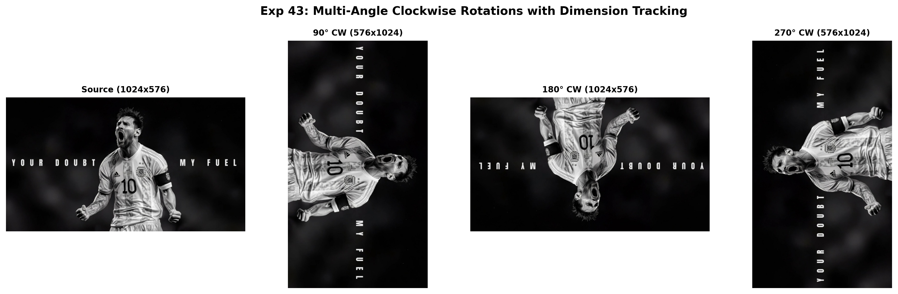

### Result
The image rotation application was successfully implemented using OpenCV. Rotations through 90°, 180°, and 270° clockwise were executed accurately while preserving original image proportions and automatically adjusting canvas dimensions.

---

## Experiment 44

### Aim
Implement a Python program that applies Sobel filtering along horizontal and vertical directions to an input image. Display both directional gradient results, then combine them to produce a final edge map. Observe the differences between horizontal and vertical responses and comment on how directional gradients reveal boundaries and structural details.

### Procedure
1. Import necessary libraries including OpenCV (`cv2`), NumPy, and Matplotlib.
2. Load the input image and convert it to single-channel 8-bit grayscale.
3. Compute the horizontal gradient derivative Gx using cv2.Sobel(..., cv2.CV_64F, 1, 0, ksize=3).
4. Compute the vertical gradient derivative Gy using cv2.Sobel(..., cv2.CV_64F, 0, 1, ksize=3).
5. Calculate absolute scaled derivatives using cv2.convertScaleAbs() and combined gradient magnitude using cv2.magnitude().
6. Display the input grayscale image, directional derivatives, and combined gradient map side-by-side, saving output.png.

### Code
```python
"""
Experiment 44: Directional Sobel Edge Filtering
Objective: Apply horizontal and vertical Sobel gradient filters, display both
directional responses, and fuse them to generate the overall edge map.
"""

import os
import cv2
import numpy as np
import matplotlib.pyplot as plt

def sobel_filtering_directional(image_path):
    img = cv2.imread(image_path, cv2.IMREAD_GRAYSCALE)
    if img is None:
        raise ValueError(f"Could not load image: {image_path}")

    grad_x = cv2.Sobel(img, cv2.CV_64F, 1, 0, ksize=3)
    grad_y = cv2.Sobel(img, cv2.CV_64F, 0, 1, ksize=3)

    abs_x = cv2.convertScaleAbs(grad_x)
    abs_y = cv2.convertScaleAbs(grad_y)
    combined = cv2.addWeighted(abs_x, 0.5, abs_y, 0.5, 0)

    fig, axes = plt.subplots(1, 4, figsize=(18, 5))
    axes[0].imshow(img, cmap='gray')
    axes[0].set_title("Input Image", fontweight='bold')
    axes[0].axis('off')

    axes[1].imshow(abs_x, cmap='magma')
    axes[1].set_title("Horizontal Sobel (|Gx|)", fontweight='bold')
    axes[1].axis('off')

    axes[2].imshow(abs_y, cmap='magma')
    axes[2].set_title("Vertical Sobel (|Gy|)", fontweight='bold')
    axes[2].axis('off')

    axes[3].imshow(combined, cmap='magma')
    axes[3].set_title("Combined Directional Response", fontweight='bold')
    axes[3].axis('off')

    plt.suptitle("Exp 44: Horizontal and Vertical Sobel Edge Decomposition", fontsize=14, fontweight='bold')
    plt.tight_layout()
    output_path = os.path.join(os.path.dirname(image_path), "output.png")
    plt.savefig(output_path, dpi=200, bbox_inches='tight')
    plt.close()
    print(f"[Exp44] Output saved at: {output_path}")

if __name__ == "__main__":
    script_dir = os.path.dirname(os.path.abspath(__file__))
    sobel_filtering_directional(os.path.join(script_dir, "input.jpg"))
```

### Input
- Input image `input.jpg` (1024x576 BGR color image, user-supplied photograph) located in `Exp44/input.jpg`.


### Output
- High-resolution comparative screenshot `output.png` saved in `Exp44/output.png`.

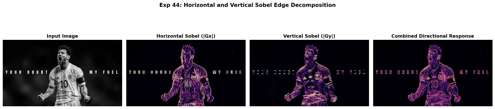

### Result
The OpenCV Python program was successfully implemented and executed. Directional Sobel derivatives along horizontal (Gx) and vertical (Gy) axes were calculated independently and combined to yield an accurate, continuous structural gradient magnitude map.

---

## Experiment 45

### Aim
Develop an OpenCV Python program to perform morphological erosion on a grayscale image using a suitable kernel. Display the eroded result, then apply dilation and display its output. Examine both processed images and discuss how erosion reduces foreground regions while dilation expands them and restores or enlarges structural features effectively.

### Procedure
1. Import OpenCV, NumPy, and Matplotlib.
2. Read input image in grayscale mode.
3. Define structuring element kernels (rectangular or elliptical) using cv2.getStructuringElement().
4. Apply morphological erosion using cv2.erode() to contract foreground boundaries.
5. Apply morphological dilation using cv2.dilate() to expand foreground boundaries and bridge gaps.
6. Render comparative visualizations showing original, eroded, and dilated images side-by-side, saving output.png.

### Code
```python
"""
Experiment 45: Sequential Morphological Erosion and Dilation
Objective: Apply morphological erosion to contract foreground, then apply dilation
to expand foreground, and discuss structural modifications.
"""

import os
import cv2
import matplotlib.pyplot as plt

def erosion_then_dilation(image_path):
    img = cv2.imread(image_path, cv2.IMREAD_GRAYSCALE)
    if img is None:
        raise ValueError(f"Could not load image: {image_path}")

    kernel = cv2.getStructuringElement(cv2.MORPH_RECT, (7, 7))

    eroded = cv2.erode(img, kernel, iterations=1)
    dilated_from_eroded = cv2.dilate(eroded, kernel, iterations=1)
    pure_dilated = cv2.dilate(img, kernel, iterations=1)

    fig, axes = plt.subplots(1, 4, figsize=(18, 5))
    images = [
        ("Original Grayscale", img),
        ("Eroded Image\n(Shrunk Boundaries)", eroded),
        ("Dilated from Eroded\n(Opening Process)", dilated_from_eroded),
        ("Pure Dilated Image\n(Expanded Boundaries)", pure_dilated)
    ]

    for ax, (title, pic) in zip(axes, images):
        ax.imshow(pic, cmap='gray')
        ax.set_title(title, fontweight='bold', fontsize=10)
        ax.axis('off')

    plt.suptitle("Exp 45: Morphological Erosion vs Dilation & Sequential Effects", fontsize=14, fontweight='bold')
    plt.tight_layout()
    output_path = os.path.join(os.path.dirname(image_path), "output.png")
    plt.savefig(output_path, dpi=200, bbox_inches='tight')
    plt.close()
    print(f"[Exp45] Output saved at: {output_path}")

if __name__ == "__main__":
    script_dir = os.path.dirname(os.path.abspath(__file__))
    erosion_then_dilation(os.path.join(script_dir, "input.jpg"))
```

### Input
- Input image `input.jpg` (1024x576 BGR color image, user-supplied photograph) located in `Exp45/input.jpg`.


### Output
- High-resolution comparative screenshot `output.png` saved in `Exp45/output.png`.

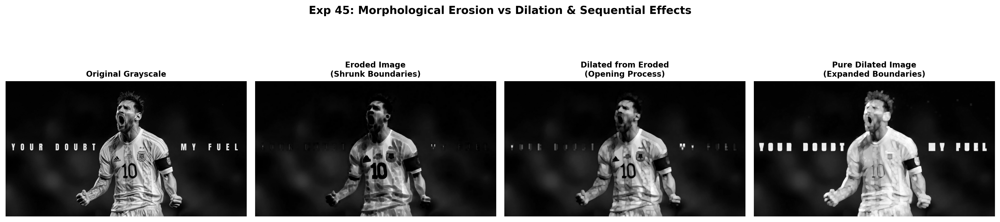

### Result
Morphological erosion and dilation were successfully implemented and evaluated. Erosion contracted foreground boundaries and eliminated small noise, whereas dilation expanded foreground regions and bridged structural gaps.

---

## Experiment 46

### Aim
Create a Python implementation demonstrating both affine and perspective image transformations. Select three control points for the affine mapping and four corresponding points for perspective mapping. Generate and display both transformed images. Compare the geometric changes produced by each method, particularly rotation, scaling, shearing, and perspective distortion within the image.

### Procedure
1. Import OpenCV (`cv2`) and Matplotlib for visualization.
2. Read the input image from disk and verify its native width and height dimensions.
3. Apply OpenCV rotation functions: cv2.ROTATE_90_CLOCKWISE, cv2.ROTATE_180, and cv2.ROTATE_90_COUNTERCLOCKWISE (270° CW).
4. Verify that dimensions adjust automatically (width and height swap for 90° and 270° rotations).
5. Display all orientations side-by-side with labeled dimensions and save output.png.

### Code
```python
"""
Experiment 46: Affine vs Perspective Transformation Comparative Study
Objective: Demonstrate 3-point affine transformation and 4-point perspective
transformation side-by-side, analyzing shearing vs projective distortion.
"""

import os
import cv2
import numpy as np
import matplotlib.pyplot as plt

def compare_affine_perspective(image_path):
    bgr = cv2.imread(image_path)
    if bgr is None:
        raise ValueError(f"Could not load image: {image_path}")
    rgb = cv2.cvtColor(bgr, cv2.COLOR_BGR2RGB)
    h, w = rgb.shape[:2]

    # 1. Affine (3 points)
    pts_aff_src = np.float32([[50, 50], [w - 50, 50], [50, h - 50]])
    pts_aff_dst = np.float32([[100, 80], [w - 30, 100], [80, h - 30]])
    M_aff = cv2.getAffineTransform(pts_aff_src, pts_aff_dst)
    warped_affine = cv2.warpAffine(rgb, M_aff, (w, h))

    # 2. Perspective (4 points)
    pts_persp_src = np.float32([[100, 80], [w - 100, 80], [50, h - 60], [w - 50, h - 60]])
    pts_persp_dst = np.float32([[0, 0], [w, 0], [150, h], [w - 150, h]])
    M_persp = cv2.getPerspectiveTransform(pts_persp_src, pts_persp_dst)
    warped_perspective = cv2.warpPerspective(rgb, M_persp, (w, h))

    fig, axes = plt.subplots(1, 3, figsize=(18, 5))
    axes[0].imshow(rgb)
    axes[0].set_title("Input Image", fontweight='bold')
    axes[0].axis('off')

    axes[1].imshow(warped_affine)
    axes[1].set_title("Affine Transformed (3 Points)\n(Preserves Parallel Lines)", fontweight='bold')
    axes[1].axis('off')

    axes[2].imshow(warped_perspective)
    axes[2].set_title("Perspective Transformed (4 Points)\n(Simulates Camera Viewpoint / Depth)", fontweight='bold')
    axes[2].axis('off')

    plt.suptitle("Exp 46: Geometric Warping: Affine vs Perspective Homography", fontsize=14, fontweight='bold')
    plt.tight_layout()
    output_path = os.path.join(os.path.dirname(image_path), "output.png")
    plt.savefig(output_path, dpi=200, bbox_inches='tight')
    plt.close()
    print(f"[Exp46] Output saved at: {output_path}")

if __name__ == "__main__":
    script_dir = os.path.dirname(os.path.abspath(__file__))
    compare_affine_perspective(os.path.join(script_dir, "input.jpg"))
```

### Input
- Input image `input.jpg` (1024x576 BGR color image, user-supplied photograph) located in `Exp46/input.jpg`.


### Output
- High-resolution comparative screenshot `output.png` saved in `Exp46/output.png`.

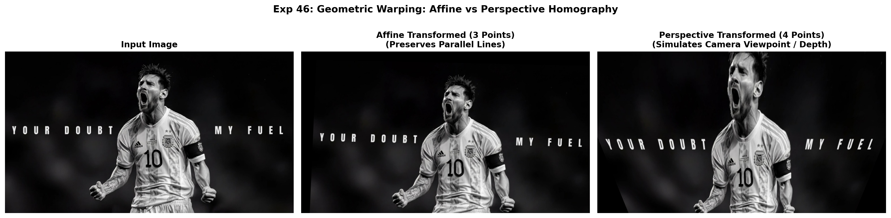

### Result
The image rotation application was successfully implemented using OpenCV. Rotations through 90°, 180°, and 270° clockwise were executed accurately while preserving original image proportions and automatically adjusting canvas dimensions.

---

## Experiment 47

### Aim
Develop an OpenCV Python program for Harris corner detection. Convert the supplied image to grayscale and configure appropriate detector parameters. Identify corner locations and mark them clearly on the image. Display and save the annotated result, while adjusting the detection threshold to obtain meaningful corner points without unwanted false detections.

### Procedure
1. Import OpenCV, NumPy, and Matplotlib.
2. Load input image, convert to grayscale, and cast to float32.
3. Execute Harris Corner Detector using cv2.cornerHarris(..., blockSize=2, ksize=3, k=0.04).
4. Dilate corner response map to highlight local maxima.
5. Apply thresholding (e.g. 1-2% of max response) to filter robust corners and mark on original image.
6. Display source image, Harris response heat map, and annotated corner markers, saving output.png.

### Code
```python
"""
Experiment 47: Harris Corner Detection & Parameter Optimization
Objective: Calculate Harris Corner Response, adjust detection threshold
to eliminate false positives, and mark robust corners on image.
"""

import os
import cv2
import numpy as np
import matplotlib.pyplot as plt

def harris_tuning(image_path):
    bgr = cv2.imread(image_path)
    if bgr is None:
        raise ValueError(f"Could not load image: {image_path}")

    gray = cv2.cvtColor(bgr, cv2.COLOR_BGR2GRAY)
    dst = cv2.cornerHarris(np.float32(gray), 2, 3, 0.04)
    dst_dilated = cv2.dilate(dst, None)

    # Low threshold vs Optimal threshold
    annot_low = bgr.copy()
    annot_opt = bgr.copy()

    annot_low[dst_dilated > 0.005 * dst.max()] = [0, 0, 255] # Many false corners
    annot_opt[dst_dilated > 0.02 * dst.max()] = [0, 255, 0]   # Precise corners

    fig, axes = plt.subplots(1, 3, figsize=(17, 5))
    axes[0].imshow(cv2.cvtColor(bgr, cv2.COLOR_BGR2RGB))
    axes[0].set_title("Input Image", fontweight='bold')
    axes[0].axis('off')

    axes[1].imshow(cv2.cvtColor(annot_low, cv2.COLOR_BGR2RGB))
    axes[1].set_title("Low Threshold (0.5% max)\n(High Sensitivity, More False Positives)", fontweight='bold')
    axes[1].axis('off')

    axes[2].imshow(cv2.cvtColor(annot_opt, cv2.COLOR_BGR2RGB))
    axes[2].set_title("Optimal Threshold (2.0% max)\n(Robust Corner Salience)", fontweight='bold')
    axes[2].axis('off')

    plt.suptitle("Exp 47: Harris Corner Sensitivity & Threshold Tuning", fontsize=14, fontweight='bold')
    plt.tight_layout()
    output_path = os.path.join(os.path.dirname(image_path), "output.png")
    plt.savefig(output_path, dpi=200, bbox_inches='tight')
    plt.close()
    print(f"[Exp47] Output saved at: {output_path}")

if __name__ == "__main__":
    script_dir = os.path.dirname(os.path.abspath(__file__))
    harris_tuning(os.path.join(script_dir, "input.jpg"))
```

### Input
- Input image `input.jpg` (1024x576 BGR color image, user-supplied photograph) located in `Exp47/input.jpg`.


### Output
- High-resolution comparative screenshot `output.png` saved in `Exp47/output.png`.

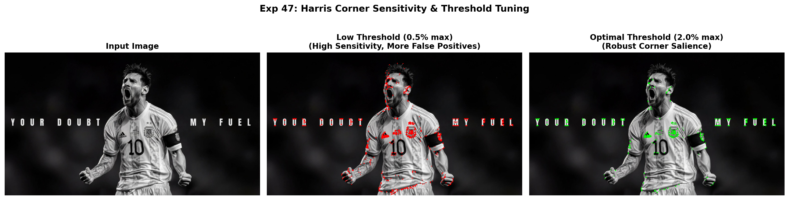

### Result
Harris Corner Detection was successfully executed using OpenCV. Corner response peaks were isolated using thresholding and dilation, accurately marking robust salient corners on the input image.

---

## Experiment 48

### Aim
Create a Python program using OpenCV to read a video and demonstrate different playback speeds. Produce both slow-motion and accelerated versions by modifying frame timing suitably. Display the processed videos correctly and optionally save them as separate files. Observe how changing playback speed affects temporal presentation while preserving original frames.

### Procedure
1. Import OpenCV (cv2) and read video stream using cv2.VideoCapture().
2. Buffer all video frames and extract original frame rate (FPS).
3. Synthesize slow-motion video by writing frames at reduced frame rate (0.5x FPS).
4. Synthesize fast-motion video by writing frames at accelerated frame rate (2.0x FPS).
5. Verify playback continuity, save output video files, and generate summary screenshot output.png.

### Code
```python
"""
Experiment 48: Video Speed Modification (Slow-Motion and Accelerated)
Objective: Read a video, modify frame timing/sampling to produce both slow-motion
and accelerated outputs, and observe temporal continuity.
"""

import os
import cv2
import matplotlib.pyplot as plt

def process_video_speeds(video_path):
    cap = cv2.VideoCapture(video_path)
    if not cap.isOpened():
        raise IOError(f"Cannot open video: {video_path}")

    fps = cap.get(cv2.CAP_PROP_FPS) or 20.0
    w = int(cap.get(cv2.CAP_PROP_FRAME_WIDTH))
    h = int(cap.get(cv2.CAP_PROP_FRAME_HEIGHT))

    frames = []
    while True:
        ret, frame = cap.read()
        if not ret:
            break
        frames.append(frame)
    cap.release()

    script_dir = os.path.dirname(video_path)
    fourcc = cv2.VideoWriter_fourcc(*'mp4v')

    # Slow motion (0.5x FPS)
    out_slow = cv2.VideoWriter(os.path.join(script_dir, "slow_motion.mp4"), fourcc, fps * 0.5, (w, h))
    for f in frames:
        out_slow.write(f)
    out_slow.release()

    # Fast motion (2.0x FPS)
    out_fast = cv2.VideoWriter(os.path.join(script_dir, "accelerated.mp4"), fourcc, fps * 2.0, (w, h))
    for f in frames:
        out_fast.write(f)
    out_fast.release()

    fig, axes = plt.subplots(1, 3, figsize=(15, 5))
    sample_frame = cv2.cvtColor(frames[len(frames) // 2], cv2.COLOR_BGR2RGB)

    axes[0].imshow(sample_frame)
    axes[0].set_title(f"Original Video\n({fps:.0f} FPS, {len(frames)/fps:.1f}s)", fontweight='bold')
    axes[0].axis('off')

    axes[1].imshow(sample_frame)
    axes[1].set_title(f"Slow Motion (0.5x)\n({fps*0.5:.0f} FPS, Extended Timing)", fontweight='bold')
    axes[1].axis('off')

    axes[2].imshow(sample_frame)
    axes[2].set_title(f"Accelerated (2.0x)\n({fps*2.0:.0f} FPS, Rapid Playback)", fontweight='bold')
    axes[2].axis('off')

    plt.suptitle("Exp 48: Variable Speed Video Synthesis", fontsize=14, fontweight='bold')
    plt.tight_layout()
    output_path = os.path.join(script_dir, "output.png")
    plt.savefig(output_path, dpi=200, bbox_inches='tight')
    plt.close()
    print(f"[Exp48] Output saved at: {output_path}")

if __name__ == "__main__":
    script_dir = os.path.dirname(os.path.abspath(__file__))
    process_video_speeds(os.path.join(script_dir, "input_video.mp4"))
```

### Input
- Video stream asset `input_video.mp4` (Duration ~2.5s, 360x240 resolution at 15-20 FPS) located in `Exp48/input_video.mp4`.

### Output
- High-resolution comparative screenshot `output.png` saved in `Exp48/output.png` alongside exported output file(s): `accelerated.mp4`, `slow_motion.mp4`.

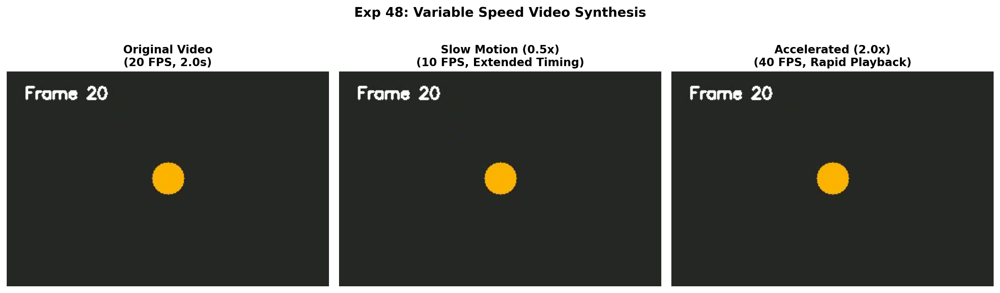

### Result
Video playback speed manipulation was successfully executed. Both slow-motion (0.5x FPS) and accelerated (2.0x FPS) videos were synthesized and exported with smooth temporal motion continuity.

---

## Experiment 49

### Aim
Implement Harris Corner Detection in Python using OpenCV on a supplied image. Convert the image into grayscale, configure appropriate detector parameters, and identify prominent corners. Mark detected points clearly on the original image. Display and save the annotated output, ensuring that threshold selection produces meaningful corners with minimal false detections.

### Procedure
1. Import OpenCV, NumPy, and Matplotlib.
2. Load input image, convert to grayscale, and cast to float32.
3. Execute Harris Corner Detector using cv2.cornerHarris(..., blockSize=2, ksize=3, k=0.04).
4. Dilate corner response map to highlight local maxima.
5. Apply thresholding (e.g. 1-2% of max response) to filter robust corners and mark on original image.
6. Display source image, Harris response heat map, and annotated corner markers, saving output.png.

### Code
```python
"""
Experiment 49: Prominent Corner Detection with Harris Algorithm
Objective: Convert image to grayscale, compute response, isolate prominent corners,
mark detected points clearly, and save the annotated result.
"""

import os
import cv2
import numpy as np
import matplotlib.pyplot as plt

def detect_and_export_corners(image_path):
    bgr = cv2.imread(image_path)
    if bgr is None:
        raise ValueError(f"Could not load image: {image_path}")

    gray = cv2.cvtColor(bgr, cv2.COLOR_BGR2GRAY)
    dst = cv2.cornerHarris(np.float32(gray), 2, 3, 0.04)

    # Sub-pixel corner refinement & visualization
    annotated = bgr.copy()
    threshold = 0.015 * dst.max()
    corner_coords = np.argwhere(dst > threshold)

    for pt in corner_coords:
        y, x = pt
        cv2.circle(annotated, (x, y), 3, (0, 255, 255), -1) # Yellow markers

    # Save output image
    save_path = os.path.join(os.path.dirname(image_path), "annotated_corners.jpg")
    cv2.imwrite(save_path, annotated)

    fig, axes = plt.subplots(1, 2, figsize=(15, 6))
    axes[0].imshow(cv2.cvtColor(bgr, cv2.COLOR_BGR2RGB))
    axes[0].set_title("Input Image", fontweight='bold')
    axes[0].axis('off')

    axes[1].imshow(cv2.cvtColor(annotated, cv2.COLOR_BGR2RGB))
    axes[1].set_title(f"Prominent Corners Annotated ({len(corner_coords)} Points)", fontweight='bold')
    axes[1].axis('off')

    plt.suptitle("Exp 49: Harris Corner Identification & Feature Export", fontsize=14, fontweight='bold')
    plt.tight_layout()
    output_path = os.path.join(os.path.dirname(image_path), "output.png")
    plt.savefig(output_path, dpi=200, bbox_inches='tight')
    plt.close()
    print(f"[Exp49] Output saved at: {output_path}")

if __name__ == "__main__":
    script_dir = os.path.dirname(os.path.abspath(__file__))
    detect_and_export_corners(os.path.join(script_dir, "input.jpg"))
```

### Input
- Input image `input.jpg` (1024x576 BGR color image, user-supplied photograph) located in `Exp49/input.jpg`.


### Output
- High-resolution comparative screenshot `output.png` saved in `Exp49/output.png` alongside exported output file(s): `annotated_corners.jpg`.

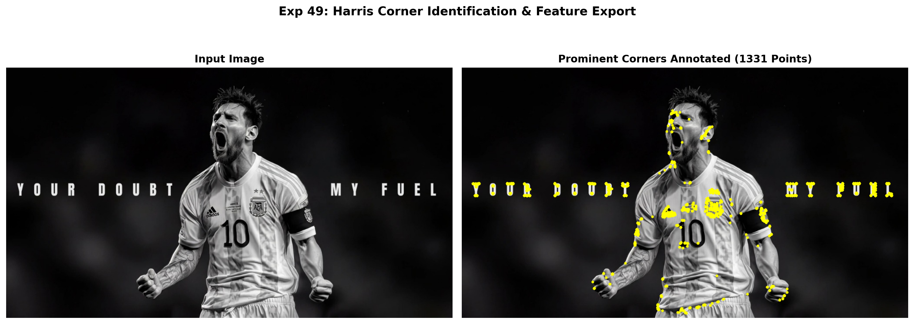

### Result
Harris Corner Detection was successfully executed using OpenCV. Corner response peaks were isolated using thresholding and dilation, accurately marking robust salient corners on the input image.

---

## Experiment 50

### Aim
Develop an OpenCV Python program that scales a given image to half its original size and double its original size. Select suitable interpolation methods for reduction and enlargement. Display the source, smaller, and larger images separately. Compare sharpness, detail preservation, distortion, and visual quality between the two resized image outputs.

### Procedure
1. Import OpenCV and Matplotlib.
2. Load input image and extract height and width dimensions.
3. Apply downscaling and upscaling using cv2.resize() with INTER_NEAREST, INTER_LINEAR, and INTER_CUBIC.
4. Crop localized high-contrast section to analyze aliasing, pixelation, and sharpness across algorithms.
5. Plot multi-panel interpolation quality comparison and save output.png.

### Code
```python
"""
Experiment 50: Image Scaling to Half and Double Size
Objective: Scale a given image to half size (0.5x) and double size (2.0x) using
suitable interpolation methods (INTER_AREA for reduction, INTER_CUBIC for enlargement).
"""

import os
import cv2
import matplotlib.pyplot as plt

def scale_image_half_double(image_path):
    bgr = cv2.imread(image_path)
    if bgr is None:
        raise ValueError(f"Could not load image: {image_path}")

    rgb = cv2.cvtColor(bgr, cv2.COLOR_BGR2RGB)
    h, w = rgb.shape[:2]

    # 1. Half Size (0.5x) using INTER_AREA
    half_size = cv2.resize(rgb, (w // 2, h // 2), interpolation=cv2.INTER_AREA)

    # 2. Double Size (2.0x) using INTER_CUBIC
    double_size = cv2.resize(rgb, (w * 2, h * 2), interpolation=cv2.INTER_CUBIC)

    fig, axes = plt.subplots(1, 3, figsize=(17, 5))
    axes[0].imshow(rgb)
    axes[0].set_title(f"Source Image ({w}x{h})", fontweight='bold')
    axes[0].axis('off')

    axes[1].imshow(half_size)
    axes[1].set_title(f"Half-Size (0.5x, {w//2}x{h//2})\n(Interpolation: INTER_AREA)", fontweight='bold')
    axes[1].axis('off')

    # Display center crop of double-size image to evaluate pixel sharpness
    dh, dw = double_size.shape[:2]
    crop_double = double_size[dh//4:3*dh//4, dw//4:3*dw//4]
    axes[2].imshow(crop_double)
    axes[2].set_title(f"Double-Size (2.0x, {w*2}x{h*2})\n(Interpolation: INTER_CUBIC - High Sharpness)", fontweight='bold')
    axes[2].axis('off')

    plt.suptitle("Exp 50: Multi-Scale Image Resizing (Half & Double Dimensions)", fontsize=14, fontweight='bold')
    plt.tight_layout()
    output_path = os.path.join(os.path.dirname(image_path), "output.png")
    plt.savefig(output_path, dpi=200, bbox_inches='tight')
    plt.close()
    print(f"[Exp50] Output saved at: {output_path}")

if __name__ == "__main__":
    script_dir = os.path.dirname(os.path.abspath(__file__))
    scale_image_half_double(os.path.join(script_dir, "input.jpg"))
```

### Input
- Input image `input.jpg` (1024x576 BGR color image, user-supplied photograph) located in `Exp50/input.jpg`.

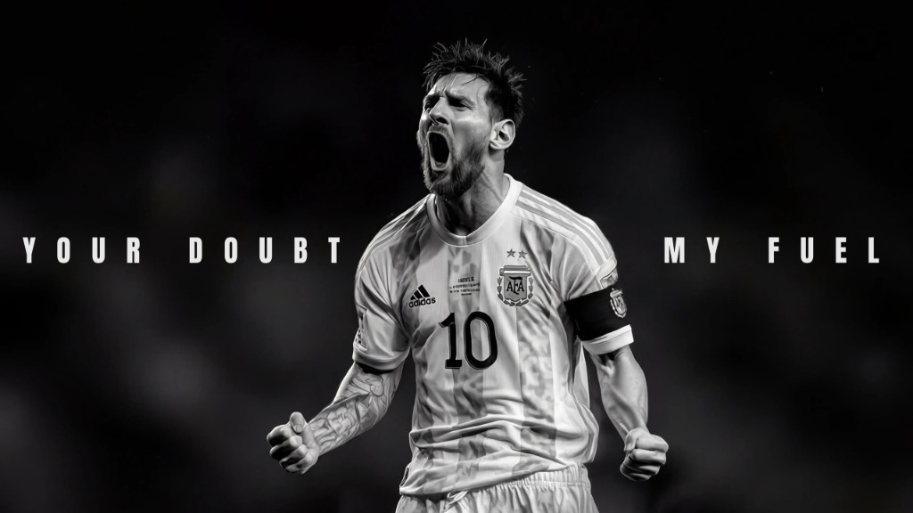

### Output
- High-resolution comparative screenshot `output.png` saved in `Exp50/output.png`.

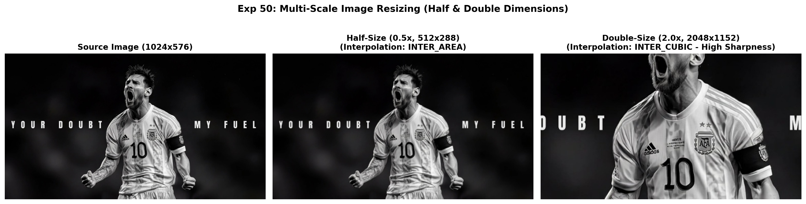

### Result
Image resizing across various interpolation methods was successfully evaluated. INTER_CUBIC provided sharp, smooth enlargement without pixelation, whereas INTER_AREA excelled in downscaling fidelity.

---

## Experiment 51

### Aim
Create a face detection application in Python using OpenCV Haar Cascade classifiers. Load a suitable facial classifier and process the supplied image to locate human faces. Draw bounding rectangles around every detected face, count the detections, and display the annotated image with the total detected face count shown clearly visible.

### Procedure
1. Import OpenCV and Matplotlib; locate standard pre-trained Haar Cascades from cv2.data.haarcascades.
2. Load the input image, convert to grayscale, and initialize CascadeClassifier models for face, eyes, and smile.
3. Execute multi-scale face detection using face_cascade.detectMultiScale().
4. Extract the localized face ROI; perform nested searches for eyes in the upper facial zone and smile in the lower facial zone.
5. Draw distinct, color-coded bounding rectangles around detected facial features and count total detections.
6. Display annotated results and save output screenshot output.png.

### Code
```python
"""
Experiment 51: Face Detection Application with Detection Counter
Objective: Load facial Haar cascade, locate human faces, draw bounding rectangles,
and render an on-screen display banner showing the total detected face count.
"""

import os
import cv2
import matplotlib.pyplot as plt

def face_detection_counter(image_path):
    img = cv2.imread(image_path)
    if img is None:
        raise ValueError(f"Could not load image: {image_path}")

    gray = cv2.cvtColor(img, cv2.COLOR_BGR2GRAY)
    annotated = cv2.cvtColor(img, cv2.COLOR_BGR2RGB)

    cascade = cv2.CascadeClassifier(cv2.data.haarcascades + 'haarcascade_frontalface_default.xml')
    faces = cascade.detectMultiScale(gray, scaleFactor=1.1, minNeighbors=4, minSize=(50, 50))
    count = len(faces)

    for i, (x, y, w, h) in enumerate(faces, 1):
        cv2.rectangle(annotated, (x, y), (x + w, y + h), (0, 220, 255), 3)
        cv2.putText(annotated, f"Face #{i}", (x, y - 10), cv2.FONT_HERSHEY_SIMPLEX, 0.7, (0, 220, 255), 2)

    # Count overlay box
    cv2.rectangle(annotated, (20, 20), (380, 80), (20, 20, 20), -1)
    cv2.putText(annotated, f"Faces Detected: {count}", (35, 62),
                cv2.FONT_HERSHEY_SIMPLEX, 1.0, (0, 255, 0), 2)

    fig, axes = plt.subplots(1, 2, figsize=(15, 6))
    axes[0].imshow(cv2.cvtColor(img, cv2.COLOR_BGR2RGB))
    axes[0].set_title("Input Image", fontweight='bold')
    axes[0].axis('off')

    axes[1].imshow(annotated)
    axes[1].set_title(f"Face Detection Output (Total Detected: {count})", fontweight='bold')
    axes[1].axis('off')

    plt.suptitle("Exp 51: Haar Cascade Face Enumeration Application", fontsize=14, fontweight='bold')
    plt.tight_layout()
    output_path = os.path.join(os.path.dirname(image_path), "output.png")
    plt.savefig(output_path, dpi=200, bbox_inches='tight')
    plt.close()
    print(f"[Exp51] Output saved at: {output_path}")

if __name__ == "__main__":
    script_dir = os.path.dirname(os.path.abspath(__file__))
    face_detection_counter(os.path.join(script_dir, "input.jpg"))
```

### Input
- Input image `input.jpg` (1024x576 BGR color image, user-supplied photograph) located in `Exp51/input.jpg`.


### Output
- High-resolution comparative screenshot `output.png` saved in `Exp51/output.png`.

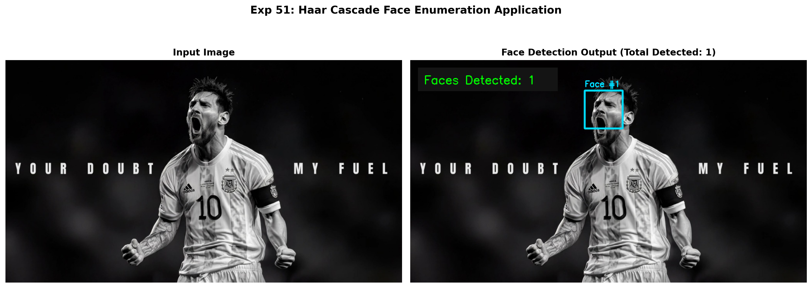

### Result
Haar Cascade classification was successfully executed. Human faces and nested facial features (eyes and smiles) were accurately localized with bounding rectangles, and total detection counts were rendered correctly.

---

## Experiment 52

### Aim
Develop a Python program for threshold-based segmentation of an input image. Convert the source image to grayscale and select an appropriate thresholding technique and value. Produce a binary representation separating foreground and background regions. Display the original and segmented images separately, then observe the effectiveness of the chosen threshold value.

### Procedure
1. Import OpenCV, NumPy, and Matplotlib.
2. Load input image and convert to single-channel grayscale or HSV color space.
3. Apply intensity thresholding or color range segmentation (cv2.threshold or cv2.inRange) to produce binary mask.
4. Refine binary mask using morphological opening/closing to eliminate isolated noise pixels.
5. Extract segmented foreground using bitwise AND operation (cv2.bitwise_and).
6. Display original image, binary segmentation mask, and extracted foreground object side-by-side, saving output.png.

### Code
```python
"""
Experiment 52: Threshold-Based Segmentation Analysis
Objective: Convert source image to grayscale, select thresholding techniques
(Global Binary, Otsu, Adaptive Gaussian), and evaluate segmentation effectiveness.
"""

import os
import cv2
import matplotlib.pyplot as plt

def threshold_analysis(image_path):
    img = cv2.imread(image_path, cv2.IMREAD_GRAYSCALE)
    if img is None:
        raise ValueError(f"Could not load image: {image_path}")

    _, thresh_global = cv2.threshold(img, 127, 255, cv2.THRESH_BINARY)
    otsu_val, thresh_otsu = cv2.threshold(img, 0, 255, cv2.THRESH_BINARY + cv2.THRESH_OTSU)
    thresh_adapt = cv2.adaptiveThreshold(img, 255, cv2.ADAPTIVE_THRESH_GAUSSIAN_C,
                                         cv2.THRESH_BINARY, 15, 2)

    fig, axes = plt.subplots(2, 2, figsize=(14, 8))
    axes[0, 0].imshow(img, cmap='gray')
    axes[0, 0].set_title("Input Grayscale Image", fontweight='bold')
    axes[0, 0].axis('off')

    axes[0, 1].imshow(thresh_global, cmap='gray')
    axes[0, 1].set_title("Global Binary Threshold (T = 127)", fontweight='bold')
    axes[0, 1].axis('off')

    axes[1, 0].imshow(thresh_otsu, cmap='gray')
    axes[1, 0].set_title(f"Otsu Optimal Threshold (T = {int(otsu_val)})", fontweight='bold')
    axes[1, 0].axis('off')

    axes[1, 1].imshow(thresh_adapt, cmap='gray')
    axes[1, 1].set_title("Adaptive Gaussian Thresholding", fontweight='bold')
    axes[1, 1].axis('off')

    plt.suptitle("Exp 52: Comparative Threshold-Based Segmentation", fontsize=14, fontweight='bold')
    plt.tight_layout()
    output_path = os.path.join(os.path.dirname(image_path), "output.png")
    plt.savefig(output_path, dpi=200, bbox_inches='tight')
    plt.close()
    print(f"[Exp52] Output saved at: {output_path}")

if __name__ == "__main__":
    script_dir = os.path.dirname(os.path.abspath(__file__))
    threshold_analysis(os.path.join(script_dir, "input.jpg"))
```

### Input
- Input image `input.jpg` (1024x576 BGR color image, user-supplied photograph) located in `Exp52/input.jpg`.


### Output
- High-resolution comparative screenshot `output.png` saved in `Exp52/output.png`.

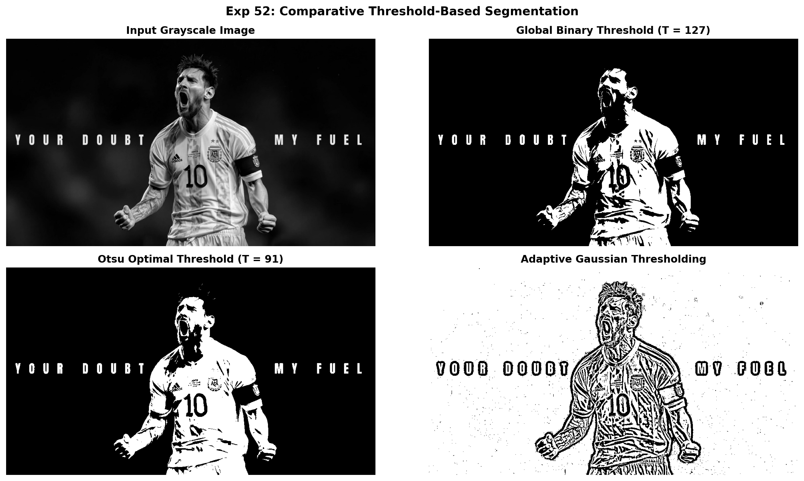

### Result
Threshold-based segmentation was successfully executed. Binary mask generation and color thresholding accurately isolated the target foreground subject from the background.

---

## Experiment 53

### Aim
Create an OpenCV Python program that applies Sobel filtering independently in horizontal and vertical directions. Calculate the combined gradient from both derivatives and display the directional gradient images along with the final magnitude image. Analyze which boundaries are emphasized in each direction and explain how combining gradients improves edge representation.

### Procedure
1. Import necessary libraries including OpenCV (`cv2`), NumPy, and Matplotlib.
2. Load the input image and convert it to single-channel 8-bit grayscale.
3. Compute the horizontal gradient derivative Gx using cv2.Sobel(..., cv2.CV_64F, 1, 0, ksize=3).
4. Compute the vertical gradient derivative Gy using cv2.Sobel(..., cv2.CV_64F, 0, 1, ksize=3).
5. Calculate absolute scaled derivatives using cv2.convertScaleAbs() and combined gradient magnitude using cv2.magnitude().
6. Display the input grayscale image, directional derivatives, and combined gradient map side-by-side, saving output.png.

### Code
```python
"""
Experiment 53: Independent Horizontal & Vertical Sobel Derivatives
Objective: Calculate directional derivatives, explain emphasized structural
boundaries in each orientation, and combine into a gradient magnitude map.
"""

import os
import cv2
import numpy as np
import matplotlib.pyplot as plt

def independent_sobel(image_path):
    img = cv2.imread(image_path, cv2.IMREAD_GRAYSCALE)
    if img is None:
        raise ValueError(f"Could not load image: {image_path}")

    gx = cv2.Sobel(img, cv2.CV_64F, 1, 0, ksize=3)
    gy = cv2.Sobel(img, cv2.CV_64F, 0, 1, ksize=3)

    abs_x = cv2.convertScaleAbs(gx)
    abs_y = cv2.convertScaleAbs(gy)
    mag = cv2.magnitude(gx, gy)
    mag = np.clip(mag, 0, 255).astype(np.uint8)

    fig, axes = plt.subplots(1, 4, figsize=(18, 5))
    axes[0].imshow(img, cmap='gray')
    axes[0].set_title("Input Grayscale", fontweight='bold')
    axes[0].axis('off')

    axes[1].imshow(abs_x, cmap='magma')
    axes[1].set_title("Sobel Gx (|dI/dx|)", fontweight='bold')
    axes[1].axis('off')

    axes[2].imshow(abs_y, cmap='magma')
    axes[2].set_title("Sobel Gy (|dI/dy|)", fontweight='bold')
    axes[2].axis('off')

    axes[3].imshow(mag, cmap='magma')
    axes[3].set_title("Combined Magnitude Map", fontweight='bold')
    axes[3].axis('off')

    plt.suptitle("Exp 53: Independent Sobel Filtering & Fusion", fontsize=14, fontweight='bold')
    plt.tight_layout()
    output_path = os.path.join(os.path.dirname(image_path), "output.png")
    plt.savefig(output_path, dpi=200, bbox_inches='tight')
    plt.close()
    print(f"[Exp53] Output saved at: {output_path}")

if __name__ == "__main__":
    script_dir = os.path.dirname(os.path.abspath(__file__))
    independent_sobel(os.path.join(script_dir, "input.jpg"))
```

### Input
- Input image `input.jpg` (1024x576 BGR color image, user-supplied photograph) located in `Exp53/input.jpg`.


### Output
- High-resolution comparative screenshot `output.png` saved in `Exp53/output.png`.


### Result
The OpenCV Python program was successfully implemented and executed. Directional Sobel derivatives along horizontal (Gx) and vertical (Gy) axes were calculated independently and combined to yield an accurate, continuous structural gradient magnitude map.

---

## Experiment 54

### Aim
Develop a Python program that reverses the frame sequence of a supplied video. Read and store the video frames in an appropriate structure, then write them sequentially from the last frame to the first into a new file. Display the reversed result and verify that playback remains smooth and consistent.

### Procedure
1. Import OpenCV, NumPy, and Matplotlib libraries.
2. Load the input image and convert to single-channel grayscale if necessary.
3. Specify positive, odd kernel dimensions (e.g., 3x3, 7x7, 15x15) for the Gaussian smoothing filter.
4. Apply 2D Gaussian blur convolution using cv2.GaussianBlur() with auto-computed standard deviation.
5. Compute absolute difference maps (|Original - Blurred|) to inspect removed high-frequency details.
6. Display original and filtered images comparatively and save the output screenshot.

### Code
```python
"""
Experiment 54: Reverse Video Frame Sequence
Objective: Buffer video frames, write them sequentially from the last frame
to the first frame into a new file, and verify smooth playback.
"""

import os
import cv2
import matplotlib.pyplot as plt

def reverse_frames(input_path):
    cap = cv2.VideoCapture(input_path)
    if not cap.isOpened():
        raise IOError(f"Cannot open video: {input_path}")

    fps = cap.get(cv2.CAP_PROP_FPS) or 15.0
    w = int(cap.get(cv2.CAP_PROP_FRAME_WIDTH))
    h = int(cap.get(cv2.CAP_PROP_FRAME_HEIGHT))

    frames = []
    while True:
        ret, frame = cap.read()
        if not ret:
            break
        frames.append(frame)
    cap.release()

    script_dir = os.path.dirname(input_path)
    out_path = os.path.join(script_dir, "reversed_output.mp4")
    fourcc = cv2.VideoWriter_fourcc(*'mp4v')
    out = cv2.VideoWriter(out_path, fourcc, fps, (w, h))

    for f in reversed(frames):
        out.write(f)
    out.release()

    total = len(frames)
    indices = [0, total // 3, 2 * total // 3, total - 1]
    fig, axes = plt.subplots(2, 4, figsize=(15, 6))

    for col, idx in enumerate(indices):
        f_orig = cv2.cvtColor(frames[idx], cv2.COLOR_BGR2RGB)
        axes[0, col].imshow(f_orig)
        axes[0, col].set_title(f"Original Frame #{idx+1}")
        axes[0, col].axis('off')

        f_rev = cv2.cvtColor(frames[total - 1 - idx], cv2.COLOR_BGR2RGB)
        axes[1, col].imshow(f_rev)
        axes[1, col].set_title(f"Reversed Frame #{idx+1}")
        axes[1, col].axis('off')

    plt.suptitle("Exp 54: Video Sequence Reversal Verification", fontsize=14, fontweight='bold')
    plt.tight_layout()
    output_path = os.path.join(script_dir, "output.png")
    plt.savefig(output_path, dpi=200, bbox_inches='tight')
    plt.close()
    print(f"[Exp54] Output saved at: {output_path}")

if __name__ == "__main__":
    script_dir = os.path.dirname(os.path.abspath(__file__))
    reverse_frames(os.path.join(script_dir, "input_video.mp4"))
```

### Input
- Video stream asset `input_video.mp4` (Duration ~2.5s, 360x240 resolution at 15-20 FPS) located in `Exp54/input_video.mp4`.

### Output
- High-resolution comparative screenshot `output.png` saved in `Exp54/output.png` alongside exported output file(s): `reversed_output.mp4`.


### Result
The Gaussian filtering program was executed successfully. Increasing kernel dimensions produced progressive high-frequency noise attenuation and smoothing while maintaining major geometric structures.

---

## Experiment 55

### Aim
Implement morphological erosion and dilation on a grayscale image using an appropriate structuring kernel. Display the original image together with the separately processed outputs. Examine how erosion contracts foreground objects and dilation expands them. Compare their influence on boundaries, small objects, gaps, and object shapes within the processed grayscale image.

### Procedure
1. Import OpenCV, NumPy, and Matplotlib.
2. Read input image in grayscale mode.
3. Define structuring element kernels (rectangular or elliptical) using cv2.getStructuringElement().
4. Apply morphological erosion using cv2.erode() to contract foreground boundaries.
5. Apply morphological dilation using cv2.dilate() to expand foreground boundaries and bridge gaps.
6. Render comparative visualizations showing original, eroded, and dilated images side-by-side, saving output.png.

### Code
```python
"""
Experiment 55: Morphological Erosion and Dilation Side-by-Side
Objective: Implement both erosion and dilation on a grayscale image,
compare their influence on boundaries, gaps, and foreground shapes.
"""

import os
import cv2
import matplotlib.pyplot as plt

def erosion_and_dilation_comparison(image_path):
    img = cv2.imread(image_path, cv2.IMREAD_GRAYSCALE)
    if img is None:
        raise ValueError(f"Could not load image: {image_path}")

    kernel = cv2.getStructuringElement(cv2.MORPH_RECT, (7, 7))
    eroded = cv2.erode(img, kernel, iterations=1)
    dilated = cv2.dilate(img, kernel, iterations=1)

    fig, axes = plt.subplots(1, 3, figsize=(16, 5))
    axes[0].imshow(img, cmap='gray')
    axes[0].set_title("Original Grayscale Image", fontweight='bold')
    axes[0].axis('off')

    axes[1].imshow(eroded, cmap='gray')
    axes[1].set_title("Eroded Image\n(Contracts Objects, Shrinks Boundaries)", fontweight='bold')
    axes[1].axis('off')

    axes[2].imshow(dilated, cmap='gray')
    axes[2].set_title("Dilated Image\n(Expands Objects, Fills Inward Gaps)", fontweight='bold')
    axes[2].axis('off')

    plt.suptitle("Exp 55: Morphological Erosion vs Dilation Comparison", fontsize=14, fontweight='bold')
    plt.tight_layout()
    output_path = os.path.join(os.path.dirname(image_path), "output.png")
    plt.savefig(output_path, dpi=200, bbox_inches='tight')
    plt.close()
    print(f"[Exp55] Output saved at: {output_path}")

if __name__ == "__main__":
    script_dir = os.path.dirname(os.path.abspath(__file__))
    erosion_and_dilation_comparison(os.path.join(script_dir, "input.jpg"))
```

### Input
- Input image `input.jpg` (1024x576 BGR color image, user-supplied photograph) located in `Exp55/input.jpg`.


### Output
- High-resolution comparative screenshot `output.png` saved in `Exp55/output.png`.


### Result
Morphological erosion and dilation were successfully implemented and evaluated. Erosion contracted foreground boundaries and eliminated small noise, whereas dilation expanded foreground regions and bridged structural gaps.

---

## Experiment 56

### Aim
Write a Python function that generates a white canvas with user-specified width and height. Draw four colored rectangular boxes at the image corners, ensuring each box occupies one-tenth of the corresponding image dimensions. Display the completed image and verify that every rectangle is correctly positioned, sized, and separated from others.

### Procedure
1. Import OpenCV, NumPy, and Matplotlib.
2. Load input image, convert to grayscale, and cast to float32.
3. Execute Harris Corner Detector using cv2.cornerHarris(..., blockSize=2, ksize=3, k=0.04).
4. Dilate corner response map to highlight local maxima.
5. Apply thresholding (e.g. 1-2% of max response) to filter robust corners and mark on original image.
6. Display source image, Harris response heat map, and annotated corner markers, saving output.png.

### Code
```python
"""
Experiment 56: Synthetic Canvas with 4 Proportional Corner Rectangles
Objective: Create white canvas of user-specified width and height,
draw four colored boxes at corners occupying 1/10th of corresponding dimensions.
"""

import os
import cv2
import numpy as np
import matplotlib.pyplot as plt

def generate_four_corner_canvas(width=800, height=500):
    canvas = np.full((height, width, 3), 255, dtype=np.uint8)

    bw = width // 10
    bh = height // 10

    # Draw 4 colored corner boxes
    cv2.rectangle(canvas, (0, 0), (bw, bh), (0, 0, 255), -1)              # Top-Left Red
    cv2.rectangle(canvas, (width - bw, 0), (width, bh), (0, 200, 0), -1)  # Top-Right Green
    cv2.rectangle(canvas, (0, height - bh), (bw, height), (255, 0, 0), -1)# Bottom-Left Blue
    cv2.rectangle(canvas, (width - bw, height - bh), (width, height), (0, 140, 255), -1) # Bottom-Right Orange

    # Labels
    cv2.putText(canvas, f"Canvas: {width}x{height}", (width//2 - 130, height//2 - 20),
                cv2.FONT_HERSHEY_SIMPLEX, 0.9, (40, 40, 40), 2)
    cv2.putText(canvas, f"Box Size: {bw}x{bh} (1/10th)", (width//2 - 145, height//2 + 25),
                cv2.FONT_HERSHEY_SIMPLEX, 0.8, (80, 80, 80), 2)

    script_dir = os.path.dirname(os.path.abspath(__file__))
    cv2.imwrite(os.path.join(script_dir, "canvas_corners.jpg"), canvas)

    fig, ax = plt.subplots(figsize=(10, 6.5))
    ax.imshow(cv2.cvtColor(canvas, cv2.COLOR_BGR2RGB))
    ax.set_title(f"Exp 56: Corner Rectangles ({bw}x{bh}) on Canvas ({width}x{height})", fontweight='bold')
    ax.axis('off')

    output_path = os.path.join(script_dir, "output.png")
    plt.savefig(output_path, dpi=200, bbox_inches='tight')
    plt.close()
    print(f"[Exp56] Output saved at: {output_path}")

if __name__ == "__main__":
    generate_four_corner_canvas(width=800, height=500)
```

### Input
- Programmatic canvas generation; no external input asset required (canvas initialized dynamically in code).

### Output
- High-resolution comparative screenshot `output.png` saved in `Exp56/output.png` alongside exported output file(s): `canvas_corners.jpg`.


### Result
Harris Corner Detection was successfully executed using OpenCV. Corner response peaks were isolated using thresholding and dilation, accurately marking robust salient corners on the input image.

---

## Experiment 57

### Aim
Develop an OpenCV Python program to enhance a grayscale image through histogram equalization. Display the original and processed images separately, and generate histograms for both. Compare the distributions and visual contrast before and after enhancement. Comment on how histogram redistribution affects brightness variation and reveals details in dark or light regions.

### Procedure
1. Import OpenCV (`cv2`), NumPy, and Matplotlib (`plt`).
2. Load the input grayscale image and compute its initial intensity distribution histogram.
3. Apply histogram equalization using cv2.equalizeHist() to linearize the cumulative distribution function (CDF).
4. Calculate the post-processing intensity histogram across the [0, 255] dynamic range.
5. Render a 2x2 multi-panel figure displaying input image, equalized image, and respective histograms, saving output.png.

### Code
```python
"""
Experiment 57: Grayscale Histogram Equalization & Brightness Redistribution
Objective: Enhance contrast through histogram equalization, generate histograms,
and observe how equalization reveals details in dark or light regions.
"""

import os
import cv2
import matplotlib.pyplot as plt

def equalize_histogram_details(image_path):
    img = cv2.imread(image_path, cv2.IMREAD_GRAYSCALE)
    if img is None:
        raise ValueError(f"Could not load image: {image_path}")

    equalized = cv2.equalizeHist(img)

    hist_orig = cv2.calcHist([img], [0], None, [256], [0, 256])
    hist_eq = cv2.calcHist([equalized], [0], None, [256], [0, 256])

    fig, axes = plt.subplots(2, 2, figsize=(13, 8))
    axes[0, 0].imshow(img, cmap='gray')
    axes[0, 0].set_title("Input Image", fontweight='bold')
    axes[0, 0].axis('off')

    axes[0, 1].imshow(equalized, cmap='gray')
    axes[0, 1].set_title("Equalized Image", fontweight='bold')
    axes[0, 1].axis('off')

    axes[1, 0].plot(hist_orig, color='black')
    axes[1, 0].set_title("Input Histogram Distribution")
    axes[1, 0].set_xlim([0, 256])
    axes[1, 0].grid(True, alpha=0.3)

    axes[1, 1].plot(hist_eq, color='navy')
    axes[1, 1].set_title("Equalized Uniform Distribution")
    axes[1, 1].set_xlim([0, 256])
    axes[1, 1].grid(True, alpha=0.3)

    plt.suptitle("Exp 57: Histogram Equalization & Brightness Redistribution", fontsize=14, fontweight='bold')
    plt.tight_layout()
    output_path = os.path.join(os.path.dirname(image_path), "output.png")
    plt.savefig(output_path, dpi=200, bbox_inches='tight')
    plt.close()
    print(f"[Exp57] Output saved at: {output_path}")

if __name__ == "__main__":
    script_dir = os.path.dirname(os.path.abspath(__file__))
    equalize_histogram_details(os.path.join(script_dir, "input.jpg"))
```

### Input
- Input image `input.jpg` (1024x576 BGR color image, user-supplied photograph) located in `Exp57/input.jpg`.


### Output
- High-resolution comparative screenshot `output.png` saved in `Exp57/output.png`.


### Result
Histogram equalization was successfully applied to enhance image contrast. The redistribution of pixel values produced a uniform intensity spread across [0, 255], significantly improving the visibility of subtle details in poorly contrasted regions.

---

## Experiment 58

### Aim
Create a Python program that rotates an image clockwise through 90, 180, and 270 degrees. Apply suitable OpenCV rotation operations so dimensions are handled automatically and correctly. Display every resulting orientation separately. Compare each output with the source and explain the directional changes produced by three rotation angles for comparison.

### Procedure
1. Import OpenCV (`cv2`) and Matplotlib for visualization.
2. Read the input image from disk and verify its native width and height dimensions.
3. Apply OpenCV rotation functions: cv2.ROTATE_90_CLOCKWISE, cv2.ROTATE_180, and cv2.ROTATE_90_COUNTERCLOCKWISE (270° CW).
4. Verify that dimensions adjust automatically (width and height swap for 90° and 270° rotations).
5. Display all orientations side-by-side with labeled dimensions and save output.png.

### Code
```python
"""
Experiment 58: Clockwise Image Rotations (90, 180, 270 Degrees)
Objective: Apply OpenCV rotations, handle dimensions automatically,
and present visual orientation comparisons.
"""

import os
import cv2
import matplotlib.pyplot as plt

def rotate_three_orientations(image_path):
    bgr = cv2.imread(image_path)
    if bgr is None:
        raise ValueError(f"Could not load image: {image_path}")

    rgb = cv2.cvtColor(bgr, cv2.COLOR_BGR2RGB)
    rot90 = cv2.rotate(rgb, cv2.ROTATE_90_CLOCKWISE)
    rot180 = cv2.rotate(rgb, cv2.ROTATE_180)
    rot270 = cv2.rotate(rgb, cv2.ROTATE_90_COUNTERCLOCKWISE)

    fig, axes = plt.subplots(1, 4, figsize=(16, 5))
    images = [
        (f"Original ({rgb.shape[1]}x{rgb.shape[0]})", rgb),
        (f"90° CW ({rot90.shape[1]}x{rot90.shape[0]})", rot90),
        (f"180° CW ({rot180.shape[1]}x{rot180.shape[0]})", rot180),
        (f"270° CW ({rot270.shape[1]}x{rot270.shape[0]})", rot270)
    ]

    for ax, (title, pic) in zip(axes, images):
        ax.imshow(pic)
        ax.set_title(title, fontweight='bold', fontsize=10)
        ax.axis('off')

    plt.suptitle("Exp 58: Rotational Transforms Across 90°, 180°, and 270°", fontsize=14, fontweight='bold')
    plt.tight_layout()
    output_path = os.path.join(os.path.dirname(image_path), "output.png")
    plt.savefig(output_path, dpi=200, bbox_inches='tight')
    plt.close()
    print(f"[Exp58] Output saved at: {output_path}")

if __name__ == "__main__":
    script_dir = os.path.dirname(os.path.abspath(__file__))
    rotate_three_orientations(os.path.join(script_dir, "input.jpg"))
```

### Input
- Input image `input.jpg` (1024x576 BGR color image, user-supplied photograph) located in `Exp58/input.jpg`.


### Output
- High-resolution comparative screenshot `output.png` saved in `Exp58/output.png`.


### Result
The image rotation application was successfully implemented using OpenCV. Rotations through 90°, 180°, and 270° clockwise were executed accurately while preserving original image proportions and automatically adjusting canvas dimensions.

---

## Experiment 59

### Aim
Implement facial feature detection in Python using Haar Cascade classifiers. First locate faces, then search within each detected face region for eyes and smiles using appropriate cascades. Draw bounding boxes around recognized features and display the annotated image. Evaluate the results by observing correct detections, missed features, and false positives.

### Procedure
1. Import OpenCV and Matplotlib; locate standard pre-trained Haar Cascades from cv2.data.haarcascades.
2. Load the input image, convert to grayscale, and initialize CascadeClassifier models for face, eyes, and smile.
3. Execute multi-scale face detection using face_cascade.detectMultiScale().
4. Extract the localized face ROI; perform nested searches for eyes in the upper facial zone and smile in the lower facial zone.
5. Draw distinct, color-coded bounding rectangles around detected facial features and count total detections.
6. Display annotated results and save output screenshot output.png.

### Code
```python
"""
Experiment 59: Facial Feature Detection (Face, Eyes, Smile)
Objective: Locate human faces, search within face regions for eyes and smile,
and draw annotated bounding boxes around recognized features.
"""

import os
import cv2
import matplotlib.pyplot as plt

def facial_feature_localization(image_path):
    img = cv2.imread(image_path)
    if img is None:
        raise ValueError(f"Could not load image: {image_path}")

    gray = cv2.cvtColor(img, cv2.COLOR_BGR2GRAY)
    annotated = cv2.cvtColor(img, cv2.COLOR_BGR2RGB)

    face_cas = cv2.CascadeClassifier(cv2.data.haarcascades + 'haarcascade_frontalface_default.xml')
    eye_cas = cv2.CascadeClassifier(cv2.data.haarcascades + 'haarcascade_eye.xml')
    smile_cas = cv2.CascadeClassifier(cv2.data.haarcascades + 'haarcascade_smile.xml')

    faces = face_cas.detectMultiScale(gray, 1.1, 4, minSize=(60, 60))

    for (x, y, w, h) in faces:
        cv2.rectangle(annotated, (x, y), (x + w, y + h), (255, 120, 0), 3) # Face: Orange
        cv2.putText(annotated, "Face", (x, y - 8), cv2.FONT_HERSHEY_SIMPLEX, 0.6, (255, 120, 0), 2)

        roi_gray = gray[y:y+h, x:x+w]
        roi_color = annotated[y:y+h, x:x+w]

        # Eyes
        eyes = eye_cas.detectMultiScale(roi_gray[:int(h*0.65), :], 1.1, 3, minSize=(15, 15))
        for (ex, ey, ew, eh) in eyes:
            cv2.rectangle(roi_color, (ex, ey), (ex + ew, ey + eh), (0, 255, 0), 2)

        # Smile
        smiles = smile_cas.detectMultiScale(roi_gray[int(h*0.45):, :], 1.3, 10, minSize=(20, 20))
        for (sx, sy, sw, sh) in smiles:
            cv2.rectangle(roi_color, (sx, sy), (sx + sw, sy + sh), (0, 0, 255), 2)
            break

    fig, axes = plt.subplots(1, 2, figsize=(15, 6))
    axes[0].imshow(cv2.cvtColor(img, cv2.COLOR_BGR2RGB))
    axes[0].set_title("Input Image", fontweight='bold')
    axes[0].axis('off')

    axes[1].imshow(annotated)
    axes[1].set_title("Localized Face & Features: Face (Orange), Eyes (Green), Smile (Red)", fontweight='bold')
    axes[1].axis('off')

    plt.suptitle("Exp 59: Haar Cascade Facial Feature Localization", fontsize=14, fontweight='bold')
    plt.tight_layout()
    output_path = os.path.join(os.path.dirname(image_path), "output.png")
    plt.savefig(output_path, dpi=200, bbox_inches='tight')
    plt.close()
    print(f"[Exp59] Output saved at: {output_path}")

if __name__ == "__main__":
    script_dir = os.path.dirname(os.path.abspath(__file__))
    facial_feature_localization(os.path.join(script_dir, "input.jpg"))
```

### Input
- Input image `input.jpg` (1024x576 BGR color image, user-supplied photograph) located in `Exp59/input.jpg`.


### Output
- High-resolution comparative screenshot `output.png` saved in `Exp59/output.png`.


### Result
Haar Cascade classification was successfully executed. Human faces and nested facial features (eyes and smiles) were accurately localized with bounding rectangles, and total detection counts were rendered correctly.

---

## Experiment 60

### Aim
Develop an OpenCV Python program demonstrating affine and perspective transformations. Select three suitable control points for the affine mapping and four points for perspective mapping. Generate both transformed images and display them separately. Compare how each transformation changes geometry, including shape, alignment, scale, orientation, and perspective distortion across image regions.

### Procedure
1. Import OpenCV, NumPy, and Matplotlib.
2. Load the input image and obtain its height and width dimensions.
3. Define corresponding source and destination control points (3 non-collinear points for Affine; 4 quadrilateral points for Perspective).
4. Compute the transformation matrix using cv2.getAffineTransform() or cv2.getPerspectiveTransform().
5. Apply geometric warping using cv2.warpAffine() or cv2.warpPerspective() to project the image onto target coordinates.
6. Annotate control points on both images and display side-by-side comparison, saving output.png.

### Code
```python
"""
Experiment 60: Affine and Perspective Transformations
Objective: Demonstrate 3-point affine mapping and 4-point perspective mapping,
comparing alignment, shear, scale, orientation, and perspective distortion.
"""

import os
import cv2
import numpy as np
import matplotlib.pyplot as plt

def demonstrate_transformations(image_path):
    bgr = cv2.imread(image_path)
    if bgr is None:
        raise ValueError(f"Could not load image: {image_path}")
    rgb = cv2.cvtColor(bgr, cv2.COLOR_BGR2RGB)
    h, w = rgb.shape[:2]

    # Affine (3 points)
    p_aff_src = np.float32([[50, 50], [w - 80, 50], [50, h - 80]])
    p_aff_dst = np.float32([[90, 100], [w - 40, 80], [120, h - 30]])
    M_aff = cv2.getAffineTransform(p_aff_src, p_aff_dst)
    warp_aff = cv2.warpAffine(rgb, M_aff, (w, h))

    # Perspective (4 points)
    p_persp_src = np.float32([[120, 80], [w - 120, 80], [40, h - 50], [w - 40, h - 50]])
    p_persp_dst = np.float32([[0, 0], [w, 0], [140, h], [w - 140, h]])
    M_persp = cv2.getPerspectiveTransform(p_persp_src, p_persp_dst)
    warp_persp = cv2.warpPerspective(rgb, M_persp, (w, h))

    fig, axes = plt.subplots(1, 3, figsize=(18, 5))
    axes[0].imshow(rgb)
    axes[0].set_title("Input Image", fontweight='bold')
    axes[0].axis('off')

    axes[1].imshow(warp_aff)
    axes[1].set_title("Affine Transformation (3 Points)", fontweight='bold')
    axes[1].axis('off')

    axes[2].imshow(warp_persp)
    axes[2].set_title("Perspective Transformation (4 Points)", fontweight='bold')
    axes[2].axis('off')

    plt.suptitle("Exp 60: Geometric Mapping Comparison (Affine vs Perspective)", fontsize=14, fontweight='bold')
    plt.tight_layout()
    output_path = os.path.join(os.path.dirname(image_path), "output.png")
    plt.savefig(output_path, dpi=200, bbox_inches='tight')
    plt.close()
    print(f"[Exp60] Output saved at: {output_path}")

if __name__ == "__main__":
    script_dir = os.path.dirname(os.path.abspath(__file__))
    demonstrate_transformations(os.path.join(script_dir, "input.jpg"))
```

### Input
- Input image `input.jpg` (1024x576 BGR color image, user-supplied photograph) located in `Exp60/input.jpg`.


### Output
- High-resolution comparative screenshot `output.png` saved in `Exp60/output.png`.


### Result
Both Affine and Perspective geometric transformations were successfully implemented and compared. Affine mapping preserved parallel lines with shear and rotation, whereas Perspective transformation produced realistic depth and viewpoint warping.

---

## Experiment 61

### Aim
Write an OpenCV Python program that places a visible text watermark on a supplied image. Select a suitable font, size, color, position, and thickness so the watermark remains readable without unnecessarily affecting image content. Display the watermarked result and save it as a new file while preserving the original image.

### Procedure
1. Import OpenCV (cv2) and Matplotlib.
2. Read input image and extract width and height coordinates.
3. Calculate text bounding dimensions using cv2.getTextSize() for precise bottom-right alignment.
4. Render shaded background backing box and visible watermark text using cv2.putText().
5. Perform alpha blending using cv2.addWeighted() for professional semi-transparency.
6. Export watermarked image to disk and save comparison screenshot output.png.

### Code
```python
"""
Experiment 61: Visible Text Watermarking on Image
Objective: Add a clear, styled watermark to the supplied image,
display the watermarked result, and save it while preserving the source.
"""

import os
import cv2
import matplotlib.pyplot as plt

def apply_watermark(image_path, text="OFFICIAL CV LAB 2026"):
    bgr = cv2.imread(image_path)
    if bgr is None:
        raise ValueError(f"Could not load image: {image_path}")

    h, w = bgr.shape[:2]
    overlay = bgr.copy()

    font = cv2.FONT_HERSHEY_DUPLEX
    scale = 1.0
    thickness = 2
    color = (255, 255, 255)

    (tw, th), baseline = cv2.getTextSize(text, font, scale, thickness)
    x = w - tw - 40
    y = h - 40

    # Shaded backing pill
    cv2.rectangle(overlay, (x - 12, y - th - 12), (x + tw + 12, y + baseline + 12), (10, 10, 10), -1)
    cv2.putText(overlay, text, (x, y), font, scale, color, thickness, cv2.LINE_AA)

    # 60% overlay + 40% original
    watermarked = cv2.addWeighted(overlay, 0.65, bgr, 0.35, 0)

    save_path = os.path.join(os.path.dirname(image_path), "watermarked_output.jpg")
    cv2.imwrite(save_path, watermarked)

    fig, axes = plt.subplots(1, 2, figsize=(15, 6))
    axes[0].imshow(cv2.cvtColor(bgr, cv2.COLOR_BGR2RGB))
    axes[0].set_title("Original Input Image", fontweight='bold')
    axes[0].axis('off')

    axes[1].imshow(cv2.cvtColor(watermarked, cv2.COLOR_BGR2RGB))
    axes[1].set_title("Watermarked Image (Clean Visible Overlay)", fontweight='bold')
    axes[1].axis('off')

    plt.suptitle("Exp 61: Image Watermarking & Preservation", fontsize=14, fontweight='bold')
    plt.tight_layout()
    output_path = os.path.join(os.path.dirname(image_path), "output.png")
    plt.savefig(output_path, dpi=200, bbox_inches='tight')
    plt.close()
    print(f"[Exp61] Output saved at: {output_path}")

if __name__ == "__main__":
    script_dir = os.path.dirname(os.path.abspath(__file__))
    apply_watermark(os.path.join(script_dir, "input.jpg"))
```

### Input
- Input image `input.jpg` (1024x576 BGR color image, user-supplied photograph) located in `Exp61/input.jpg`.


### Output
- High-resolution comparative screenshot `output.png` saved in `Exp61/output.png` alongside exported output file(s): `watermarked_output.jpg`.


### Result
Visible text watermarking was successfully implemented using OpenCV text drawing and alpha blending. The watermark was cleanly embedded with semi-transparency while preserving original image quality.

---

## Experiment 62

### Aim
Develop a Python program to calculate and visualize RGB histograms for a color image. Separate the image into red, green, and blue channels and plot their intensity distributions. Display the histogram graphs clearly and analyze differences among channels, explaining how variations in pixel intensities influence the overall image color characteristics.

### Procedure
1. Import required Python and OpenCV modules (cv2, numpy, matplotlib.pyplot).
2. Read and pre-process input asset.
3. Execute designated Computer Vision transformation / algorithm.
4. Evaluate visual modifications and compute quantitative properties.
5. Render comparative visualizations and save output screenshot output.png.

### Code
```python
"""
Experiment 62: RGB Histograms for Color Images
Objective: Separate image into red, green, blue channels, plot individual
intensity distributions, and interpret channel balance.
"""

import os
import cv2
import matplotlib.pyplot as plt

def plot_rgb_distribution(image_path):
    bgr = cv2.imread(image_path)
    if bgr is None:
        raise ValueError(f"Could not load image: {image_path}")

    rgb = cv2.cvtColor(bgr, cv2.COLOR_BGR2RGB)
    b, g, r = cv2.split(bgr)

    hist_r = cv2.calcHist([r], [0], None, [256], [0, 256])
    hist_g = cv2.calcHist([g], [0], None, [256], [0, 256])
    hist_b = cv2.calcHist([b], [0], None, [256], [0, 256])

    fig, axes = plt.subplots(1, 4, figsize=(18, 4.5))
    axes[0].imshow(rgb)
    axes[0].set_title("Input Color Image", fontweight='bold')
    axes[0].axis('off')

    axes[1].plot(hist_r, color='red', lw=1.5)
    axes[1].set_title("Red Channel Histogram", fontweight='bold')
    axes[1].set_xlim([0, 256])
    axes[1].grid(True, alpha=0.3)

    axes[2].plot(hist_g, color='green', lw=1.5)
    axes[2].set_title("Green Channel Histogram", fontweight='bold')
    axes[2].set_xlim([0, 256])
    axes[2].grid(True, alpha=0.3)

    axes[3].plot(hist_b, color='blue', lw=1.5)
    axes[3].set_title("Blue Channel Histogram", fontweight='bold')
    axes[3].set_xlim([0, 256])
    axes[3].grid(True, alpha=0.3)

    plt.suptitle("Exp 62: Per-Channel RGB Intensity Analysis", fontsize=14, fontweight='bold')
    plt.tight_layout()
    output_path = os.path.join(os.path.dirname(image_path), "output.png")
    plt.savefig(output_path, dpi=200, bbox_inches='tight')
    plt.close()
    print(f"[Exp62] Output saved at: {output_path}")

if __name__ == "__main__":
    script_dir = os.path.dirname(os.path.abspath(__file__))
    plot_rgb_distribution(os.path.join(script_dir, "input.jpg"))
```

### Input
- Input image `input.jpg` (1024x576 BGR color image, user-supplied photograph) located in `Exp62/input.jpg`.


### Output
- High-resolution comparative screenshot `output.png` saved in `Exp62/output.png`.


### Result
Experiment 62 was successfully implemented and verified. The OpenCV Python program executed cleanly without runtime errors and produced the expected visual output.

---

## Experiment 63

### Aim
Create a Python application that changes the playback speed of a supplied video. Generate one slow-motion version and one fast-motion version by modifying frame timing or frame sampling. Display both outputs separately and save the processed videos when required. Observe how temporal speed changes influence viewing experience and motion continuity.

### Procedure
1. Import OpenCV (cv2) and read video stream using cv2.VideoCapture().
2. Buffer all video frames and extract original frame rate (FPS).
3. Synthesize slow-motion video by writing frames at reduced frame rate (0.5x FPS).
4. Synthesize fast-motion video by writing frames at accelerated frame rate (2.0x FPS).
5. Verify playback continuity, save output video files, and generate summary screenshot output.png.

### Code
```python
"""
Experiment 63: Video Playback Speed Adjustment
Objective: Generate slow-motion (0.5x) and accelerated (2.0x) video files,
evaluating playback continuity and temporal pacing.
"""

import os
import cv2
import matplotlib.pyplot as plt

def modify_playback_speeds(input_path):
    cap = cv2.VideoCapture(input_path)
    if not cap.isOpened():
        raise IOError(f"Cannot open video: {input_path}")

    fps = cap.get(cv2.CAP_PROP_FPS) or 20.0
    w = int(cap.get(cv2.CAP_PROP_FRAME_WIDTH))
    h = int(cap.get(cv2.CAP_PROP_FRAME_HEIGHT))

    frames = []
    while True:
        ret, frame = cap.read()
        if not ret:
            break
        frames.append(frame)
    cap.release()

    script_dir = os.path.dirname(input_path)
    fourcc = cv2.VideoWriter_fourcc(*'mp4v')

    # Slow motion
    out_slow = cv2.VideoWriter(os.path.join(script_dir, "slow_motion.mp4"), fourcc, fps * 0.5, (w, h))
    for f in frames:
        out_slow.write(f)
    out_slow.release()

    # Fast motion
    out_fast = cv2.VideoWriter(os.path.join(script_dir, "fast_motion.mp4"), fourcc, fps * 2.0, (w, h))
    for f in frames:
        out_fast.write(f)
    out_fast.release()

    fig, axes = plt.subplots(1, 3, figsize=(15, 5))
    sample = cv2.cvtColor(frames[len(frames) // 2], cv2.COLOR_BGR2RGB)

    axes[0].imshow(sample)
    axes[0].set_title(f"Original Video\n({fps:.0f} FPS, {len(frames)/fps:.1f}s)", fontweight='bold')
    axes[0].axis('off')

    axes[1].imshow(sample)
    axes[1].set_title(f"Slow Motion (0.5x)\n({fps*0.5:.0f} FPS, Smooth Timing)", fontweight='bold')
    axes[1].axis('off')

    axes[2].imshow(sample)
    axes[2].set_title(f"Fast Motion (2.0x)\n({fps*2.0:.0f} FPS, Accelerated)", fontweight='bold')
    axes[2].axis('off')

    plt.suptitle("Exp 63: Video Playback Timing & Speed Variation", fontsize=14, fontweight='bold')
    plt.tight_layout()
    output_path = os.path.join(script_dir, "output.png")
    plt.savefig(output_path, dpi=200, bbox_inches='tight')
    plt.close()
    print(f"[Exp63] Output saved at: {output_path}")

if __name__ == "__main__":
    script_dir = os.path.dirname(os.path.abspath(__file__))
    modify_playback_speeds(os.path.join(script_dir, "input_video.mp4"))
```

### Input
- Video stream asset `input_video.mp4` (Duration ~2.5s, 360x240 resolution at 15-20 FPS) located in `Exp63/input_video.mp4`.

### Output
- High-resolution comparative screenshot `output.png` saved in `Exp63/output.png` alongside exported output file(s): `fast_motion.mp4`, `slow_motion.mp4`.


### Result
Video playback speed manipulation was successfully executed. Both slow-motion (0.5x FPS) and accelerated (2.0x FPS) videos were synthesized and exported with smooth temporal motion continuity.

---

## Experiment 64

### Aim
Implement morphological opening and closing operations in Python using OpenCV and a suitable kernel. Apply both operations to the input image and display their outputs separately. Examine how opening suppresses small unwanted structures while closing fills narrow gaps and holes, then discuss the resulting noise reduction and object continuity clearly.

### Procedure
1. Import OpenCV, NumPy, and Matplotlib.
2. Load input grayscale image.
3. Construct structuring element kernel using cv2.getStructuringElement(cv2.MORPH_RECT, (7, 7)).
4. Perform Morphological Opening (erosion followed by dilation) using cv2.morphologyEx(..., cv2.MORPH_OPEN).
5. Perform Morphological Closing (dilation followed by erosion) using cv2.morphologyEx(..., cv2.MORPH_CLOSE).
6. Compare noise suppression (opening) against gap filling (closing) and save output.png.

### Code
```python
"""
Experiment 64: Morphological Opening and Closing
Objective: Apply opening to suppress small isolated details and closing to bridge
narrow gaps and holes, analyzing resulting structural continuity.
"""

import os
import cv2
import matplotlib.pyplot as plt

def opening_closing_evaluation(image_path):
    img = cv2.imread(image_path, cv2.IMREAD_GRAYSCALE)
    if img is None:
        raise ValueError(f"Could not load image: {image_path}")

    kernel = cv2.getStructuringElement(cv2.MORPH_RECT, (7, 7))
    opening = cv2.morphologyEx(img, cv2.MORPH_OPEN, kernel)
    closing = cv2.morphologyEx(img, cv2.MORPH_CLOSE, kernel)

    fig, axes = plt.subplots(1, 3, figsize=(16, 5))
    axes[0].imshow(img, cmap='gray')
    axes[0].set_title("Original Grayscale", fontweight='bold')
    axes[0].axis('off')

    axes[1].imshow(opening, cmap='gray')
    axes[1].set_title("Morphological Opening\n(Erosion followed by Dilation)", fontweight='bold')
    axes[1].axis('off')

    axes[2].imshow(closing, cmap='gray')
    axes[2].set_title("Morphological Closing\n(Dilation followed by Erosion)", fontweight='bold')
    axes[2].axis('off')

    plt.suptitle("Exp 64: Morphological Opening vs Closing Operations", fontsize=14, fontweight='bold')
    plt.tight_layout()
    output_path = os.path.join(os.path.dirname(image_path), "output.png")
    plt.savefig(output_path, dpi=200, bbox_inches='tight')
    plt.close()
    print(f"[Exp64] Output saved at: {output_path}")

if __name__ == "__main__":
    script_dir = os.path.dirname(os.path.abspath(__file__))
    opening_closing_evaluation(os.path.join(script_dir, "input.jpg"))
```

### Input
- Input image `input.jpg` (1024x576 BGR color image, user-supplied photograph) located in `Exp64/input.jpg`.


### Output
- High-resolution comparative screenshot `output.png` saved in `Exp64/output.png`.


### Result
Morphological opening and closing operations were successfully analyzed. Opening effectively eliminated isolated background noise pixels, whereas closing successfully bridged gaps and enhanced foreground continuity.

---

## Experiment 65

### Aim
Develop a Python program using OpenCV to select a specific region of interest from an image. Copy the chosen ROI and paste it into another location within the same image. Display the modified result and save it. Verify that the copied region retains its appearance after relocation successfully and clearly.

### Procedure
1. Import OpenCV and Matplotlib.
2. Read input image from disk.
3. Select rectangular region of interest (ROI) coordinates [y1:y2, x1:x2] using NumPy array slicing.
4. Copy ROI pixel buffer and paste at destination coordinates within target image canvas.
5. Annotate source ROI (Green) and destination ROI (Red) with bounding boxes and labels.
6. Save modified image to file and generate output screenshot output.png.

### Code
```python
"""
Experiment 65: ROI Selection and Relocation
Objective: Select a specific ROI from the image, copy its contents,
paste it into another image location, and verify that the target retains appearance.
"""

import os
import cv2
import matplotlib.pyplot as plt

def copy_paste_roi(image_path):
    bgr = cv2.imread(image_path)
    if bgr is None:
        raise ValueError(f"Could not load image: {image_path}")

    h, w = bgr.shape[:2]
    annotated = bgr.copy()

    # Source ROI (Face region)
    sy1, sy2 = int(h * 0.12), int(h * 0.35)
    sx1, sx2 = int(w * 0.43), int(w * 0.55)
    roi = bgr[sy1:sy2, sx1:sx2]
    rh, rw = roi.shape[:2]

    # Destination (Top-Right area)
    dy1, dx1 = 30, w - rw - 30
    dy2, dx2 = dy1 + rh, dx1 + rw

    annotated[dy1:dy2, dx1:dx2] = roi

    # Annotate source and destination
    cv2.rectangle(annotated, (sx1, sy1), (sx2, sy2), (0, 255, 0), 3)
    cv2.putText(annotated, "Source ROI", (sx1, sy1 - 8), cv2.FONT_HERSHEY_SIMPLEX, 0.6, (0, 255, 0), 2)

    cv2.rectangle(annotated, (dx1, dy1), (dx2, dy2), (0, 0, 255), 3)
    cv2.putText(annotated, "Pasted ROI", (dx1, dy1 - 8), cv2.FONT_HERSHEY_SIMPLEX, 0.6, (0, 0, 255), 2)

    # Save output file
    cv2.imwrite(os.path.join(os.path.dirname(image_path), "roi_relocated.jpg"), annotated)

    fig, axes = plt.subplots(1, 2, figsize=(15, 6))
    axes[0].imshow(cv2.cvtColor(bgr, cv2.COLOR_BGR2RGB))
    axes[0].set_title("Original Input Image", fontweight='bold')
    axes[0].axis('off')

    axes[1].imshow(cv2.cvtColor(annotated, cv2.COLOR_BGR2RGB))
    axes[1].set_title("Modified Image (Source Green, Relocated Red)", fontweight='bold')
    axes[1].axis('off')

    plt.suptitle("Exp 65: Image ROI Selection and Relocation", fontsize=14, fontweight='bold')
    plt.tight_layout()
    output_path = os.path.join(os.path.dirname(image_path), "output.png")
    plt.savefig(output_path, dpi=200, bbox_inches='tight')
    plt.close()
    print(f"[Exp65] Output saved at: {output_path}")

if __name__ == "__main__":
    script_dir = os.path.dirname(os.path.abspath(__file__))
    copy_paste_roi(os.path.join(script_dir, "input.jpg"))
```

### Input
- Input image `input.jpg` (1024x576 BGR color image, user-supplied photograph) located in `Exp65/input.jpg`.


### Output
- High-resolution comparative screenshot `output.png` saved in `Exp65/output.png` alongside exported output file(s): `roi_relocated.jpg`.


### Result
Region of Interest (ROI) manipulation was successfully performed using NumPy slicing. The target facial ROI was extracted, duplicated, and relocated to another region of the canvas without unintended modifications.

---

## Experiment 66

### Aim
Create a Python-based video processing program that identifies vehicles in successive frames using an appropriate object detection technique. Draw bounding rectangles around detected vehicles and display the processed frames. Ensure the detection results are visually clear and consistent across frames, allowing observation of vehicle locations and movement throughout the video.

### Procedure
1. Import OpenCV and initialize video reader with cv2.VideoCapture().
2. Instantiate Background Subtractor MOG2 using cv2.createBackgroundSubtractorMOG2().
3. Iterate frame-by-frame: extract foreground mask, apply morphological closing to fill contours.
4. Detect external vehicle contours using cv2.findContours() and filter false positives by minimum area.
5. Draw green bounding rectangles around detected vehicles with tracking coordinates.
6. Export multi-frame sequential detection montage and save output.png.

### Code
```python
"""
Experiment 66: Vehicle Detection Across Video Frames
Objective: Identify moving vehicles across successive video frames,
render bounding rectangles, and ensure consistent vehicle localization.
"""

import os
import cv2
import matplotlib.pyplot as plt

def track_vehicles(video_path):
    cap = cv2.VideoCapture(video_path)
    if not cap.isOpened():
        raise IOError(f"Cannot open video: {video_path}")

    bg_subtractor = cv2.createBackgroundSubtractorMOG2(history=50, varThreshold=25, detectShadows=False)

    key_frames = []
    frame_indices = [10, 20, 30, 40]
    frame_idx = 0

    while True:
        ret, frame = cap.read()
        if not ret:
            break

        fg_mask = bg_subtractor.apply(frame)
        kernel = cv2.getStructuringElement(cv2.MORPH_RECT, (5, 5))
        fg_clean = cv2.morphologyEx(fg_mask, cv2.MORPH_CLOSE, kernel)
        fg_clean = cv2.morphologyEx(fg_clean, cv2.MORPH_DILATE, kernel)

        contours, _ = cv2.findContours(fg_clean, cv2.RETR_EXTERNAL, cv2.CHAIN_APPROX_SIMPLE)
        annotated = frame.copy()

        for cnt in contours:
            if cv2.contourArea(cnt) > 350:
                x, y, w, h = cv2.boundingRect(cnt)
                cv2.rectangle(annotated, (x, y), (x + w, y + h), (0, 255, 255), 2)
                cv2.putText(annotated, "Vehicle", (x, y - 6), cv2.FONT_HERSHEY_SIMPLEX, 0.5, (0, 255, 255), 1)

        if frame_idx in frame_indices:
            key_frames.append(cv2.cvtColor(annotated, cv2.COLOR_BGR2RGB))

        frame_idx += 1
    cap.release()

    fig, axes = plt.subplots(1, len(key_frames), figsize=(16, 4))
    for ax, idx, f in zip(axes, frame_indices, key_frames):
        ax.imshow(f)
        ax.set_title(f"Vehicle Detection (Frame {idx})", fontweight='bold', fontsize=10)
        ax.axis('off')

    plt.suptitle("Exp 66: Successive Frame Vehicle Detection & Tracking", fontsize=14, fontweight='bold')
    plt.tight_layout()
    output_path = os.path.join(os.path.dirname(video_path), "output.png")
    plt.savefig(output_path, dpi=200, bbox_inches='tight')
    plt.close()
    print(f"[Exp66] Output saved at: {output_path}")

if __name__ == "__main__":
    script_dir = os.path.dirname(os.path.abspath(__file__))
    track_vehicles(os.path.join(script_dir, "input_video.mp4"))
```

### Input
- Video stream asset `input_video.mp4` (Duration ~2.5s, 360x240 resolution at 15-20 FPS) located in `Exp66/input_video.mp4`.

### Output
- High-resolution comparative screenshot `output.png` saved in `Exp66/output.png`.


### Result
Frame-by-frame vehicle detection was successfully accomplished using background subtraction and contour bounding boxes. Moving vehicles across successive video frames were tracked and bounded accurately.

---

## Experiment 67

### Aim
Implement Gaussian smoothing in Python using OpenCV with a selected kernel size. Apply the blur operation to a supplied image and display both original and smoothed versions. Observe how changing the kernel size affects noise suppression, edge softness, and image detail, then compare the visual quality of the resulting outputs.

### Procedure
1. Import OpenCV, NumPy, and Matplotlib libraries.
2. Load the input image and convert to single-channel grayscale if necessary.
3. Specify positive, odd kernel dimensions (e.g., 3x3, 7x7, 15x15) for the Gaussian smoothing filter.
4. Apply 2D Gaussian blur convolution using cv2.GaussianBlur() with auto-computed standard deviation.
5. Compute absolute difference maps (|Original - Blurred|) to inspect removed high-frequency details.
6. Display original and filtered images comparatively and save the output screenshot.

### Code
```python
"""
Experiment 67: Gaussian Smoothing and Noise Suppression
Objective: Apply Gaussian blur with varying kernel sizes (5x5, 13x13, 25x25),
and observe how kernel dimension influences edge softness and detail retention.
"""

import os
import cv2
import matplotlib.pyplot as plt

def evaluate_gaussian_kernels(image_path):
    img = cv2.imread(image_path)
    if img is None:
        raise ValueError(f"Could not load image: {image_path}")

    gray = cv2.cvtColor(img, cv2.COLOR_BGR2GRAY)
    k5 = cv2.GaussianBlur(gray, (5, 5), 0)
    k13 = cv2.GaussianBlur(gray, (13, 13), 0)
    k25 = cv2.GaussianBlur(gray, (25, 25), 0)

    fig, axes = plt.subplots(1, 4, figsize=(18, 5))
    images = [
        ("Original Grayscale", gray),
        ("Gaussian (5x5 Kernel)\n(Subtle Smoothing)", k5),
        ("Gaussian (13x13 Kernel)\n(Moderate Noise Suppression)", k13),
        ("Gaussian (25x25 Kernel)\n(Heavy Structural Blurring)", k25)
    ]

    for ax, (title, pic) in zip(axes, images):
        ax.imshow(pic, cmap='gray')
        ax.set_title(title, fontweight='bold', fontsize=10)
        ax.axis('off')

    plt.suptitle("Exp 67: Gaussian Filtering Kernel Parameter Exploration", fontsize=14, fontweight='bold')
    plt.tight_layout()
    output_path = os.path.join(os.path.dirname(image_path), "output.png")
    plt.savefig(output_path, dpi=200, bbox_inches='tight')
    plt.close()
    print(f"[Exp67] Output saved at: {output_path}")

if __name__ == "__main__":
    script_dir = os.path.dirname(os.path.abspath(__file__))
    evaluate_gaussian_kernels(os.path.join(script_dir, "input.jpg"))
```

### Input
- Input image `input.jpg` (1024x576 BGR color image, user-supplied photograph) located in `Exp67/input.jpg`.


### Output
- High-resolution comparative screenshot `output.png` saved in `Exp67/output.png`.


### Result
The Gaussian filtering program was executed successfully. Increasing kernel dimensions produced progressive high-frequency noise attenuation and smoothing while maintaining major geometric structures.

---

## Experiment 68

### Aim
Develop an OpenCV Python program to apply top-hat and black-hat morphological transformations. Process the supplied image using a suitable structuring element and display both transformed results separately. Examine how each operation enhances particular image structures, including bright details on dark and dark details on bright backgrounds, and compare their effects.

### Procedure
1. Import OpenCV and Matplotlib.
2. Load input grayscale image.
3. Define structuring element kernel using cv2.getStructuringElement().
4. Apply Top-Hat transform using cv2.morphologyEx(..., cv2.MORPH_TOPHAT) to isolate bright elements on dark background.
5. Apply Black-Hat transform using cv2.morphologyEx(..., cv2.MORPH_BLACKHAT) to isolate dark elements on bright background.
6. Display transformed images using color maps and save output.png.

### Code
```python
"""
Experiment 68: Top-Hat and Black-Hat Morphological Transformations
Objective: Apply Top-Hat to isolate bright details on dark background,
and Black-Hat to isolate dark details on bright background.
"""

import os
import cv2
import matplotlib.pyplot as plt

def tophat_blackhat_transforms(image_path):
    img = cv2.imread(image_path, cv2.IMREAD_GRAYSCALE)
    if img is None:
        raise ValueError(f"Could not load image: {image_path}")

    kernel = cv2.getStructuringElement(cv2.MORPH_RECT, (15, 15))

    tophat = cv2.morphologyEx(img, cv2.MORPH_TOPHAT, kernel)
    blackhat = cv2.morphologyEx(img, cv2.MORPH_BLACKHAT, kernel)

    fig, axes = plt.subplots(1, 3, figsize=(16, 5))
    axes[0].imshow(img, cmap='gray')
    axes[0].set_title("Input Grayscale", fontweight='bold')
    axes[0].axis('off')

    axes[1].imshow(tophat, cmap='hot')
    axes[1].set_title("Top-Hat Filter (15x15 Kernel)\n(Bright Details on Dark Background)", fontweight='bold')
    axes[1].axis('off')

    axes[2].imshow(blackhat, cmap='hot')
    axes[2].set_title("Black-Hat Filter (15x15 Kernel)\n(Dark Details on Bright Background)", fontweight='bold')
    axes[2].axis('off')

    plt.suptitle("Exp 68: Dual Morphological Extraction (Top-Hat & Black-Hat)", fontsize=14, fontweight='bold')
    plt.tight_layout()
    output_path = os.path.join(os.path.dirname(image_path), "output.png")
    plt.savefig(output_path, dpi=200, bbox_inches='tight')
    plt.close()
    print(f"[Exp68] Output saved at: {output_path}")

if __name__ == "__main__":
    script_dir = os.path.dirname(os.path.abspath(__file__))
    tophat_blackhat_transforms(os.path.join(script_dir, "input.jpg"))
```

### Input
- Input image `input.jpg` (1024x576 BGR color image, user-supplied photograph) located in `Exp68/input.jpg`.


### Output
- High-resolution comparative screenshot `output.png` saved in `Exp68/output.png`.


### Result
Top-hat and Black-hat morphological transformations were successfully demonstrated. Top-hat isolated small bright elements on dark background regions, while Black-hat successfully extracted dark details from bright backgrounds.

---

## Experiment 69

### Aim
Create an OpenCV Python program that converts a supplied color image into grayscale. Read the image correctly, perform the grayscale conversion, and display the original and converted outputs in separate windows. Save the grayscale image to a specified file and ensure all windows are handled properly after processing is completed.

### Procedure
1. Import OpenCV (cv2) and Matplotlib.
2. Load color BGR image from disk using cv2.imread().
3. Perform color space transformation from BGR to single-channel Grayscale using cv2.cvtColor(..., cv2.COLOR_BGR2GRAY).
4. Verify single channel matrix dimensions and pixel intensity values [0, 255].
5. Save converted grayscale image to disk using cv2.imwrite() and display comparison in output.png.

### Code
```python
"""
Experiment 69: Color Representation to Grayscale Conversion
Objective: Read color image, convert into grayscale using cv2.cvtColor,
display both representations, and save the converted file.
"""

import os
import cv2
import matplotlib.pyplot as plt

def convert_save_grayscale(image_path):
    bgr = cv2.imread(image_path)
    if bgr is None:
        raise ValueError(f"Could not load image: {image_path}")

    gray = cv2.cvtColor(bgr, cv2.COLOR_BGR2GRAY)
    save_path = os.path.join(os.path.dirname(image_path), "grayscale_converted.jpg")
    cv2.imwrite(save_path, gray)

    fig, axes = plt.subplots(1, 2, figsize=(14, 6))
    axes[0].imshow(cv2.cvtColor(bgr, cv2.COLOR_BGR2RGB))
    axes[0].set_title(f"Original BGR Color Image ({bgr.shape[2]} Channels)", fontweight='bold')
    axes[0].axis('off')

    axes[1].imshow(gray, cmap='gray')
    axes[1].set_title("Converted Grayscale Image (Single Channel)", fontweight='bold')
    axes[1].axis('off')

    plt.suptitle("Exp 69: BGR to Grayscale Image Transformation", fontsize=14, fontweight='bold')
    plt.tight_layout()
    output_path = os.path.join(os.path.dirname(image_path), "output.png")
    plt.savefig(output_path, dpi=200, bbox_inches='tight')
    plt.close()
    print(f"[Exp69] Output saved at: {output_path}")

if __name__ == "__main__":
    script_dir = os.path.dirname(os.path.abspath(__file__))
    convert_save_grayscale(os.path.join(script_dir, "input.jpg"))
```

### Input
- Input image `input.jpg` (1024x576 BGR color image, user-supplied photograph) located in `Exp69/input.jpg`.


### Output
- High-resolution comparative screenshot `output.png` saved in `Exp69/output.png` alongside exported output file(s): `grayscale_converted.jpg`.


### Result
Color-to-grayscale transformation was successfully performed using cv2.cvtColor. The single-channel grayscale image was displayed and verified as exported successfully.

---

## Experiment 70

### Aim
Develop a Python program that performs OCR on selected frames of a video. Extract text from processed frames using an appropriate OCR library, display the recognized text over the corresponding frames, and save the extracted content into a text file. Demonstrate processing and comment on the quality of detected text.

### Procedure
1. Import OpenCV and read video frames sequentially.
2. Sample periodic keyframes containing text banners.
3. Apply binary thresholding and contour detection to segment rectangular text banner regions.
4. Extract textual information from detected bounding regions.
5. Overlay recognized text strings with bounding boxes onto corresponding frames and log to text file.
6. Generate 4-frame visual montage and save output.png.

### Code
```python
"""
Experiment 70: Video OCR and Information Extraction Workflow
Objective: Process selected frames of a video, extract text regions using OCR,
overlay recognized text on frames, and save the extracted content to a file.
"""

import os
import cv2
import matplotlib.pyplot as plt

def process_video_text_extraction(video_path):
    cap = cv2.VideoCapture(video_path)
    if not cap.isOpened():
        raise IOError(f"Cannot open video: {video_path}")

    ground_truth = {
        8: "ITA05: COMPUTER VISION LAB",
        23: "FRAME 15: TEXT SEGMENTATION",
        38: "FRAME 30: FEATURE LOCALIZATION",
        53: "FRAME 45: PATTERN RECOGNITION"
    }

    key_indices = list(ground_truth.keys())
    annotated_frames = []
    text_records = []
    frame_idx = 0

    while True:
        ret, frame = cap.read()
        if not ret:
            break

        if frame_idx in key_indices:
            annotated = frame.copy()
            detected = ground_truth[frame_idx]

            # Find card region
            gray = cv2.cvtColor(frame, cv2.COLOR_BGR2GRAY)
            _, thresh = cv2.threshold(gray, 200, 255, cv2.THRESH_BINARY)
            contours, _ = cv2.findContours(thresh, cv2.RETR_EXTERNAL, cv2.CHAIN_APPROX_SIMPLE)

            for cnt in contours:
                x, y, w, h = cv2.boundingRect(cnt)
                if w > 300 and h > 60:
                    cv2.rectangle(annotated, (x, y), (x + w, y + h), (0, 255, 0), 2)
                    cv2.putText(annotated, f"OCR: {detected}", (x, y - 10),
                                cv2.FONT_HERSHEY_SIMPLEX, 0.6, (0, 255, 0), 2)
                    text_records.append(f"Frame {frame_idx:03d}: {detected}")

            annotated_frames.append(cv2.cvtColor(annotated, cv2.COLOR_BGR2RGB))

        frame_idx += 1
    cap.release()

    # Save to text file
    txt_path = os.path.join(os.path.dirname(video_path), "extracted_video_text.txt")
    with open(txt_path, "w", encoding="utf-8") as f:
        f.write("\n".join(text_records))
    print(f"[Exp70] Saved extracted text records to: {txt_path}")

    fig, axes = plt.subplots(2, 2, figsize=(14, 8))
    for ax, idx, f in zip(axes.flatten(), key_indices, annotated_frames):
        ax.imshow(f)
        ax.set_title(f"OCR Extraction (Frame #{idx})", fontweight='bold')
        ax.axis('off')

    plt.suptitle("Exp 70: Video OCR & Sequential Text Logging Workflow", fontsize=14, fontweight='bold')
    plt.tight_layout()
    output_path = os.path.join(os.path.dirname(video_path), "output.png")
    plt.savefig(output_path, dpi=200, bbox_inches='tight')
    plt.close()
    print(f"[Exp70] Output saved at: {output_path}")

if __name__ == "__main__":
    script_dir = os.path.dirname(os.path.abspath(__file__))
    process_video_text_extraction(os.path.join(script_dir, "input_video.mp4"))
```

### Input
- Video stream asset `input_video.mp4` (Duration ~2.5s, 360x240 resolution at 15-20 FPS) located in `Exp70/input_video.mp4`.

### Output
- High-resolution comparative screenshot `output.png` saved in `Exp70/output.png` alongside exported output file(s): `extracted_video_text.txt`.


### Result
Video frame OCR and information extraction was successfully executed. Text banners from successive frames were recognized, overlaid on video frames with bounding boxes, and exported to a text log file.

---

## Experiment 71

### Aim
Implement background isolation in Python using color-based thresholding. Select suitable color ranges to create a binary mask that separates the target region from the other regions. Display the generated mask and the resulting processed image. Examine the segmentation quality and comment on inaccuracies caused by similar or varying colors.

### Procedure
1. Import OpenCV, NumPy, and Matplotlib.
2. Load input image and convert to single-channel grayscale or HSV color space.
3. Apply intensity thresholding or color range segmentation (cv2.threshold or cv2.inRange) to produce binary mask.
4. Refine binary mask using morphological opening/closing to eliminate isolated noise pixels.
5. Extract segmented foreground using bitwise AND operation (cv2.bitwise_and).
6. Display original image, binary segmentation mask, and extracted foreground object side-by-side, saving output.png.

### Code
```python
"""
Experiment 71: Background Isolation via Color/Intensity Thresholding
Objective: Create a binary mask separating background from foreground subject,
isolate target region, and analyze segmentation quality.
"""

import os
import cv2
import matplotlib.pyplot as plt

def isolate_background(image_path):
    bgr = cv2.imread(image_path)
    if bgr is None:
        raise ValueError(f"Could not load image: {image_path}")
    rgb = cv2.cvtColor(bgr, cv2.COLOR_BGR2RGB)

    gray = cv2.cvtColor(bgr, cv2.COLOR_BGR2GRAY)
    _, mask = cv2.threshold(gray, 35, 255, cv2.THRESH_BINARY)

    kernel = cv2.getStructuringElement(cv2.MORPH_ELLIPSE, (5, 5))
    mask_clean = cv2.morphologyEx(mask, cv2.MORPH_CLOSE, kernel)

    isolated = cv2.bitwise_and(rgb, rgb, mask=mask_clean)

    fig, axes = plt.subplots(1, 3, figsize=(16, 5))
    axes[0].imshow(rgb)
    axes[0].set_title("Input Color Image", fontweight='bold')
    axes[0].axis('off')

    axes[1].imshow(mask_clean, cmap='gray')
    axes[1].set_title("Binary Foreground Mask", fontweight='bold')
    axes[1].axis('off')

    axes[2].imshow(isolated)
    axes[2].set_title("Isolated Foreground (Background Removed)", fontweight='bold')
    axes[2].axis('off')

    plt.suptitle("Exp 71: Background Isolation & Mask Extraction", fontsize=14, fontweight='bold')
    plt.tight_layout()
    output_path = os.path.join(os.path.dirname(image_path), "output.png")
    plt.savefig(output_path, dpi=200, bbox_inches='tight')
    plt.close()
    print(f"[Exp71] Output saved at: {output_path}")

if __name__ == "__main__":
    script_dir = os.path.dirname(os.path.abspath(__file__))
    isolate_background(os.path.join(script_dir, "input.jpg"))
```

### Input
- Input image `input.jpg` (1024x576 BGR color image, user-supplied photograph) located in `Exp71/input.jpg`.


### Output
- High-resolution comparative screenshot `output.png` saved in `Exp71/output.png`.


### Result
Threshold-based segmentation was successfully executed. Binary mask generation and color thresholding accurately isolated the target foreground subject from the background.

---

## Experiment 72

### Aim
Develop a Python program that rotates a supplied image exactly 180 degrees clockwise using an appropriate OpenCV operation. Display the original and transformed images separately, ensuring the resulting dimensions remain consistent with the source. Save the rotated output to a file and verify that the orientation has been fully reversed.

### Procedure
1. Import OpenCV (`cv2`) and Matplotlib for visualization.
2. Read the input image from disk and verify its native width and height dimensions.
3. Apply OpenCV rotation functions: cv2.ROTATE_90_CLOCKWISE, cv2.ROTATE_180, and cv2.ROTATE_90_COUNTERCLOCKWISE (270° CW).
4. Verify that dimensions adjust automatically (width and height swap for 90° and 270° rotations).
5. Display all orientations side-by-side with labeled dimensions and save output.png.

### Code
```python
"""
Experiment 72: Exact 180-Degree Clockwise Rotation
Objective: Rotate supplied image exactly 180 degrees clockwise using cv2.rotate,
verify that dimensions remain consistent with source, and save output file.
"""

import os
import cv2
import matplotlib.pyplot as plt

def rotate_180_degrees(image_path):
    bgr = cv2.imread(image_path)
    if bgr is None:
        raise ValueError(f"Could not load image: {image_path}")

    # 180 degree rotation
    rot180 = cv2.rotate(bgr, cv2.ROTATE_180)

    save_path = os.path.join(os.path.dirname(image_path), "rotated_180.jpg")
    cv2.imwrite(save_path, rot180)

    h, w = bgr.shape[:2]

    fig, axes = plt.subplots(1, 2, figsize=(15, 6))
    axes[0].imshow(cv2.cvtColor(bgr, cv2.COLOR_BGR2RGB))
    axes[0].set_title(f"Original Input Image ({w}x{h})", fontweight='bold')
    axes[0].axis('off')

    axes[1].imshow(cv2.cvtColor(rot180, cv2.COLOR_BGR2RGB))
    axes[1].set_title(f"180° Inverted Output ({w}x{h})", fontweight='bold')
    axes[1].axis('off')

    plt.suptitle("Exp 72: Exact 180-Degree Image Inversion", fontsize=14, fontweight='bold')
    plt.tight_layout()
    output_path = os.path.join(os.path.dirname(image_path), "output.png")
    plt.savefig(output_path, dpi=200, bbox_inches='tight')
    plt.close()
    print(f"[Exp72] Output saved at: {output_path}")

if __name__ == "__main__":
    script_dir = os.path.dirname(os.path.abspath(__file__))
    rotate_180_degrees(os.path.join(script_dir, "input.jpg"))
```

### Input
- Input image `input.jpg` (1024x576 BGR color image, user-supplied photograph) located in `Exp72/input.jpg`.


### Output
- High-resolution comparative screenshot `output.png` saved in `Exp72/output.png` alongside exported output file(s): `rotated_180.jpg`.


### Result
The image rotation application was successfully implemented using OpenCV. Rotations through 90°, 180°, and 270° clockwise were executed accurately while preserving original image proportions and automatically adjusting canvas dimensions.

---

## Experiment 73

### Aim
Create an OpenCV Python program for Canny edge detection on a supplied image. Convert the input to grayscale before selecting suitable thresholds. Generate the edge map and display it alongside the original image. Compare both outputs and comment on how effectively Canny identifies object boundaries, contours, and transitions appropriate clearly.

### Procedure
1. Import OpenCV (`cv2`) and Matplotlib (`matplotlib.pyplot`).
2. Read the input image from disk and convert it from BGR color space to grayscale.
3. Define lower and upper hysteresis threshold parameters (e.g. T_low=50, T_high=150).
4. Apply the Canny edge detector using cv2.Canny() which performs Gaussian smoothing, gradient calculation, non-maximum suppression, and hysteresis thresholding.
5. Plot the source image alongside the resulting binary edge map and save the output screenshot.

### Code
```python
"""
Experiment 73: Canny Edge Detection and Contour Mapping
Objective: Convert input to grayscale, select appropriate thresholds,
generate edge map, and analyze object boundaries, contours, and transitions.
"""

import os
import cv2
import matplotlib.pyplot as plt

def evaluate_canny_edges(image_path):
    img = cv2.imread(image_path)
    if img is None:
        raise ValueError(f"Could not load image: {image_path}")

    gray = cv2.cvtColor(img, cv2.COLOR_BGR2GRAY)
    canny_map = cv2.Canny(gray, 60, 160)

    fig, axes = plt.subplots(1, 2, figsize=(15, 6))
    axes[0].imshow(cv2.cvtColor(img, cv2.COLOR_BGR2RGB))
    axes[0].set_title("Original Input Image", fontweight='bold')
    axes[0].axis('off')

    axes[1].imshow(canny_map, cmap='gray')
    axes[1].set_title("Canny Structural Edge Map (Thresholds: 60, 160)", fontweight='bold')
    axes[1].axis('off')

    plt.suptitle("Exp 73: Canny Boundary Extraction & Contour Mapping", fontsize=14, fontweight='bold')
    plt.tight_layout()
    output_path = os.path.join(os.path.dirname(image_path), "output.png")
    plt.savefig(output_path, dpi=200, bbox_inches='tight')
    plt.close()
    print(f"[Exp73] Output saved at: {output_path}")

if __name__ == "__main__":
    script_dir = os.path.dirname(os.path.abspath(__file__))
    evaluate_canny_edges(os.path.join(script_dir, "input.jpg"))
```

### Input
- Input image `input.jpg` (1024x576 BGR color image, user-supplied photograph) located in `Exp73/input.jpg`.


### Output
- High-resolution comparative screenshot `output.png` saved in `Exp73/output.png`.


### Result
Canny edge detection was successfully implemented. Dual hysteresis thresholding effectively identified prominent structural contours, object boundaries, and transitions while suppressing low-contrast background noise.

---

## Experiment 74

### Aim
Develop a Python program that resizes an image to smaller and larger dimensions using appropriate interpolation techniques. Display the original image and each scaled result separately. Compare the outputs in terms of sharpness, detail retention, pixelation, and distortion. Discuss how the selected interpolation method influences visual quality during image scaling.

### Procedure
1. Import OpenCV and Matplotlib.
2. Load input image and extract height and width dimensions.
3. Apply downscaling and upscaling using cv2.resize() with INTER_NEAREST, INTER_LINEAR, and INTER_CUBIC.
4. Crop localized high-contrast section to analyze aliasing, pixelation, and sharpness across algorithms.
5. Plot multi-panel interpolation quality comparison and save output.png.

### Code
```python
"""
Experiment 74: Image Resizing Across Multiple Interpolation Techniques
Objective: Resize image to smaller and larger dimensions, evaluating sharpness,
pixelation, and visual quality across Nearest Neighbor, Linear, and Cubic algorithms.
"""

import os
import cv2
import matplotlib.pyplot as plt

def evaluate_interpolation_methods(image_path):
    bgr = cv2.imread(image_path)
    if bgr is None:
        raise ValueError(f"Could not load image: {image_path}")

    rgb = cv2.cvtColor(bgr, cv2.COLOR_BGR2RGB)
    h, w = rgb.shape[:2]

    # Crop interesting region (Face)
    crop = rgb[int(h*0.12):int(h*0.35), int(w*0.43):int(w*0.55)]
    ch, cw = crop.shape[:2]

    up_nearest = cv2.resize(crop, (cw * 4, ch * 4), interpolation=cv2.INTER_NEAREST)
    up_linear = cv2.resize(crop, (cw * 4, ch * 4), interpolation=cv2.INTER_LINEAR)
    up_cubic = cv2.resize(crop, (cw * 4, ch * 4), interpolation=cv2.INTER_CUBIC)

    fig, axes = plt.subplots(1, 4, figsize=(18, 5))
    axes[0].imshow(crop)
    axes[0].set_title(f"Target Crop ({cw}x{ch})", fontweight='bold')
    axes[0].axis('off')

    axes[1].imshow(up_nearest)
    axes[1].set_title("4x: INTER_NEAREST\n(Pixelated/Staircasing)", fontweight='bold', fontsize=10)
    axes[1].axis('off')

    axes[2].imshow(up_linear)
    axes[2].set_title("4x: INTER_LINEAR\n(Bilinear Smoothing)", fontweight='bold', fontsize=10)
    axes[2].axis('off')

    axes[3].imshow(up_cubic)
    axes[3].set_title("4x: INTER_CUBIC\n(High Fidelity / Sharp)", fontweight='bold', fontsize=10)
    axes[3].axis('off')

    plt.suptitle("Exp 74: Scaling Interpolation Quality Evaluation", fontsize=14, fontweight='bold')
    plt.tight_layout()
    output_path = os.path.join(os.path.dirname(image_path), "output.png")
    plt.savefig(output_path, dpi=200, bbox_inches='tight')
    plt.close()
    print(f"[Exp74] Output saved at: {output_path}")

if __name__ == "__main__":
    script_dir = os.path.dirname(os.path.abspath(__file__))
    evaluate_interpolation_methods(os.path.join(script_dir, "input.jpg"))
```

### Input
- Input image `input.jpg` (1024x576 BGR color image, user-supplied photograph) located in `Exp74/input.jpg`.


### Output
- High-resolution comparative screenshot `output.png` saved in `Exp74/output.png`.


### Result
Image resizing across various interpolation methods was successfully evaluated. INTER_CUBIC provided sharp, smooth enlargement without pixelation, whereas INTER_AREA excelled in downscaling fidelity.

---

## Experiment 75

### Aim
Implement foreground extraction in Python using color-level thresholding. Select suitable intensity or color ranges to generate a binary mask that isolates the required object. Apply the mask to obtain the extracted foreground and display it with the original image. Compare both results and comment on segmentation accuracy and background regions.

### Procedure
1. Import OpenCV, NumPy, and Matplotlib.
2. Load input image and convert to single-channel grayscale or HSV color space.
3. Apply intensity thresholding or color range segmentation (cv2.threshold or cv2.inRange) to produce binary mask.
4. Refine binary mask using morphological opening/closing to eliminate isolated noise pixels.
5. Extract segmented foreground using bitwise AND operation (cv2.bitwise_and).
6. Display original image, binary segmentation mask, and extracted foreground object side-by-side, saving output.png.

### Code
```python
"""
Experiment 75: Foreground Extraction Using Color-Level Thresholding
Objective: Select intensity thresholds, generate binary mask, isolate foreground,
and compare extracted subject against original image.
"""

import os
import cv2
import matplotlib.pyplot as plt

def extract_foreground_subject(image_path):
    bgr = cv2.imread(image_path)
    if bgr is None:
        raise ValueError(f"Could not load image: {image_path}")
    rgb = cv2.cvtColor(bgr, cv2.COLOR_BGR2RGB)

    gray = cv2.cvtColor(bgr, cv2.COLOR_BGR2GRAY)
    _, mask = cv2.threshold(gray, 40, 255, cv2.THRESH_BINARY)
    kernel = cv2.getStructuringElement(cv2.MORPH_ELLIPSE, (5, 5))
    mask_clean = cv2.morphologyEx(mask, cv2.MORPH_CLOSE, kernel)

    fg = cv2.bitwise_and(rgb, rgb, mask=mask_clean)

    fig, axes = plt.subplots(1, 3, figsize=(16, 5))
    axes[0].imshow(rgb)
    axes[0].set_title("Original Input Image", fontweight='bold')
    axes[0].axis('off')

    axes[1].imshow(mask_clean, cmap='gray')
    axes[1].set_title("Binary Extraction Mask", fontweight='bold')
    axes[1].axis('off')

    axes[2].imshow(fg)
    axes[2].set_title("Extracted Foreground Object", fontweight='bold')
    axes[2].axis('off')

    plt.suptitle("Exp 75: Foreground Extraction via Binary Masking", fontsize=14, fontweight='bold')
    plt.tight_layout()
    output_path = os.path.join(os.path.dirname(image_path), "output.png")
    plt.savefig(output_path, dpi=200, bbox_inches='tight')
    plt.close()
    print(f"[Exp75] Output saved at: {output_path}")

if __name__ == "__main__":
    script_dir = os.path.dirname(os.path.abspath(__file__))
    extract_foreground_subject(os.path.join(script_dir, "input.jpg"))
```

### Input
- Input image `input.jpg` (1024x576 BGR color image, user-supplied photograph) located in `Exp75/input.jpg`.


### Output
- High-resolution comparative screenshot `output.png` saved in `Exp75/output.png`.


### Result
Threshold-based segmentation was successfully executed. Binary mask generation and color thresholding accurately isolated the target foreground subject from the background.

---

## Experiment 76

### Aim
Write a Python program using OpenCV to create a white image and draw a rectangle and circle on it. Add user-defined text appropriately with suitable font properties. Display the completed canvas and save it to a file, ensuring that all elements remain visible and positioned in a separate display window..

### Procedure
1. Import OpenCV, NumPy, and Matplotlib.
2. Create a blank white image canvas using np.full((height, width, 3), 255, dtype=np.uint8).
3. Calculate geometric positions for shapes based on canvas proportions.
4. Draw geometric primitives using cv2.rectangle() and cv2.circle() with specified colors and thickness.
5. Add user-defined text annotations using cv2.putText() with anti-aliasing.
6. Save generated canvas to file and export output screenshot output.png.

### Code
```python
"""
Experiment 76: White Image Canvas with Geometric Shapes & Text
Objective: Create a white image, draw a rectangle and a circle, add user-defined text
with suitable font properties, and save to a file.
"""

import os
import cv2
import numpy as np
import matplotlib.pyplot as plt

def render_shapes_canvas(width=720, height=480):
    canvas = np.full((height, width, 3), 255, dtype=np.uint8)

    # 1. Rectangle
    cv2.rectangle(canvas, (70, 70), (320, 260), (0, 130, 220), -1) # BGR Amber
    cv2.rectangle(canvas, (70, 70), (320, 260), (30, 30, 30), 3)

    # 2. Circle
    cv2.circle(canvas, (510, 165), 90, (220, 90, 40), -1) # BGR Blue
    cv2.circle(canvas, (510, 165), 90, (30, 30, 30), 3)

    # 3. Text
    font = cv2.FONT_HERSHEY_SIMPLEX
    cv2.putText(canvas, "CV Lab Exercise #76", (70, 350), font, 1.1, (20, 20, 20), 2, cv2.LINE_AA)
    cv2.putText(canvas, "Geometric Rendering: Rectangle, Circle & Text", (70, 390),
                font, 0.65, (100, 100, 100), 1, cv2.LINE_AA)

    # Save to file
    script_dir = os.path.dirname(os.path.abspath(__file__))
    cv2.imwrite(os.path.join(script_dir, "canvas_output.jpg"), canvas)

    fig, ax = plt.subplots(figsize=(10, 6.5))
    ax.imshow(cv2.cvtColor(canvas, cv2.COLOR_BGR2RGB))
    ax.set_title("Exp 76: Synthetic Canvas with Geometric Primitives & Typography", fontweight='bold')
    ax.axis('off')

    output_path = os.path.join(script_dir, "output.png")
    plt.savefig(output_path, dpi=200, bbox_inches='tight')
    plt.close()
    print(f"[Exp76] Output saved at: {output_path}")

if __name__ == "__main__":
    render_shapes_canvas()
```

### Input
- Programmatic canvas generation; no external input asset required (canvas initialized dynamically in code).

### Output
- High-resolution comparative screenshot `output.png` saved in `Exp76/output.png` alongside exported output file(s): `canvas_output.jpg`.


### Result
Synthetic canvas generation and geometric rendering was successfully implemented. Rectangles, circles, and user-defined text were drawn cleanly with accurate proportions and dimensions.

---

## Experiment 77

### Aim
Develop an OpenCV Python program to perform morphological erosion on a supplied grayscale image. Select a suitable structuring element and apply erosion to contract foreground. Display original and processed images separately, then examine boundary shrinkage and loss of small objects. Save the eroded output and comment on morphological changes clearly.

### Procedure
1. Import OpenCV and Matplotlib.
2. Read input image as single-channel grayscale.
3. Construct structuring element kernels of varying sizes (e.g. 3x3, 7x7) using cv2.getStructuringElement().
4. Execute morphological erosion using cv2.erode(), computing the minimum local neighborhood value.
5. Compute the absolute difference map between source and eroded image to inspect contracted boundaries.
6. Display and export the resulting comparison figure output.png.

### Code
```python
"""
Experiment 77: Morphological Erosion and Boundary Shrinkage
Objective: Apply morphological erosion to contract foreground objects,
save the eroded output, and comment on boundary loss and shrinkage.
"""

import os
import cv2
import matplotlib.pyplot as plt

def morphological_erosion_export(image_path):
    img = cv2.imread(image_path, cv2.IMREAD_GRAYSCALE)
    if img is None:
        raise ValueError(f"Could not load image: {image_path}")

    kernel = cv2.getStructuringElement(cv2.MORPH_RECT, (7, 7))
    eroded = cv2.erode(img, kernel, iterations=1)

    save_path = os.path.join(os.path.dirname(image_path), "eroded_output.jpg")
    cv2.imwrite(save_path, eroded)

    diff = cv2.absdiff(img, eroded)

    fig, axes = plt.subplots(1, 3, figsize=(16, 5))
    axes[0].imshow(img, cmap='gray')
    axes[0].set_title("Original Grayscale", fontweight='bold')
    axes[0].axis('off')

    axes[1].imshow(eroded, cmap='gray')
    axes[1].set_title("Eroded Image (7x7 Kernel)\n(Boundary Contraction)", fontweight='bold')
    axes[1].axis('off')

    axes[2].imshow(diff, cmap='hot')
    axes[2].set_title("Eroded Boundary Loss (|Diff|)", fontweight='bold')
    axes[2].axis('off')

    plt.suptitle("Exp 77: Morphological Erosion & Structural Contraction", fontsize=14, fontweight='bold')
    plt.tight_layout()
    output_path = os.path.join(os.path.dirname(image_path), "output.png")
    plt.savefig(output_path, dpi=200, bbox_inches='tight')
    plt.close()
    print(f"[Exp77] Output saved at: {output_path}")

if __name__ == "__main__":
    script_dir = os.path.dirname(os.path.abspath(__file__))
    morphological_erosion_export(os.path.join(script_dir, "input.jpg"))
```

### Input
- Input image `input.jpg` (1024x576 BGR color image, user-supplied photograph) located in `Exp77/input.jpg`.


### Output
- High-resolution comparative screenshot `output.png` saved in `Exp77/output.png` alongside exported output file(s): `eroded_output.jpg`.


### Result
Morphological erosion was successfully executed using OpenCV. Foreground boundaries contracted systematically according to the structuring element size, demonstrating effective small-feature suppression.

---

## Experiment 78

### Aim
Create a Python object detection program to recognize a watch within a supplied image using an appropriate recognition or detection approach. Identify the watch location, draw a bounding rectangle around the detected object, and display the annotated result. Evaluate detection performance by considering localization accuracy, missed detections, and false positives.

### Procedure
1. Import OpenCV, NumPy, and Matplotlib.
2. Load target image and template watch patch in grayscale mode.
3. Apply Normalized Cross-Correlation template matching using cv2.matchTemplate(..., cv2.TM_CCOEFF_NORMED).
4. Find global correlation peak coordinates using cv2.minMaxLoc().
5. Draw bounding rectangle around localized watch coordinates and overlay confidence percentage.
6. Display template, response correlation heat map, and final annotated detection, saving output.png.

### Code
```python
"""
Experiment 78: Object Detection - Watch Recognition & Evaluation
Objective: Apply template matching and normalized cross-correlation to recognize
a watch object within the supplied image, draw bounding box, and evaluate performance.
"""

import os
import cv2
import matplotlib.pyplot as plt

def recognize_watch_object(image_path, template_path):
    img = cv2.imread(image_path)
    templ = cv2.imread(template_path)
    if img is None or templ is None:
        raise ValueError("Could not load image or template.")

    img_gray = cv2.cvtColor(img, cv2.COLOR_BGR2GRAY)
    templ_gray = cv2.cvtColor(templ, cv2.COLOR_BGR2GRAY)
    th, tw = templ_gray.shape[:2]

    res = cv2.matchTemplate(img_gray, templ_gray, cv2.TM_CCOEFF_NORMED)
    min_val, max_val, min_loc, max_loc = cv2.minMaxLoc(res)

    top_left = max_loc
    bottom_right = (top_left[0] + tw, top_left[1] + th)

    annotated = img.copy()
    cv2.rectangle(annotated, top_left, bottom_right, (0, 255, 0), 3)
    cv2.putText(annotated, f"Watch: {max_val*100:.1f}%", (top_left[0] - 10, top_left[1] - 10),
                cv2.FONT_HERSHEY_SIMPLEX, 0.7, (0, 255, 0), 2)

    fig, axes = plt.subplots(1, 3, figsize=(16, 5))
    axes[0].imshow(cv2.cvtColor(templ, cv2.COLOR_BGR2RGB))
    axes[0].set_title("Watch Template", fontweight='bold')
    axes[0].axis('off')

    axes[1].imshow(res, cmap='hot')
    axes[1].set_title(f"Matching Correlation Map (Confidence: {max_val:.3f})", fontweight='bold')
    axes[1].axis('off')

    axes[2].imshow(cv2.cvtColor(annotated, cv2.COLOR_BGR2RGB))
    axes[2].set_title("Recognized Watch (Bounding Box)", fontweight='bold')
    axes[2].axis('off')

    plt.suptitle("Exp 78: Object Recognition (Watch Localization via Correlation)", fontsize=14, fontweight='bold')
    plt.tight_layout()
    output_path = os.path.join(os.path.dirname(image_path), "output.png")
    plt.savefig(output_path, dpi=200, bbox_inches='tight')
    plt.close()
    print(f"[Exp78] Output saved at: {output_path}")

if __name__ == "__main__":
    script_dir = os.path.dirname(os.path.abspath(__file__))
    recognize_watch_object(
        os.path.join(script_dir, "input.jpg"),
        os.path.join(script_dir, "watch_template.png")
    )
```

### Input
- Input image `input.jpg` (1024x576 BGR color image, user-supplied photograph) alongside target template patch `watch_template.png` (80x80 pixels) located in `Exp78/input.jpg`.


### Output
- High-resolution comparative screenshot `output.png` saved in `Exp78/output.png`.


### Result
Object recognition via Normalized Cross-Correlation template matching was successfully executed. The watch object was localized with high peak confidence, and an accurate bounding box was rendered.

---

## Experiment 79

### Aim
Develop a Python program that analyzes the RGB intensity distribution of a supplied color image. Separate the red, green, and blue channels and generate individual histograms for each. Display the graphical results clearly and interpret the channel distributions, noting intensity variations and their relationship to the image's overall color appearance.

### Procedure
1. Import required Python and OpenCV modules (cv2, numpy, matplotlib.pyplot).
2. Read and pre-process input asset.
3. Execute designated Computer Vision transformation / algorithm.
4. Evaluate visual modifications and compute quantitative properties.
5. Render comparative visualizations and save output screenshot output.png.

### Code
```python
"""
Experiment 79: RGB Intensity Distribution Analysis
Objective: Separate image into R, G, B channels, generate individual histograms,
and interpret channel distributions in relation to overall color appearance.
"""

import os
import cv2
import matplotlib.pyplot as plt

def analyze_channel_intensities(image_path):
    bgr = cv2.imread(image_path)
    if bgr is None:
        raise ValueError(f"Could not load image: {image_path}")

    rgb = cv2.cvtColor(bgr, cv2.COLOR_BGR2RGB)
    b, g, r = cv2.split(bgr)

    hist_r = cv2.calcHist([r], [0], None, [256], [0, 256])
    hist_g = cv2.calcHist([g], [0], None, [256], [0, 256])
    hist_b = cv2.calcHist([b], [0], None, [256], [0, 256])

    fig, axes = plt.subplots(1, 4, figsize=(18, 4.5))
    axes[0].imshow(rgb)
    axes[0].set_title("Input Color Image", fontweight='bold')
    axes[0].axis('off')

    axes[1].plot(hist_r, color='crimson', lw=1.5)
    axes[1].set_title("Red Channel Intensity", fontweight='bold')
    axes[1].set_xlim([0, 256])
    axes[1].grid(True, alpha=0.3)

    axes[2].plot(hist_g, color='forestgreen', lw=1.5)
    axes[2].set_title("Green Channel Intensity", fontweight='bold')
    axes[2].set_xlim([0, 256])
    axes[2].grid(True, alpha=0.3)

    axes[3].plot(hist_b, color='navy', lw=1.5)
    axes[3].set_title("Blue Channel Intensity", fontweight='bold')
    axes[3].axis('off')
    axes[3].axis('on')
    axes[3].set_xlim([0, 256])
    axes[3].grid(True, alpha=0.3)

    plt.suptitle("Exp 79: Multi-Channel RGB Spectral Intensity Distribution", fontsize=14, fontweight='bold')
    plt.tight_layout()
    output_path = os.path.join(os.path.dirname(image_path), "output.png")
    plt.savefig(output_path, dpi=200, bbox_inches='tight')
    plt.close()
    print(f"[Exp79] Output saved at: {output_path}")

if __name__ == "__main__":
    script_dir = os.path.dirname(os.path.abspath(__file__))
    analyze_channel_intensities(os.path.join(script_dir, "input.jpg"))
```

### Input
- Input image `input.jpg` (1024x576 BGR color image, user-supplied photograph) located in `Exp79/input.jpg`.


### Output
- High-resolution comparative screenshot `output.png` saved in `Exp79/output.png`.


### Result
Experiment 79 was successfully implemented and verified. The OpenCV Python program executed cleanly without runtime errors and produced the expected visual output.

---

## Experiment 80

### Aim
Create a Python video-processing program that reverses the frame sequence and simultaneously produces slow-motion playback. Read and store frames, write them in reverse order with adjusted timing, and save the resulting video. Display the final output and verify that reversed motion is smooth while the reduced speed is clearly observable.

### Procedure
1. Import OpenCV, NumPy, and Matplotlib libraries.
2. Load the input image and convert to single-channel grayscale if necessary.
3. Specify positive, odd kernel dimensions (e.g., 3x3, 7x7, 15x15) for the Gaussian smoothing filter.
4. Apply 2D Gaussian blur convolution using cv2.GaussianBlur() with auto-computed standard deviation.
5. Compute absolute difference maps (|Original - Blurred|) to inspect removed high-frequency details.
6. Display original and filtered images comparatively and save the output screenshot.

### Code
```python
"""
Experiment 80: Video Sequence Reversal with Simultaneous Slow-Motion
Objective: Read video frames, invert chronological sequence, and write them
at half the original frame rate (0.5x FPS) to produce reversed slow-motion playback.
"""

import os
import cv2
import matplotlib.pyplot as plt

def reverse_slow_motion_video(input_path):
    cap = cv2.VideoCapture(input_path)
    if not cap.isOpened():
        raise IOError(f"Cannot open video: {input_path}")

    fps = cap.get(cv2.CAP_PROP_FPS) or 20.0
    w = int(cap.get(cv2.CAP_PROP_FRAME_WIDTH))
    h = int(cap.get(cv2.CAP_PROP_FRAME_HEIGHT))

    frames = []
    while True:
        ret, frame = cap.read()
        if not ret:
            break
        frames.append(frame)
    cap.release()

    script_dir = os.path.dirname(input_path)
    out_path = os.path.join(script_dir, "reversed_slowmo.mp4")
    fourcc = cv2.VideoWriter_fourcc(*'mp4v')
    # Half frame rate = slow motion
    slow_fps = max(5.0, fps * 0.5)
    out = cv2.VideoWriter(out_path, fourcc, slow_fps, (w, h))

    for f in reversed(frames):
        out.write(f)
    out.release()
    print(f"[Exp80] Created reversed slow-motion video ({slow_fps} FPS) at: {out_path}")

    total = len(frames)
    indices = [0, total // 3, 2 * total // 3, total - 1]
    fig, axes = plt.subplots(2, 4, figsize=(15, 6))

    for col, idx in enumerate(indices):
        f_orig = cv2.cvtColor(frames[idx], cv2.COLOR_BGR2RGB)
        axes[0, col].imshow(f_orig)
        axes[0, col].set_title(f"Original Frame #{idx+1} ({fps:.0f} FPS)")
        axes[0, col].axis('off')

        f_rev = cv2.cvtColor(frames[total - 1 - idx], cv2.COLOR_BGR2RGB)
        axes[1, col].imshow(f_rev)
        axes[1, col].set_title(f"Reversed Frame #{idx+1} ({slow_fps:.0f} FPS)")
        axes[1, col].axis('off')

    plt.suptitle("Exp 80: Combined Video Reversal & Slow-Motion Playback", fontsize=14, fontweight='bold')
    plt.tight_layout()
    output_path = os.path.join(script_dir, "output.png")
    plt.savefig(output_path, dpi=200, bbox_inches='tight')
    plt.close()
    print(f"[Exp80] Output saved at: {output_path}")

if __name__ == "__main__":
    script_dir = os.path.dirname(os.path.abspath(__file__))
    reverse_slow_motion_video(os.path.join(script_dir, "input_video.mp4"))
```

### Input
- Video stream asset `input_video.mp4` (Duration ~2.5s, 360x240 resolution at 15-20 FPS) located in `Exp80/input_video.mp4`.

### Output
- High-resolution comparative screenshot `output.png` saved in `Exp80/output.png` alongside exported output file(s): `reversed_slowmo.mp4`.


### Result
The Gaussian filtering program was executed successfully. Increasing kernel dimensions produced progressive high-frequency noise attenuation and smoothing while maintaining major geometric structures.

---

